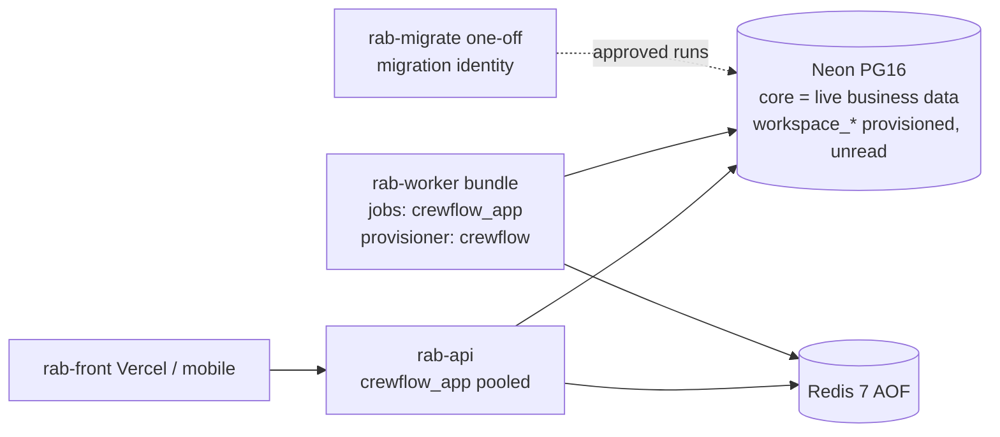
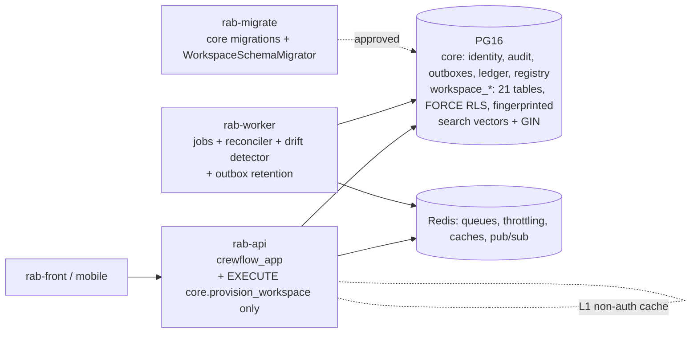

# Crewflow vs Twenty CRM: full engine parity audit and dependency plan (Wave A)

**Date:** 2026-10-22
**Mode:** read-only audit. Nothing was implemented, migrated, deployed or connected to. This file is the only repository change.

## Revisions examined

**Crewflow**
- Branch `feat/venue-manager-teams-ui`, HEAD `073aa17cd20bf62af20d5af670ecb892c06078d4`.
- The working tree is dirty, with about 80 modified files (see `git status`).
- Another agent is concurrently editing these provisioning files. They were read as they stood and must be treated as **in flux**:
  - `provision-workspace-schema.ts`
  - `runtime-database-guard.ts`
  - `workspace-provisioner.main.ts`
  - `docker-compose*.yml`
  - `core/proposed-migrations/1786719500000-ServerPathWorkspaceProvisioning.ts`

**Twenty CRM** (`github.com/twentyhq/twenty`)
- Commit `6a1e7de9b74292b4b39e8d59fe86b714c6345a73`, dated 2026-10-22 16:26 UTC ("Allow private CLI staging before SDK publication (#28651)").
- Shallow, blob-less, sparse clone of `packages/twenty-server`, `packages/twenty-shared/src` and `packages/twenty-docker`, made in a scratch directory outside the repo.
- This commit is **newer** than the `f836a286…` revision quoted in `CREWFLOW_TWENTY_STYLE_ARCHITECTURE_REPORT.md`. Several names used in earlier briefs no longer exist at `6a1e7de`:
  - `GlobalWorkspaceOrmManager` is now `WorkspaceOrmManager`.
  - There is no per-workspace TypeORM `DataSource`.
  - `workspace.version` was dropped in 1.23.
  - There is no `WorkspaceAuthGuard`; it is `JwtAuthGuard`.
  - There is no `AuditService`; it is `event-logs`.

**Path conventions**
- Twenty paths: `TS/` = `packages/twenty-server/src/`, `TSH/` = `packages/twenty-shared/src/`, `TD/` = `packages/twenty-docker/`.
- Crewflow paths: `S/` = `packages/rab-server/src/`, `M/` = `S/database/typeorm/core/migrations/`, `WS/` = `S/database/typeorm/workspace-schema/v1/`, `W/` = `packages/rab-worker/src/`.
- Line numbers are from the revisions above.

**Classification rule:** behaviour verified in code, never inferred from a file name or table name.
- **PRESENT**: equivalent or stronger behaviour is live.
- **PARTIAL**: some behaviour exists, but it is gated off, incomplete or unenforced.
- **MISSING**: no behaviour.
- **DIFFERENT BY DESIGN**: Crewflow deliberately solves the problem another way, and that way is at least as safe for this domain.
- **BLOCKED**: could not verify.

No Twenty-side cell is BLOCKED: every Twenty fact below was read from the commit above.

---

## 0. Status counts (current classification, before any Wave B to E work)

| Classification | Count | Areas |
|---|---|---|
| PRESENT | 4 | 4 Tenant isolation, 5 DB roles, 11 Domain constraints, 14 Async work |
| PARTIAL | 7 | 3 Tenant model, 6 Schema evolution, 7 Workspace version tracking, 8 Metadata/permissions, 16 Metadata caching, 17 Encryption & secrets, 15 Audit/timeline (timeline half only) |
| MISSING | 2 | 9 Soft delete, 13 Search |
| DIFFERENT BY DESIGN | 5 | 1 Engine, 2 ORM, 10 Money, 12 Enums, 18 Mobile storage (Twenty has no mobile app) |
| BLOCKED | 0 | none |

Area 15 counts once, as PARTIAL. Its audit half is stronger than Twenty and DIFFERENT BY DESIGN; its timeline half is PARTIAL.

---

## 1. The comparison table

| # | Area | Twenty actual (6a1e7de) | Crewflow before (073aa17 + dirty tree) | Crewflow after (planned) | Evidence | Status |
|---|---|---|---|---|---|---|
| 1 | Engine | `postgres:16` + Redis. Optional ClickHouse, used only if `CLICKHOUSE_URL` is set; it holds the event/audit/pageview/usage streams, 3-year TTL. | `postgres:16-alpine` (dev/QA), Neon in production, `redis:7-alpine` (AOF). No analytics store. | Unchanged: PG + Redis. Analytics deferred; if ever needed, PG partitioned tables first. | TD/docker-compose.yml:120,135; TS/database/clickHouse/clickhouse.service.ts:37,58; config-variables.ts:913-927,1396 // packages/rab-docker/docker-compose.yml:13; docker-compose.production.yml:3,76 | DIFFERENT BY DESIGN |
| 2 | ORM | TypeORM for `core`. Custom twenty-orm over one shared `pg.Pool` for workspaces. **Schema-qualified identifiers**, no `search_path`. Tenant is in AsyncLocalStorage only, never in the DB session. | One TypeORM DataSource. Every tenant call runs in a transaction that binds 7 `rab.*` GUCs plus `search_path` with `set_config(..., true)` (transaction-local). Heavy raw SQL (≈381 `.query(` call sites). No pool reset hook. | Keep the transaction-local GUC model. Add a pool-checkout assertion as defence in depth. Schema routing stays inside the same transaction. | TS/engine/twenty-orm/datasource/workspace-data-source.service.ts:56-106; build-workspace-table-shape.util.ts:121 // S/engine/core-modules/tenant/tenant-context.service.ts:46-100,139-146 | DIFFERENT BY DESIGN |
| 3 | Tenant model | `core` plus `workspace_<base36(uuid)>`. All business objects are per workspace. No cross-schema FKs. Schema created in the request path (`activateWorkspace → createWorkspaceDBSchema`). | Business tables are live in `core`. 21-table `workspace_<32hex>` schemas are provisioned by the Worker provisioner but **not read at runtime** (`HWS_RUNTIME_ENABLED=false`). 130 cross-schema FKs to `core`. Backfill is a manual CLI. | Server-path provisioning through one restricted SECURITY DEFINER function. Runtime routing switched on only after a gated cutover. Cross-schema FKs kept deliberately for identity tables. | TS/engine/workspace-datasource/utils/get-workspace-schema-name.util.ts:3-5; workspace-manager.service.ts:38-89 // S/engine/core-modules/environment/environment-variables.ts:142; S/database/typeorm/workspace-schema/provision-workspace-schema.ts:53-68; schema-resolver.service.ts:35,72-89 | PARTIAL |
| 4 | Tenant isolation | **Application-level only.** No RLS or policy anywhere (grep over all packages = 0). Workspace ID is merged into `where` clauses; RLP predicates are applied in the ORM. | ENABLE plus FORCE RLS on tenant tables, `core.current_org()`/`current_workspace()` policies, second role-aware predicate, guards, 404-not-403. CI check covers the `core` schema only. | Same, plus extend `check-rls-coverage.ts` and the posture golden to `workspace_*` schemas. | grep `ROW LEVEL SECURITY\|CREATE POLICY` → 0; TS/engine/twenty-orm/workspace-scoped-repository/ // tools/check-rls-coverage.ts:19,29-82,130-191; M/1786665700000-TenantSessionContext.ts:20-34 | PRESENT (stricter than Twenty) |
| 5 | DB roles | One credential for everything. Compose uses `postgres`. Helm gives `twenty_app_user` `GRANT ALL` and it owns the workspace schemas. The dev image uses SUPERUSER. | `crewflow_app` (runtime: NOSUPERUSER, NOBYPASSRLS, owns nothing, no SET ROLE), `crewflow` (provisioner), `rab_secure_owner` (NOLOGIN schema owner), migration identity on one-off runs only. Boot guards and a posture golden file. | Unchanged. Golden file extended to workspace schemas. | TD/helm/twenty/templates/deployment-server.yaml:98-128; TD/twenty-app-dev/.../init-db.sh:23 // S/engine/utils/assert-runtime-db-role.ts:21,39-71; M/1786687000000-CrewflowAppRestrictedRuntimeRole.ts:77; S/database/typeorm/core/security-posture.ts:13-75 | PRESENT (stricter than Twenty) |
| 6 | Schema evolution | Metadata-driven: flat-entity diff, then action builders, then a runner that commits metadata rows and DDL in one transaction (`lock_timeout 8s`), plus deferred actions. TypeORM migrations frozen. | 188 hand-written TypeORM migrations in `core.migrations`. Workspace changes are applied by **15 migrations that each loop over `workspace_*` schemas**. No per-workspace runner, ledger or failure isolation. | Small per-workspace migration runner with a per-schema ledger, reusing the existing `v1/*.ts` SQL modules. Not a metadata engine. | TS/engine/workspace-manager/workspace-migration/.../workspace-migration-runner.service.ts:178,376,392,454 // M/1786719450000-AttendanceCheckIn.ts:17-28 | PARTIAL |
| 7 | Workspace version tracking | `core.upgradeMigration` rows per (command, workspace), status `completed`/`failed`, attempt, error. Sequential iterator; aborts the next instance step if any workspace failed; no advisory lock. | `core.workspace_schema_registry.schema_version` is frozen at 1 (`SUPPORTED_WORKSPACE_SCHEMA_VERSIONS={1}`). Looping migrations never update the registry. `verifyStructure` runs only at provisioning. No checksum. | `workspace_schema_migration` ledger, `schema_version` bumped per step, structural fingerprint, scheduled drift detector, advisory-locked runner. | TS/engine/core-modules/upgrade/upgrade-migration.entity.ts:16-70; upgrade-sequence-runner.service.ts:194-209 // M/1786674900000-WorkspaceSchemaRegistry.ts:28-61; provision-workspace-schema.ts:142-257 | PARTIAL |
| 8 | Core entities & metadata | Object/Field/Index/SearchField metadata; relations as fields; select options in `fieldMetadata.options` jsonb; Role, RoleTarget, ObjectPermission, FieldPermission, PermissionFlag, RowLevelPermissionPredicate(+Group); recordShare. | Fixed domain schema. Hardcoded member object registry (staff/venue/shift). `role`, `permission` (43 flags), `role_permission`, `user_role`, overrides, `role_object_permission` (tri-state plus `record_filter` jsonb ≤8 KB), `role_field_permission`, record-filter compiler (fails to FALSE), role-aware RLS. | Keep the fixed schema. Fill field-permission gaps on payroll/attendance reads. No generic custom objects. | TS/engine/metadata-modules/** (entities listed in §3.8) // M/1786665800000-IdentitySchema.ts:99-161; M/1786716000000-RoleObjectFieldPermissions.ts; S/modules/identity/member-access/record-filter.ts | PARTIAL |
| 9 | Soft delete | `deletedAt` on every workspace entity. Default `deletedAt IS NULL` filter, restore, destroy. Daily trash cleanup hard-deletes after `workspace.trashRetentionDays` (default 14). | `deleted_at` exists on `core.user` and `stored_file`, but **nothing sets `user.deleted_at`**; user deletion is a hard delete. Financial/audit rows are protected by grants and triggers, but `payroll_record` FKs `ON DELETE CASCADE` from attendance/shift/staff_profile. | Explicit per-entity archive/restore for operational entities (venue, job_role, shift drafts, staff). **Never** for payroll, payslip, attendance or audit. Replace the cascade with RESTRICT. | TS/engine/twenty-orm/base.workspace-entity.ts:1-6; trash-cleanup.service.ts:87-148 // S/engine/core-modules/user-deletion/user-deletion.service.ts:71-188; WS/payroll-record.ts:89-91 | MISSING |
| 10 | Money | `CURRENCY` composite: `amountMicros` is `numeric` (no scale) and `currencyCode` is `text`. Currency code is **not validated** against ISO. Transform is `Number(value)` (float). | DB `bigint` pence with CHECK ≥ 0 on rates, snapshots and payroll figures. JS `Pence = number` with `Number.isInteger` guards. Rate snapshot at confirmation, frozen again in `payroll_record`. No currency column (GBP implicit). | Keep pence. Add a bigint-safe boundary assertion (≤ `Number.MAX_SAFE_INTEGER`), a CHECK on `attendance.earned_pence`, and fix the rounding comment. Currency column only if multi-currency becomes a requirement. | TSH/types/composite-types/currency.composite-type.ts:4-20; validate-currency-field-or-throw.util.ts:12-45 // packages/rab-shared/src/utils/money.ts:7-48; S/modules/offer/services/apply-offer-confirmation.ts:198-201; WS/payroll-record.ts:73-90 | DIFFERENT BY DESIGN |
| 11 | Domain constraints | Unique/partial indexes from metadata (WHERE allowlist = `"deletedAt" IS NULL`). **No CHECK from metadata. No exclusion constraints** anywhere. | `btree_gist` exclusions: no double booking, no payroll period overlap. Many CHECKs; unique indexes for one-active-attendance, one record per attendance, and so on. | Keep. Add a regression suite that asserts each constraint by name in `core` and in every `workspace_*`. Add the missing `attendance` CHECKs. Decide cross-workspace double-booking (owner). | TS/engine/twenty-orm/workspace-schema-manager/services/workspace-schema-index-manager.service.ts:11-78; validate-index-where-clause.util.ts:2 // M/1786666000000-SchedulingSchema.ts:128; M/1786719200000-PayrollCalendarRunsPayslips.ts:63-88 | PRESENT (stricter than Twenty) |
| 12 | Enums | Native per-column PG `ENUM`. Option changes **rebuild the type** and copy data with CASE; **unmapped values become NULL** (data loss on option removal). | No PG enum types. `text` + `CHECK (status IN …)`. Transitions enforced by `assertTransition` (53 call sites) and DB triggers (e.g. `payroll_record_guard`). | Keep TEXT+CHECK. Add a test that every shared transition table equals its DB CHECK list. | TS/engine/twenty-orm/workspace-schema-manager/services/workspace-schema-enum-manager.service.ts:146-254,395-431 // packages/rab-shared/src/state/assert-transition.ts; M/1786719200000-…:115-140 | DIFFERENT BY DESIGN |
| 13 | Search | Generated `tsvector` (`to_tsvector('simple', unaccent_immutable(...))`) STORED column per searchable object. GIN index. Prefix `:*` terms, `ts_rank_cd` ranking, ILIKE fallback for CJK only. | `ILIKE '%q%'` (escaped), limit 8/20, permission-gated per type. **No tsvector, pg_trgm or GIN index.** | Generated `tsvector` plus GIN on staff/venue/shift (and `pg_trgm` for names/refs), keeping the same permission gating and RLS. | TS/engine/workspace-manager/utils/get-ts-vector-column-expression.util.ts:20-32; TS/engine/core-modules/search/services/search.service.ts:267-381 // S/modules/search/services/search.service.ts:21-252 | MISSING |
| 14 | Async work | 27 BullMQ queues. **Default attempts = 1 (no retry)**. Failed jobs kept 7 days. No DLQ. No general outbox (entity events enqueued after commit, not transactionally). Crons via `upsertJobScheduler` plus a Redis dedupe lock. | BullMQ for email/push/statements (attempts 5, exponential backoff, deterministic job IDs). **Transactional PG outboxes** (email, push, realtime, due-work, statements) with `FOR UPDATE SKIP LOCKED`, leases, generations, terminal `FAILED`. Redis heartbeats. Interval scheduler. No retention purge of outboxes. | Keep. Add retention/purge jobs for terminal outbox rows (and null `rendered_html` after send), plus a failed-row admin view. Do not move to BullMQ repeatables. | TS/engine/core-modules/message-queue/drivers/bullmq.driver.ts:460-522; queue-retention.constants.ts:1-6 // W/queues/rab-email/email-dispatch.job.ts:134; M/1786698000000-RealtimeEventOutbox.ts:94-127; M/1786676800000-WorkerDueWork.ts | PRESENT (stricter than Twenty) |
| 15 | Audit / timeline | `timelineActivity` workspace object, **mutable**: rows merged within 10 minutes; no insert-only control. Audit events go to ClickHouse (MergeTree, deletable by retention). App role has `GRANT ALL`. | `core.audit_log` insert-only: `REVOKE UPDATE, DELETE, TRUNCATE` from `crewflow_app` and `crewflow`, FORCE RLS. Timelines (staff/manager/payslip) derived from it. No hash chain. No generic per-record timeline. | Keep audit_log as the only source of truth. Add read-model timeline views per entity. Optional hash chain only if a compliance need appears. | TS/modules/timeline/repositories/timeline-activity.repository.ts:354-427; event-log-cleanup.service.ts:104 // M/1786666200000-AccountLifecycleSchema.ts:60-82; M/1786686000000-AuditLogCrewflowOwnerRevoke.ts:29; M/1786717700000-…:189 | PARTIAL (timeline); audit DIFFERENT BY DESIGN and stricter |
| 16 | Metadata caching | Two layers: in-process Map (revalidated every 100 ms, entries 30 min) plus Redis hash. Invalidation by random hash; compare-and-set Lua publish; `metadataVersion` bump. | Redis-only, single layer, fail-fast client (150 ms, error = miss). Version-vector keys (session/user/role/membership/org) with HMAC'd values. All 4 caches **off by default**. Authoritative PG snapshot per request; fails closed (401). | Optional in-process L1 for **non-authorisation** metadata only (workspace→schema, permission catalogue). Authorisation keeps the version-vector check against PG/Redis. Turn caches on per environment after a load test. | TS/engine/workspace-cache/services/workspace-cache.service.ts:63-74,484-615 // S/engine/core-modules/environment/environment-variables.ts:170,190,210,226; auth-context-cache.service.ts:19,44-74; security-version.service.ts:80-97 | PARTIAL |
| 17 | Encryption & secrets | AES-256-GCM, HKDF per-**workspace** subkey, `enc:v2:<kid>:` envelope enforced by DB CHECK. Primary plus fallback key. Rotation CLI over all encrypted columns. TOTP implemented and encrypted. ES256 JWT with automated key rotation (legacy HS256 still accepted). | AES-256-GCM, HKDF from keyring (`RAB2` envelope with kid). No AAD. Rotation CLI covers **SMTP password only**. TOTP column exists but MFA is unimplemented. Push tokens encrypted but excluded from rotation. HS256 JWT keyring (manual rotation). OAuth provider tokens not stored. | Extend `secret:rotate` to all encrypted columns. Add AAD (table/column/row-id) in a new envelope version. DB CHECK on envelope prefix. TOTP only as its own approved feature. JWT key rotation stays manual unless asked. | TS/engine/core-modules/secret-encryption/utils/derive-gcm-key.util.ts:11-30; rotate-secret-encryption.command.ts:15-16; connected-account.entity.ts:35-46 // S/engine/core-modules/secret-encryption/secret-encryption.service.ts:6-178; secret-rotation.service.ts:20-27 | PARTIAL |
| 18 | Mobile storage | **No mobile app** in the tree (no pubspec, xcodeproj or AndroidManifest; packages listed in §3.18). | Flutter: `flutter_secure_storage` for tokens with default options (Keychain not `ThisDeviceOnly`, no fresh-install wipe). iOS native: Keychain `AfterFirstUnlockThisDeviceOnly` plus a UserDefaults install marker wipe. No offline attendance queue (online-only, by design: server time is authoritative). | Align Flutter with iOS native (`first_unlock_this_device`, fresh-install wipe). Keep attendance online-only unless the owner approves an offline design (see §6). | `git ls-tree HEAD packages/` (Twenty) // packages/rab-mobile/lib/core/api/api_client.dart:122-196; packages/rab-iphone/Crewflow/Core/SecureStorage/SecureStore.swift:21-167 | DIFFERENT BY DESIGN (no Twenty comparator) |

---

## 2. Security findings discovered during the audit (§5.8 format)

These are **current-state** findings, not parity items. None was fixed (read-only stage).

### F1. Live password-reset/invite tokens persisted in `email_outbox` and never purged (Medium)
- **Actor → action → consequence:** an actor with read access to `core.email_outbox` (a DB backup reader, a leaked read replica, a future SQL-injection read primitive) reads `rendered_html` for a `PASSWORD_RESET` job. They obtain a raw reset URL and can take over the account while the token is still valid and unused.
- **Location:**
  - S/engine/core-modules/auth/services/auth.service.ts:830-831 builds `reset-password?token=${token}` into the rendered email.
  - S/engine/core-modules/email/email-outbox.service.ts:58 stores `renderedHtml`.
  - No job nulls or deletes it. The only `DELETE FROM core.email_outbox` is a one-off in M/1786715000000-MemberInvitationSchema.ts:134.
- **Root cause:** the outbox stores fully rendered bodies, and the retention design (Wave D) has not covered outboxes.
- **Fix:** after a terminal SENT or FAILED status, null `rendered_html`/`rendered_text` for token-bearing job types. Alternatively, store a template key plus parameters and render at send time from the token hash's companion data. Add a retention purge.
- **Regression test:** an integration test sends a reset email, runs the dispatch job, and asserts `rendered_html IS NULL` and that no row contains the raw token.

### F2. Flutter secure storage uses default Keychain accessibility and no fresh-install wipe (Low–Medium)
- **Actor → action → consequence:** a device backup/migration or a reinstall restores `rab.refreshToken`. The session resumes on a device or install the user did not authenticate.
- **Location:** packages/rab-mobile/lib/core/api/api_client.dart:122-196 (no `IOSOptions`/`AndroidOptions`). The iOS native app does it right: packages/rab-iphone/Crewflow/Core/SecureStorage/SecureStore.swift:21,158-167.
- **Fix:** `IOSOptions(accessibility: KeychainAccessibility.first_unlock_this_device)`, `AndroidOptions(encryptedSharedPreferences: true)` (or the v11 default cipher), and a first-launch marker wipe that mirrors `FreshInstallGuard`.
- **Regression test:** a Flutter unit test asserting the storage options, and a widget test where the reinstall marker is absent, which must wipe tokens.

### F3. `payroll_record` can be removed by cascade from attendance/shift/staff_profile (Medium, integrity)
- **Actor → action → consequence:** any future code path, CLI or owner-run SQL that deletes a `staff_profile`, `shift` or `attendance` row silently deletes approved payroll records. Only the service-layer check in `user-deletion.service.ts` prevents it, so the database layer has no protection. That breaks the five-layer rule for financial records.
- **Location:** WS/payroll-record.ts:89-91 (`ON DELETE CASCADE`).
- **Fix:** a migration changing these FKs to `ON DELETE RESTRICT` in `core` and every `workspace_*` (a gated persistent-schema change).
- **Regression test:** deleting a staff_profile that has an approved payroll_record fails with 23503 in both schemas.

### F4. RLS coverage CI and the posture golden file do not scan `workspace_*` schemas (Medium, latent)
- **Actor → action → consequence:** a future workspace-schema migration that forgets FORCE or a policy passes CI. It becomes exploitable the moment `HWS_RUNTIME_ENABLED` is turned on.
- **Location:**
  - tools/check-rls-coverage.ts:130-154 scans `core` tables with `organisation_id` only.
  - S/database/typeorm/core/security-posture.ts:13-59 is core-only.
  - `verifyStructure` (provision-workspace-schema.ts:215-257) runs only at provisioning.
- **Fix:** extend both tools to iterate `pg_namespace` matching `^workspace_[0-9a-f]{32}$`. This is a hard prerequisite of the HWS cutover gate.
- **Regression test:** a deliberately broken disposable workspace schema with FORCE removed must fail the check.

### F5. Deleted user's email retained indefinitely in immutable `audit_log.metadata` (data-retention decision, not a bug)
- **Location:** S/engine/core-modules/user-deletion/user-deletion.service.ts:176-178.
- This touches data retention. Per CLAUDE.md, no rule is invented here. **Owner decision needed:** keep it (audit value) or store a keyed hash instead.
- The stale comment at :167-170 (FK `ON DELETE SET NULL`) contradicts M/1786692000000, which dropped the FK.

### F6. Encrypted secrets are not bound to their row or column (Low)
- AES-GCM is used without AAD (secret-encryption.service.ts). A DB writer could swap ciphertexts between rows of the same column.
- Twenty has the same gap per row, but binds each workspace to its own subkey.
- **Fix:** a new envelope version `RAB3` with AAD = `table|column|rowId`, rolled out through the extended rotation CLI (gated).

**Also noted, not findings:**
- `docker-compose.qa.yml:85,123` points the API's `DATABASE_URL` at the `crewflow` login, which `assertRuntimeDbRole` should refuse. QA compose appears stale (untested).
- `money.ts:30` claims "half away from zero", but `Math.round` rounds −x.5 toward +∞. Pay is non-negative today, so there is no impact.
- CLAUDE.md's NOT_FORCED paragraph is stale. `staff_profile` and `manager_profile` were re-FORCEd (tools/check-rls-coverage.ts comment at the allowlist). The file now lists 11 entries plus `organisation` and `platform_admin` = 13: `user`, `login_history`, `refresh_token`, `password_reset_token`, `manager_workspace`, `worker_due_work`, `account_invite`, `user_session`, `user_auth_identity`, `member_invitation`, `email_change_request`. Per CLAUDE.md, the file wins.

---

## 3. Per-area detail

Each area records: Twenty implementation, Crewflow equivalent, classification, what is missing, the security difference, the proposal (the smallest change that reuses Crewflow code), dependencies, risk and gates, effort, cost, and tests.

### 3.1 Engine
**Twenty**
- Postgres: `TD/docker-compose.yml:120` (`postgres:16`). Helm uses a spilo PG15 image (`TD/twenty-postgres-spilo/Dockerfile:1`). There is no minimum-version check in code.
- Setup: `TS/database/scripts/setup-db.ts:8-41` creates `core`/`public`, `uuid-ossp`, `unaccent`, `citext` and `public.unaccent_immutable`.
- Boot: the entrypoint runs `upgrade` on every boot and only warns if it fails (`TD/twenty/entrypoint.sh:13-29`).
- Redis does five jobs: BullMQ (`bullmq.driver.ts:60`), cache (`cache-storage.module-factory.ts:27`), sessions, the token-bucket throttler, and locks.
- ClickHouse is optional:
  - `ClickHouseService` creates a client only if `CLICKHOUSE_URL` is set (`TS/database/clickHouse/clickhouse.service.ts:37,58`).
  - `CLICKHOUSE_URL` is required only when `ANALYTICS_ENABLED=true` (config-variables.ts:913-927).
  - `EVENT_SINKS` defaults to `['clickhouse']`, but the sink is silently dropped without a URL (`event-sink-availability.ts:10-11`).
  - ClickHouse stores `workspaceEvent`, `pageview`, `objectEvent` (record audit stream), `usageEvent` (billing), `applicationLog`, `shortLinkClick` and `messageView` (MergeTree, 3-year TTL). Postgres stores everything else, including `timelineActivity`.

**Crewflow**
- PG16 (`packages/rab-docker/docker-compose.yml:13`). Production uses Neon (`database-target.ts:35-38`, `EXPECTED_PRODUCTION_IDENTITY`).
- `redis:7-alpine` with AOF (`docker-compose.production.yml:76`). Redis carries BullMQ, throttling (fails closed 503), auth/entity caches, realtime pub/sub and heartbeats.
- `grep -ri clickhouse packages/` returns 0.
- Migrations are a one-off `rab-migrate`, never run at boot. That is stricter than Twenty's `upgrade` on every boot.

**Assessment**
- **Classification:** DIFFERENT BY DESIGN.
- **Missing:** an analytics store, which is not required.
- **Security:** Crewflow is stricter. Twenty's boot-time upgrade runs DDL with the app credential and tolerates failure.
- **Proposal:** none. If analytics is wanted, start with PG views or monthly-partitioned tables in a separate `analytics` schema, read-only to `crewflow_app`.
- **Dependencies:** none. **Risk:** low.
- **Cost:** ClickHouse would be an always-on service with roughly 2–4 GB RAM minimum for stable merges, plus a disk and backups. See §8.
- **Tests:** none needed.

### 3.2 ORM
**Twenty**
- Core: TypeORM, `schema:'core'`, `poolSize` from `PG_POOL_MAX_CONNECTIONS` (`TS/database/typeorm/core/core.datasource.ts:40-85`). The legacy TypeORM migration folder is frozen.
- Workspace: `WorkspaceDataSourceService` creates one primary `pg.Pool` and an optional replica pool per process (`workspace-data-source.service.ts:56-84`, ended at :164-176). `getDataSource()` builds a lightweight wrapper per call from AsyncLocalStorage (:86-106).
- SQL uses schema-qualified, escaped identifiers (`build-workspace-table-shape.util.ts:121`; `workspace-repository.ts:815-817`). `search_path` appears nowhere.
- Transactions: `runInRollbackSafeTransaction` destroys the client if ROLLBACK fails (`run-in-rollback-safe-transaction.util.ts:9-48`).
- There is **no DB-side tenant context**.

**Crewflow**
- One DataSource (`S/database/typeorm/core/core.datasource.ts`: `synchronize:false` :51, no default schema :45-50, pool 10 :56, 30 s timeouts :68-69, `core.migrations` :102).
- `TenantContextService.runInTenantContext` / `runInWorkspaceContext` (`tenant-context.service.ts:46-100`) open a transaction. They run `SET TRANSACTION READ ONLY` under Admin Inspect (:134), set 7 GUCs in one round trip (:139-142), and set the search_path transaction-locally (:146).
- `WorkspaceExecutionContext.run` (`workspace-execution-context.ts:33-41`) duplicates this for the worker. Its comment at :18-19 is stale.
- Raw SQL: about 226 `.query(` calls in modules, 53 in engine and 102 in the worker.
- No `DISCARD`/`RESET` hook. Safety relies on `is_local=true`.

**Assessment**
- **Classification:** DIFFERENT BY DESIGN.
- **Missing:**
  - A pool-checkout guard. If any code issues `set_config(..., false)` or a session-level `SET`, it would leak across pooled connections. A grep found no such call, but nothing enforces it.
  - Twenty's rollback-failure client destruction.
- **Security:** Crewflow is stricter. The DB enforces tenancy, whereas Twenty relies on correct ORM code. A raw query that forgets `workspaceId` in Twenty is a cross-tenant read; in Crewflow it returns zero rows.
- **Proposal:**
  1. A lint/CI grep that forbids `set_config(…, false)`, `SET search_path` and `SET SESSION` outside the migration identity.
  2. A unit test that `bindGucs`/`bindSearchPath` always pass `true`.
  3. An optional pool `connect` hook asserting `current_setting('rab.organisation_id', true)` is empty on checkout (cost: one round trip, so only in test/staging).
  4. Merge `WorkspaceExecutionContext` into `TenantContextService` so there is one binding implementation.
- **Dependencies:** area 3. **Risk:** low.
- **Effort:** 1–2 days.
- **Cost:** none (assertion off in production).
- **Tests:**
  - Two sequential transactions on a pool of 1: the second sees empty GUCs and the default search_path.
  - An inspect transaction rejects INSERT with 25006.

### 3.3 Tenant model
**Twenty**
- Schema name is `workspace_${uuidToBase36(id)}` (`get-workspace-schema-name.util.ts:3-5`).
- `WorkspaceSchemaService.createWorkspaceDBSchema` (`workspace-schema.service.ts:34-47`) runs `CREATE SCHEMA` on the core connection, gated by `WORKSPACE_SCHEMA_DDL_LOCKED` (default false).
- It is called in the request path: `WorkspaceResolver` (`workspace.resolver.ts:154`) → `WorkspaceService.activateWorkspace` (`workspace.service.ts:506`) → `WorkspaceManagerService.init` (`workspace-manager.service.ts:38-89`), which creates the schema, syncs the standard app (DDL) and sets up roles.
- `core` holds platform data and all metadata. `workspace_*` holds every business object.
- FKs are always same-schema (`workspace-schema-foreign-key-manager.service.ts:32`).

**Crewflow**
- `HWS_RUNTIME_ENABLED` defaults to false (`environment-variables.ts:142`, verified). It is unset in dev and QA compose. Production compose explicitly forbids `true` (`docker-compose.production.yml:114,210`). The worker-bundle launcher forces `true` for the provisioner child only (`start-worker-bundle.cjs:208`).
- When on: `SchemaResolverService.resolve` (`schema-resolver.service.ts:72-89`) requires a `READY` registry row with version ∈ {1} and binds search_path to that schema only. Failure becomes a 404 (`all-exceptions.filter.ts:76-84`).
- When off: everything reads `core`.
- Provisioning:
  - The Worker job (`W/queues/rab-maintenance/workspace-provisioning.job.ts:59-87`, advisory lock) calls `provisionWorkspaceSchema` (`provision-workspace-schema.ts:126-285`).
  - It uses SECURITY DEFINER lifecycle functions, applies the template plus 12 module files, runs `verifyStructure` against `V1_EXPECTED` (21 tables / 128 FKs / 90 indexes / 39 policies, :53-60), then marks READY or FAILED.
  - The schema is owned by `rab_secure_owner` (`M/1786688000000-WorkspaceSchemaCrewflowAppUsageGrant.ts:38-93`).
- Staged server-path provisioning (`core/proposed-migrations/1786719500000-ServerPathWorkspaceProvisioning.ts` plus `v1/server-path-template.ts`) is **not active**. It is the other agent's in-flux work.
- Per-workspace tables (21): staff_profile, user_note, venue, venue_manager_staff, job_role, venue_role_rate, manager_venue, shift, shift_request_staff, shift_assignment, job_offer, replacement_request, attendance, attendance_correction, shift_report, shift_staff_review, payroll_record, payroll_run, payroll_run_line, payslip, payslip_document (`provision-workspace-schema.ts:64-68`, verified).
- Core-only: organisation, user, manager_workspace, manager_profile, roles/permissions, sessions/tokens, invites, audit_log, outboxes, worker_due_work, stored_file, payroll_calendar(_period), platform_config, registry, migrations.
- Cross-schema FKs from the workspace templates: `core."user"` 51, `core.organisation` 33, `core.manager_workspace` 31, `core.stored_file` 9, `core.manager_profile` 4, `core.payroll_calendar_period` 2.
- Backfill: `hws-backfill.service.ts:107-140` is reachable only through the `hws:backfill` CLI (`--dry-run` default, `--apply`, `--verify`, `--resume`; `command/hws-backfill.command.ts:71-128`). Never automatic.

**Assessment**
- **Classification:** PARTIAL. Physical schemas and routing code exist, but runtime reads are core-only and tenant data is not migrated.
- **Missing:** server-path provisioning (in flux), a cutover runbook, and per-workspace evolution (3.6/3.7).
- **Security:** Crewflow's schema owner is NOLOGIN and the runtime role has USAGE only. Twenty's app role owns the schemas and can run any DDL.
  - Cross-schema FKs to `core` are a deliberate difference, not a weakness. They keep identity single-sourced.
  - Consequence: `DROP SCHEMA … CASCADE` needs care, and core tables cannot be moved per workspace.
- **Proposal:**
  1. Finish the staged server path. Only one narrow `crewflow`-owned SECURITY DEFINER `core.provision_workspace(uuid)` would be EXECUTE-able by `crewflow_app`; it is idempotent, takes an advisory lock, and its template is frozen and hashed. This is Wave B (other agent).
  2. Keep the Worker provisioner as a reconciler for FAILED/PROVISIONING rows.
  3. Never let the API connection hold CREATE on the database.
- **Dependencies:** 5, 6, 7, 4 (F4).
- **Risk:** critical at cutover.
- **Gates (owner approval):**
  - G1: approval of the staged server-path migration.
  - G4: HWS cutover. See §5.
- **Effort:** server path 3–5 days (in progress). Cutover rehearsal and tooling 2–3 weeks.
- **Cost:** about 21 tables × N workspaces worth of catalog bloat. Negligible below roughly 1,000 workspaces. Planner and catalog memory grow per schema (Twenty runs thousands).
- **Tests:**
  - Concurrent provisioning of the same workspace yields one schema.
  - The API role cannot `CREATE SCHEMA`.
  - With the flag on, an unknown or FAILED workspace returns 404.
  - A cross-workspace read through a forged `rab.workspace_id` returns 0 rows.

### 3.4 Tenant isolation
**Twenty**
- No RLS: grep for `ROW LEVEL SECURITY|CREATE POLICY` across all three packages returns 0 (verified).
- `JwtAuthGuard` (`TS/engine/guards/jwt-auth.guard.ts:15-58`) authenticates.
- `WorkspaceAuthContextMiddleware` sets the AsyncLocalStorage context.
- `WorkspaceScopedRepository` merges `workspaceId` into `where` clauses for core tables.
- `WorkspaceRepository` applies permission and row-level-predicate filters (`permissions.utils.ts:47`, `build-row-level-permission-record-filter.util.ts:301`).

**Crewflow**
- Five layers per CLAUDE.md:
  1. `PermissionGuard` mixin (`S/engine/guards/permission.guard.ts:24-47`; DB re-check plus GET-only under inspect).
  2. Service checks (`ResourceScopeService`).
  3. Org-scoped queries.
  4. ENABLE+FORCE RLS keyed on `core.current_org()`/`current_workspace()`/`current_uid()` (`M/1786665700000-TenantSessionContext.ts:20-34`; about 400 policy references).
  5. A role-aware second predicate (`M/1786676400000-StaffVenueRlsRoleAware.ts`; payroll predicates `WS/payroll-record.ts:100-115`).
- 404-not-403 (`all-exceptions.filter.ts:71-84`).
- CI: `tools/check-rls-coverage.ts`:
  - connects as `crewflow_app` and fails otherwise (:191);
  - asserts the NOT_FORCED allowlist is ENABLE-but-not-FORCE (:157-167);
  - **core only**.

**Assessment**
- **Classification:** PRESENT, stricter than Twenty.
- **Missing:** workspace-schema coverage in CI (F4).
- **Security:** never copy Twenty's app-only model. Crewflow's RLS means a missed `where` clause cannot leak data.
- **Proposal:** extend `check-rls-coverage.ts` and `security-posture.ts` to `workspace_*` (about 1 day). Prerequisite for G4.
- **Dependencies:** 3, 5. **Risk:** low (tooling only).
- **Tests:** a no-context query on each workspace table returns 0 rows. A FORCE-stripped disposable schema fails CI.

### 3.5 DB roles
**Twenty:** compose uses `PG_DATABASE_USER:-postgres` (`TD/docker-compose.yml:12,71`). Helm grants `twenty_app_user` `GRANT ALL PRIVILEGES` and default privileges (`deployment-server.yaml:98-128`). The dev image creates a SUPERUSER (`init-db.sh:23`). One credential does reads, writes and DDL.

**Crewflow**

| Role | Created in | Attributes / purpose |
|---|---|---|
| `rab_owner`, `rab_app` | dev `packages/rab-docker/postgres-init/01-roles.sql:12-13` | Retired to NOLOGIN at `M/1786682000000-CrewflowSingleCredentialRoleArchitecture.ts:445-446` |
| `crewflow` | `M/1786682000000…:100` | Provisioner and business-table owner |
| `rab_secure_owner` | `M/1786682000000…:109` | NOLOGIN; owns workspace schemas |
| `crewflow_app` | `M/1786687000000-CrewflowAppRestrictedRuntimeRole.ts:77` | NOSUPERUSER NOCREATEDB NOCREATEROLE NOBYPASSRLS |

Boot and CI guards:
- `assertRuntimeDbRole` (`S/engine/utils/assert-runtime-db-role.ts:39-71`): current_user = session_user = `crewflow_app`, no BYPASSRLS/SUPER, no membership in `crewflow`/`rab_secure_owner`/`rab_owner`.
- `runtime-database-guard.ts:95-287` (in flux): refuses `DATABASE_URL_UNPOOLED`, the provisioner URL and migration env vars in the API and worker; enforces the production identity; runs a read-only probe.
- Posture golden (`security-posture.golden.txt`, 601 lines) checked by `scripts/check-db-security-posture.ts:32`.
- Migration identity phases (`migration-identity.ts:17-73`).

**Assessment**
- **Classification:** PRESENT, much stricter.
- **Missing:** workspace schemas in the golden file; the QA compose role (see §2 notes).
- **Proposal:** none beyond F4.
- **Risk:** any grant change is a gate (G1).
- **Tests:** the existing guard specs, plus golden coverage of `workspace_*`.

### 3.6 Schema evolution
**Twenty**
- The field-create path:
  1. `FieldMetadataService.createOneField` (`field-metadata.service.ts:64`).
  2. `WorkspaceMigrationValidateBuildAndRunService` (:73).
  3. The build orchestrator: flat-entity diff, then builders and validators.
  4. `WorkspaceMigrationRunnerService.run` (:178): one core transaction (:376), `SET LOCAL lock_timeout='8s'` (:392), action handlers `executeForMetadata` then `executeForWorkspaceSchema` (e.g. `create-field-action-handler.service.ts:108-198`), commit (:454), then cache invalidation and a `metadataVersion` bump (:109-115).
- Metadata rows and DDL commit together.
- Deferred actions (FK validation) are persisted and retried.

**Crewflow**
- 188 TypeORM migrations (`M/`, `<13-digit>-PascalName.ts`, `migrationsTransactionMode:'each'`).
- Workspace DDL is handled by 15 migrations that each select `nspname ~ '^workspace_[0-9a-f]{32}$'` and apply the same `WS/*.ts` SQL function (e.g. `M/1786719450000-AttendanceCheckIn.ts:17-28`).
- New workspaces get the template plus every module file (`provision-workspace-schema.ts:185-201`).
- Adding a module currently means four manual edits: a migration, `applyTemplate`, the `V1_EXPECTED` counts and the frozen server-path module.

**Assessment**
- **Classification:** PARTIAL. Evolution works but is not tracked per workspace. One failing schema fails the whole migration, and there is no resume.
- **Missing:** a per-workspace ledger and runner, partial-failure isolation, and lock timeouts.
- **Security:** a Twenty-style metadata engine would need the runtime to hold DDL rights. Twenty's app role does. **Do not copy this.** Crewflow's runtime role must never run DDL.
- **Proposal:**
  - A `WorkspaceSchemaMigrator`, run only by the migration identity or provisioner, that holds an ordered list of the existing `WS/*.ts` modules as `{id, version, sql, expectedDelta}`.
  - Per schema, under `pg_advisory_xact_lock(hashtext(schema))` and `SET LOCAL lock_timeout`, it applies pending modules and writes a `core.workspace_schema_migration(workspace_id, module_id, version, checksum, status, attempt, error, applied_at)` row (ENABLE+FORCE RLS, REVOKE INSERT/UPDATE/DELETE from `crewflow_app`).
  - Core migrations then call the migrator instead of hand-looping.
  - Provisioning reuses the same list, giving one source of truth.
- **Dependencies:** 7, 3, 5.
- **Risk:** high, because it changes persistent schema-management behaviour.
- **Gates:** G2 (ledger table migration plus first backfill of ledger rows from existing schemas).
- **Effort:** 1–1.5 weeks.
- **Cost:** none at runtime.
- **Tests:**
  - A failure in schema 2 of 3 leaves schemas 1 and 3 migrated and 2 FAILED with its error recorded.
  - Rerun resumes.
  - A checksum mismatch on an applied module refuses.
  - The runtime role cannot call the migrator.

### 3.7 Workspace version tracking and drift
**Twenty**
- `core.upgradeMigration` (`upgrade-migration.entity.ts:16-70`).
- `UpgradeCommand` (`upgrade.command.ts:31,109`), run as instance-fast, then instance-slow, then per-workspace commands.
- `WorkspaceIteratorService.iterate` (`workspace-iterator.service.ts:79-173`) is sequential and continues past failures, but the sequence aborts before the next instance step if any workspace failed (`upgrade-sequence-runner.service.ts:194-209`).
- No advisory lock (stated in `TS/../docs/UPGRADE_COMMANDS.md`).
- `workspace.version` was dropped (`1-23-instance-command-fast-…drop-workspace-version-column.ts:10`).

**Crewflow**
- `core.workspace_schema_registry` (`M/1786674900000-WorkspaceSchemaRegistry.ts:28-61`): `schema_version` default 0, `status` PROVISIONING/READY/FAILED, `ready_at`, `last_migrated_at`, `migration_error`; FORCE RLS; writes only through SECURITY DEFINER functions.
- `schema_version` stays 1 forever. `last_migrated_at` is written only at READY.
- `manager_workspace.schema_status` has MIGRATING, but the registry does not (`M/1786714000000…:41-42`).
- `verifyStructure` (`provision-workspace-schema.ts:215-257`) is not periodic.
- There is no checksum or fingerprint.

**Assessment**
- **Classification:** PARTIAL.
- **Missing:** a per-step ledger (3.6), a version bump, a structural fingerprint and a scheduled drift detector.
- **Security:** drift detection is a security control here, because RLS lives in each schema. Twenty has no equivalent: it has no RLS to drift.
- **Proposal:**
  - Add `schema_fingerprint text` and `fingerprint_checked_at` to the registry.
  - The fingerprint is sha256 over a canonical catalog dump (tables, columns, constraints, indexes, policies, FORCE flag, owner, grants).
  - A daily Worker job, run as the provisioner identity, recomputes it, compares it with the expected fingerprint for the current module set, writes a `worker_event` or alert, and flips the registry to a new `DRIFTED` status. `SchemaResolverService` then 404s (fail closed). Owner decision: maybe alert-only first.
  - Bump `schema_version` per migrator step.
- **Dependencies:** 3.6.
- **Risk:** high (persistent registry change, and fail-closed routing could cause an outage).
- **Gates:** G2 (registry columns), G3 (enabling fail-closed on drift).
- **Effort:** 4–6 days.
- **Cost:** one catalog query per schema per day. Negligible.
- **Tests:** dropping a policy in a disposable schema makes the detector flag it. With fail-closed on, requests return 404. Rerunning the migrator restores READY.

### 3.8 Core entities and metadata
**Twenty** (all under `TS/engine/metadata-modules/`):
- `ObjectMetadataEntity` (object-metadata.entity.ts:45).
- `FieldMetadataEntity` (field-metadata.entity.ts:48): options jsonb :125, settings :128, relation targets :188/:205, isUnique :175, isAuditLogged :186.
- `IndexMetadataEntity` and `IndexFieldMetadataEntity`.
- `RoleEntity` (role.entity.ts:20; flags canRead/Update/SoftDelete/DestroyAllObjectRecords…).
- `RoleTargetEntity`, `ObjectPermissionEntity`, `FieldPermissionEntity`, `PermissionFlagEntity`.
- `RowLevelPermissionPredicateEntity` plus Group.
- `recordShare` in the workspace schema.

**Crewflow**
- Fixed schema.
- `member-object-registry.ts:15` (`staff`, `venue`, `shift`), with field definitions and `sensitiveAuthority` flags (:69-246).
- Permission catalogue: `packages/rab-shared/src/constants/permission-flags.ts` (43 keys), seeded by `M/1786718000000-PermissionCatalogueAndSystemRoleDefaults.ts:26`.
- Role tables: `M/1786665800000-IdentitySchema.ts:99-161`.
- `M/1786716000000-RoleObjectFieldPermissions.ts`: role_object_permission (tri-state, `record_filter` ≤ 8 KB), role_field_permission, `permission_version` invalidation.
- `record-filter.ts` compiler: allowlisted operators, max 20 conditions, AND-ed onto the mandatory scope, invalid compiles to FALSE.

**Assessment**
- **Classification:** PARTIAL. Roles, object/field permissions and record filters are present. Custom objects, custom fields, select-option metadata and index metadata are absent (by design).
- **Security:**
  - Crewflow's record filter is AND-ed **under** RLS, so a bad filter can only narrow access.
  - Twenty's RLP is the only row control, which makes it weaker.
  - Twenty has per-role `canDestroyAllObjectRecords`. Crewflow has no destroy concept for financial data, which is stronger.
- **Proposal:**
  - No generic metadata engine.
  - Extend the member object registry and `role_field_permission` coverage to payroll/attendance read DTOs, so field visibility is enforced in services (layer 2) as well as the UI.
- **Dependencies:** none.
- **Risk:** medium (permissions).
- **Effort:** 3–5 days.
- **Tests:** a role with `role_field_permission` deny on `pay_rate_pence` gets the field omitted in REST and export. An invalid record_filter gives zero rows.

### 3.9 Soft delete
**Twenty**
- `BaseWorkspaceEntity.deletedAt` (`TS/engine/twenty-orm/base.workspace-entity.ts:1-6`).
- `softDelete`/`restore`/`delete` (`workspace-repository.ts:709-757`; SQL at `workspace-mutation-query-builder.ts:139-161`).
- Default read filter (`build-select-statement.util.ts:339-344`).
- API mapping: delete is a soft delete, destroy is a hard delete (`common-delete-many…:57-62`, `common-destroy-many…:57-62`).
- Trash cleanup: cron `10 0 * * *`, per-workspace `trashRetentionDays` default 14 (`workspace.entity.ts:155-157`), hard-deletes in batches of 1000 with the system context (`trash-cleanup.service.ts:87-148`).

**Crewflow**
- `deleted_at` exists on `core.user` (`M/1786665800000…:83`, `@DeleteDateColumn` user.entity.ts:103) and `stored_file`. Nothing sets it (no `softDelete`/`softRemove` calls), so the `deleted_at IS NULL` predicates are dead code.
- `user-deletion.service.ts`: `assertCanDelete` (:71-142) blocks deletion when history is protected; `deleteUser` (:154-188) audits and then **hard-deletes**.
- Venue uses `status='archived'`.
- Protected history:
  - audit_log: REVOKE UPDATE/DELETE/TRUNCATE.
  - attendance_correction, venue_manager_staff: REVOKE UPDATE/DELETE.
  - payroll_record: no DELETE grant; money columns immutable; `payroll_record_guard` trigger.
  - payroll_run_line, payslip_document: insert-only.
  - **Except** for the FK cascades in F3.
- Retention purges exist for tokens, images and invites only.

**Assessment**
- **Classification:** MISSING as a framework.
- **Security:** Twenty's trash cleanup would **destroy** records after 14 days. For payroll, attendance and audit that would breach CLAUDE.md and likely UK record-keeping obligations. Do not copy it.
- **Proposal:**
  - Per-entity archive (`archived_at`, `archived_by`) only for venue, job_role, staff_profile (leaver), manager_profile, and draft shifts. Each needs:
    - named actions `archiveVenue` / `restoreVenue`, never a status write;
    - `assertTransition` entries;
    - a default `archived_at IS NULL` filter in services and list RLS policies, but **not** in FK or history reads;
    - an audit row.
  - Never archive or delete: payroll_record, payroll_run(_line), payslip(_document), attendance(+correction), approved statements, audit_log.
  - Fix F3 cascades to RESTRICT.
  - Remove or document the dead `user.deleted_at`.
  - **Owner decision (retention):** do archived rows ever purge? None is proposed for financial data.
- **Dependencies:** 11, 12, 15.
- **Risk:** high (persistent schema plus retention).
- **Gate:** G5 (soft-delete columns and FK RESTRICT in core and all workspaces).
- **Effort:** 1–1.5 weeks.
- **Cost:** none.
- **Tests:**
  - Archived venue is hidden from lists but still resolves in historical shifts and payslips.
  - Deleting a staff member with payroll history fails at the DB.
  - `crewflow_app` cannot DELETE payroll rows.

### 3.10 Money
**Twenty**
- `currencyCompositeType` (`TSH/types/composite-types/currency.composite-type.ts:4-20`): `amountMicros` NUMERIC maps to PG `numeric` (`field-metadata-type-to-column-type.util.ts:21-22`); `currencyCode` is TEXT.
- Validation (`validate-currency-field-or-throw.util.ts:12-45`) checks numeric-ness only. The ISO `CurrencyCode` enum is not used server-side.
- Transform is `Number(value)` (float).
- Rounding happens only in the shared helper `Math.round(amount*1e6)`.

**Crewflow**
- DB `bigint` pence with CHECK ≥ 0 on: staff/job_role/venue_role_rate/shift rates (`M/1786666000000…:29-151`), `pay_rate_snapshot_pence` (:118), `payroll_record_figures_check` (`WS/payroll-record.ts:85`), `payroll_run_line_figures_check`, `payslip_net_check`.
- Snapshot chain:
  1. shift rate at offer (`offer.service.ts:426`);
  2. re-snapshot at confirmation from the locked shift (`apply-offer-confirmation.ts:198-201`);
  3. `payForMinutes(snapshot, minutes)` (`attendance.service.ts:622,1081,1300`);
  4. frozen into `payroll_record.pay_rate_pence/amount_pence`, with an RLS insert that must mirror the approved attendance (`WS/payroll-record.ts:49-50,73-74`).
- JS `Pence = number` with `Number.isInteger` asserts (`packages/rab-shared/src/utils/money.ts:7-48`, verified). This differs from CLAUDE.md's "always bigint pence" in JS, but it is safe below 2^53 pence (≈ £90 trillion).
- Gaps: no CHECK on `attendance.earned_pence`/`worked_minutes` (`M/1786667000000…:36-37`); GBP implicit; the rounding comment is wrong for negatives.

**Assessment**
- **Classification:** DIFFERENT BY DESIGN. Crewflow is stricter: integer, CHECKed, snapshotted.
- **Proposal:**
  - Add `CHECK (earned_pence >= 0 AND worked_minutes >= 0)` in core and workspace. Validate as `NOT VALID` first, then `VALIDATE CONSTRAINT` after a pre-check query.
  - Add `assertSafePence` (≤ `Number.MAX_SAFE_INTEGER`) in `bigint-transformer.ts:8-11`.
  - Fix the comment.
  - Document "GBP only" as assumption A-x. A currency column is out of scope.
- **Dependencies:** 11.
- **Risk:** medium.
- **Gate:** G5 (adding CHECKs to persistent tables needs a pre-check that there are no violating rows).
- **Effort:** 1–2 days.
- **Tests:** a negative earned_pence insert fails; the transformer rejects 2^53+1; a property test of `payForMinutes` against a bigint reference.

### 3.11 Domain constraints
**Twenty**
- Index metadata supports `isUnique` and `indexWhereClause`, restricted to `"deletedAt" IS NULL` (`validate-index-where-clause.util.ts:2`).
- DDL is built in `workspace-schema-index-manager.service.ts:21-78`.
- Field `isUnique` gives a non-partial unique index, so soft-deleted rows still conflict (`generate-index-for-flat-field-metadata.util.ts:14-53`).
- No CHECK from metadata. No EXCLUDE anywhere.

**Crewflow**
- Extensions `btree_gist`, `pgcrypto` and `citext` (`M/1786665600000-InitSchema.ts:15-17`).
- Exclusion and CHECK constraints:

| Constraint | Location | Notes |
|---|---|---|
| `shift_assignment_no_double_booking` | `M/1786666000000…:128`; `WS/workspace-schema-v1.sql:317` | 409 on violation (`apply-offer-confirmation.ts:204`) |
| `payroll_calendar_period_no_overlap` | `M/1786719200000…:88` | |
| `payroll_calendar_one_active_per_year` | same migration | |
| `payroll_calendar_version_key` | same migration | |
| Payroll uniques | `WS/payroll-runs.ts:55,91,132,170` | run/period, line/record, payslip/run+staff, document/version |
| `attendance_one_active_per_staff` | `WS sql:463` | |
| shift time order and capacity CHECKs | `WS sql:302-311` | |

**Assessment**
- **Classification:** PRESENT, stricter than Twenty.
- **Missing:**
  - Double booking is scoped per schema and per `staff_profile_id`. After HWS cutover, one person in two workspaces is not protected. Owner decision: is that a business rule? It is cross-tenant, so it would need a core-level reservation table.
  - attendance CHECKs (3.10).
  - A regression suite that proves constraints exist in every workspace schema.
- **Proposal:** a `constraint-regression.integration.spec.ts` that, per schema (`core` plus each disposable `workspace_*`), attempts each forbidden write and asserts the SQLSTATE (23P01, 23514, 23505). Also add the constraint list to the drift fingerprint (3.7).
- **Dependencies:** 3, 7.
- **Risk:** low (tests only).
- **Effort:** 2–3 days.

### 3.12 Enums
**Twenty**
- SELECT/MULTI_SELECT/RATING map to a native `enum`, named `${table}_${column}_enum` (`compute-postgres-enum-name.util.ts:8-13`).
- `WorkspaceSchemaEnumManagerService` (`workspace-schema-enum-manager.service.ts:29-141`).
- `alterEnumValues` (:146-254) renames the old type and column, creates new ones, copies data with CASE (:395-431, verified), and drops the old ones. **Values not in the map become NULL.**

**Crewflow**
- No `CREATE TYPE` in migrations.
- Every status is `text CHECK (status IN …)`.
- Transitions: `assertTransition` (`packages/rab-shared/src/state/assert-transition.ts`), 53 call sites, mapped to 409 by `invalid-transition.filter.ts`.
- The DB trigger `payroll_record_guard` mirrors `PAYROLL_RECORD_TRANSITIONS`.

**Assessment**
- **Classification:** DIFFERENT BY DESIGN, safer.
  - A CHECK change is one `DROP/ADD CONSTRAINT … NOT VALID; VALIDATE`.
  - A removed value fails loudly instead of being nulled.
  - Native enums cannot drop values without a type rebuild.
- **Proposal:** a test that, for each table in `rab-shared/src/state`, the set of states equals the DB CHECK list, parsed from `pg_constraint` in a disposable DB.
- **Risk:** low. **Effort:** 1 day.

### 3.13 Search
**Twenty**
- `searchVector` is a STORED generated `tsvector` (`generate-column-definitions.util.ts:101-117`) using the expression in `get-ts-vector-column-expression.util.ts:20-32`: `to_tsvector('simple', unaccent_immutable(...))`, with email domain and phone variants.
- GIN index (`build-search-vector-gin-index-for-custom-object.util.ts:7-42`).
- `SearchService` (`search.service.ts:267-381`): prefix `:*` terms, ranked by `ts_rank_cd`, then `ts_rank`, then id. `statement_timeout` set via `set_config` (:408). ILIKE fallback for CJK (:383-480).

**Crewflow**
- `S/modules/search/services/search.service.ts`: `ILIKE '%q%'` with `toIlikePattern` escaping (:119-252), limit 8/20, gated by permission and member policy (:80-85).
- No index supports it.

**Assessment**
- **Classification:** MISSING.
- **Security:** neutral. Crewflow's search already runs under RLS. Any new index must not bypass it (indexes do not), and generated columns inherit table policies.
- **Proposal:**
  - Migration (core plus each workspace through the 3.6 migrator) to add `search_vector tsvector GENERATED ALWAYS AS (to_tsvector('simple', unaccent_immutable(coalesce(first_name,'')||' '||coalesce(last_name,'')||' '||coalesce(staff_ref,'')))) STORED` and GIN on staff_profile, venue and shift.
  - Plus `pg_trgm` GIN on short identifiers, for infix matches users already rely on with ILIKE.
  - This needs `unaccent` and `pg_trgm` extensions on Neon (both supported) and an IMMUTABLE wrapper, created by the migration identity.
  - Keep the ILIKE fallback.
  - Exclude email from the vector unless the caller has the email-read field permission. Email is sensitive; today it is optional in staff search.
- **Dependencies:** 3.6 (to roll out to workspaces), 3.8.
- **Risk:** medium.
- **Gate:** G5 (generated columns rewrite the table; plan `ADD COLUMN` on large tables off-peak and measure).
- **Effort:** 3–4 days.
- **Cost:** about +10–30% table storage for the vector and GIN, slightly slower writes, faster search.
- **Tests:**
  - Ranking returns an exact name first.
  - Accent-insensitive matching.
  - A cross-tenant term returns 0.
  - Email terms do not match without the permission.
  - `EXPLAIN` shows a GIN scan on the seeded 50k-row disposable DB.

### 3.14 Async work
**Twenty**
- `MessageQueue` has 27 queues (`message-queue.constants.ts:5-33`); BullMQ is hard-wired (`message-queue.module-factory.ts:18`).
- Defaults (`bullmq.driver.ts:460-492`): `attempts = 1 + retryLimit`, so the default is **no retry**. Retention (`queue-retention.constants.ts:1-6`): completed 4 h, failed 7 days.
- Dedupe by job-ID prefix (:495-522). No DLQ.
- Crons via `upsertJobScheduler` (:372-413) plus a Redis dedupe lock (`cron-trigger-deduplication.service.ts:11-48`).
- Entity events are enqueued **after** commit, not transactionally (`entity-events-to-db.listener.ts`).
- `pendingWakeUp` and `campaignDelivery` are DB lease patterns.

**Crewflow**
- BullMQ `rab-email`/`rab-push`: attempts 5, exponential backoff 5 s, removeOnFail 30 days, deterministic jobId `email-outbox.<id>.attempt.<gen>` (`email-queue.service.ts:9-12,63,76`). Statements: attempts 1, retries counted on the row (`W/main.ts:474-493`).
- PG outboxes, each claimed with `FOR UPDATE SKIP LOCKED`:
  - email_outbox (`M/1786670200000…:41-73`, fencing `M/1786673900000…`; `email-dispatch.job.ts:134`);
  - push_delivery (`M/1786700000000…:87-113`);
  - realtime_event (`event_key UNIQUE`, lease, max 10, `failed`; `M/1786698000000…:94-127`);
  - worker_due_work (lease token, SECURITY DEFINER claim; `M/1786676800000…`);
  - statement status on payroll_record.
- Interval scheduler `WorkerRuntime.every` (`W/main.ts:284-533`). Heartbeat `rab:worker:heartbeat` TTL 30 s every 15 s.

**Assessment**
- **Classification:** PRESENT, stricter.
  - The writes are transactional.
  - Crewflow retries by default; Twenty does not.
  - Crewflow has fencing generations.
- **Missing:**
  - Retention for terminal outbox rows (email_outbox, realtime_event, push_delivery, worker_event). See F1.
  - An admin "failed items" view and replay action (named action, audited).
  - Multi-replica leader election for the interval loop. The advisory locks exist per job; verify each job takes one.
- **Proposal:**
  - Purge jobs through narrow SECURITY DEFINER functions with fixed retention constants. **Owner must pick the retention periods.** Suggested placeholders, not decisions: realtime 7 days, push 30 days, email body nulled at terminal state, row kept 90 days.
  - Replay as an `outbox:replay <id>` command and admin action that bumps the generation.
- **Dependencies:** 15 (audit replays).
- **Risk:** medium (deletes data).
- **Gate:** G6 (retention periods).
- **Effort:** 3–5 days.
- **Cost:** reduces storage.
- **Tests:**
  - The purge never touches non-terminal rows.
  - The purge runs as definer and `crewflow_app` cannot DELETE directly.
  - Replay of a FAILED email sends exactly once (generation fence).

### 3.15 Audit and timeline
**Twenty**
- `entity-events-to-db.listener.ts:52-154` enqueues timeline upserts and, if `isAuditLogged`, ClickHouse event logs.
- The timeline merges rows within 10 minutes (`timeline-activity.repository.ts:354-427`). Mutable.
- ClickHouse MergeTree tables have `TTL 3 YEAR DELETE` plus retention deletes (`event-log-cleanup.service.ts:104`).
- The app role has `GRANT ALL`. There is no immutable audit.

**Crewflow**
- `core.audit_log`: FORCE RLS, REVOKE UPDATE/DELETE from rab_app (`M/1786666200000-AccountLifecycleSchema.ts:60-82`); REVOKE UPDATE/DELETE/TRUNCATE from crewflow (`M/1786686000000…:29`) and crewflow_app (`M/1786717700000…:189`); identity FKs dropped to keep history (`M/1786692000000`).
- `AuditService.record` runs in the caller's transaction and verifies identities (`audit.service.ts:221-252`).
- Timelines: staff (`staff.controller.ts:143`), manager (`manager.controller.ts:101`), activity feed (`audit.controller.ts:13`), payslip (`payroll-run.service.ts:276`).
- No hash chain. The org FK is still `ON DELETE CASCADE` (`M/1786692000000…:37-40` notes it).

**Assessment**
- **Classification:** audit is DIFFERENT BY DESIGN and stricter; timeline is PARTIAL.
- **Proposal:**
  - A generic `GET /<entity>/:id/timeline` read model over `audit_log` (indexed on `(organisation_id, target_type, target_id, created_at)`). No new write path and no merging.
  - Optional per-org hash chain (`prev_hash`) only if an external audit requirement appears. **Owner decision.**
  - Decide organisation-deletion semantics for audit_log, which is a retention decision.
- **Dependencies:** 9.
- **Risk:** low for reads. Medium for the index migration on a large audit_log (use `CREATE INDEX CONCURRENTLY` in a non-transactional migration).
- **Effort:** 3 days.
- **Tests:** a timeline never shows another org's rows. No UPDATE/DELETE route exists (route-table scan test). Writes in a rolled-back transaction leave no audit row.

### 3.16 Metadata caching
**Twenty**
- `WorkspaceCacheService` (`workspace-cache.service.ts:63-74,103,484-615,1023-1028`):
  - local Map revalidated against Redis `:hash` every 100 ms, 6000 entries, 30 min TTL;
  - compare-and-set Lua publish;
  - invalidation by a random-UUID hash.
- `CoreEntityCacheService` is similar.
- `incrementMetadataVersion` (`workspace-metadata-version.service.ts:26-58`).
- Redis TTL 7 days.

**Crewflow**
- One fail-fast Redis client (`auth-cache-redis-client.provider.ts:23-30`). Errors become a miss.
- `AuthSecuritySnapshotService` (one PG snapshot per request; 401 on failure, :38/:89/:298).
- Version vector (`security-version.service.ts:80-97`; monotonic guard `M/1786684000000`).
- `AuthContextCacheService` key includes the version vector, values are HMAC'd, TTL 900 s (:19,44-74).
- `UserSessionCacheService` ≤ 60 s. `CoreEntityCacheService` epoch keys, 300 s TTL. `WorkspaceMetadataCacheService`.
- **All four are default-off** (`environment-variables.ts:170,190,210,226`).

**Assessment**
- **Classification:** PARTIAL. Single layer, off by default.
- **Security:** Twenty's local layer can serve data up to about 100 ms stale. For **authorisation** that is a revocation window Crewflow currently does not have. Do not add an L1 for permissions or sessions.
- **Proposal:**
  - In-process L1 (bounded LRU, 1–5 s TTL) only for immutable-ish lookups: workspace→schema resolution (registry READY rows, invalidated on status change via Redis pub/sub that already exists for realtime) and the permission catalogue.
  - Turn on `CORE_ENTITY_CACHE_ENABLED`/`WORKSPACE_METADATA_CACHE_ENABLED` per environment after a k6 load test. Keep `AUTH_CONTEXT_CACHE_ENABLED` decisions with the owner.
- **Dependencies:** 3 (resolver), 7 (DRIFTED must invalidate).
- **Risk:** medium.
- **Effort:** 3–4 days.
- **Cost:** a few MB RAM per API replica. Fewer Neon round trips.
- **Tests:**
  - A permission revoke takes effect on the very next request with all caches on.
  - With Redis down, requests still succeed via PG (or the throttler 503s, as designed).
  - A registry status flip to FAILED/DRIFTED is honoured within the L1 TTL.

### 3.17 Encryption and secrets
**Twenty**
- `SecretEncryptionService` (`secret-encryption.service.ts:28,83-137`): AES-256-GCM v2, HKDF-SHA256 with info `twenty:enc:v2:<workspaceId|instance>` (`derive-gcm-key.util.ts:11-30`), envelope `enc:v2:<kid>:` (kid = first 8 hex of sha256(key)).
- `ENCRYPTION_KEY` falls back to `APP_SECRET`. `FALLBACK_ENCRYPTION_KEY` is supported.
- DB `CHECK LIKE 'enc:v2:%'` on connected-account tokens, the 2FA secret, signing keys and app variables.
- Rotation CLI `secret-encryption:rotate` (`rotate-secret-encryption.command.ts:15-16`).
- TOTP via otplib, encrypted per workspace (`two-factor-authentication.service.ts:60-70,176-186`). Recovery codes are sha256.
- JWT ES256 with an automated rotation cron (`signing-key-rotation.service.ts:27-49`). Legacy HS256 is still accepted (`jwt-wrapper.service.ts:187-231`).
- Weaknesses:
  - The legacy AES-CTR path, without authentication, still exists (`encrypt-aes-ctr.util.ts`).
  - The key falls back to APP_SECRET.

**Crewflow**
- `secret-encryption.service.ts`: AES-256-GCM, 12-byte IV, HKDF legacy-from-APP_SECRET (:54) or keyring `rab-secret-encryption:<kid>` (:177-178), `RAB2` envelope with kid, no AAD.
- `APP_ENCRYPTION_KEYRING`/`APP_ENCRYPTION_ACTIVE_KID`.
- `secret:rotate` (`secret-rotation.command.ts:15-30`) covers SMTP password only (`secret-rotation.service.ts:20-27`).
- `user.totp_secret_encrypted` exists but is never written, so MFA is unimplemented.
- `push_device.push_token_encrypted`.
- JWT HS256 keyring (`access-token.service.ts:5-56`); the legacy key is raw APP_SECRET.
- Tokens are stored as hashes. OAuth provider tokens are not stored. PKCE verifier and nonce are plaintext but short-lived.

**Assessment**
- **Classification:** PARTIAL.
- **Security:**
  - Crewflow is GCM-only, so there is no unauthenticated mode.
  - Twenty is stronger on rotation coverage, the envelope DB CHECK and per-workspace subkeys.
- **Proposal:**
  1. Extend `secret:rotate` to `push_token_encrypted` (and TOTP when implemented). Same dry-run/apply/verify flow.
  2. A `CHECK (col IS NULL OR substring(col from 1 for 4) = 'RAB2'::bytea …)` per encrypted column. Format to be confirmed against the actual byte layout.
  3. A `RAB3` envelope with AAD = table|column|row-id and per-org HKDF info. Rolled out by the rotation CLI.
  4. Retire the APP_SECRET legacy key paths once the keyrings are set in every environment.
  5. TOTP/MFA as a separate approved feature (auth plus THREAT-MODEL entry).
- **Dependencies:** none.
- **Risk:** **critical for key rotation and re-encryption** (unrecoverable if the wrong key is retired).
- **Gate:** G7: rotation apply on production; retiring a kid; changing the envelope.
- **Effort:** steps 1–2: 2–3 days. RAB3: 1 week. MFA: 1–2 weeks.
- **Tests:** round-trip with the old kid after rotation; tamper (swap ciphertext between rows) fails under RAB3; the CHECK rejects plaintext; `--verify` catches any undecryptable row.

### 3.18 Mobile storage
**Twenty:** no mobile app. The `packages/` tree has no Flutter/iOS/Android project (`git ls-tree HEAD packages/`: twenty-front, twenty-ui, twenty-server, … with no pubspec, xcodeproj or AndroidManifest). There is nothing to compare.

**Crewflow, Flutter** (`packages/rab-mobile`)
- `flutter_secure_storage ^11.0.0` (pubspec.yaml:38).
- Keys `rab.accessToken`, `rab.refreshToken`, `rab.sessionUserId`, `rab.applicationTarget` (`lib/core/api/api_client.dart:122-196`), `rab.biometric.*` (`biometric_store.dart:11-16`), `rab.push.deviceId`.
- Default options and no reinstall wipe (F2).
- No local DB and no offline queue: clock actions are online-only (`api_client.dart:61`).

**Crewflow, iOS native** (`packages/rab-iphone`)
- Keychain `kSecAttrAccessibleAfterFirstUnlockThisDeviceOnly` (`SecureStore.swift:21,38,63`).
- `FreshInstallGuard` UserDefaults marker wipes the Keychain (:158-167).
- Biometrics are an LAContext gate, not `kSecAttrAccessControl`-bound. Full re-auth after 90 days.

**Assessment**
- **Classification:** DIFFERENT BY DESIGN (no comparator).
- **Missing:** F2 parity in Flutter.
- **Offline attendance:** deliberately absent. CLAUDE.md requires the server clock (`serverNow − clockInAt`), and an offline clock-in would need a signed, server-time-reconciled design with geofence evidence. That touches attendance and payroll. **Owner decision; not proposed.**
- **Proposal:** F2 fix only (about 1 day).
- **Tests:** see F2.

---

## 4. Dependency graph

```mermaid
flowchart TD
  A[Wave A: this audit] --> B1
  subgraph B[Wave B: workspace/database foundation]
    B1[B1 Server-path provisioning<br/>secure SECURITY DEFINER fn<br/>(other agent, in flux)] --> B2[B2 RLS-coverage + posture golden<br/>extended to workspace_* (F4)]
    B1 --> B3[B3 Per-workspace migrator + ledger<br/>(area 6)]
    B3 --> B4[B4 Version tracking + fingerprint<br/>+ drift detector (area 7)]
    B2 --> B5
    B4 --> B5[B5 Tenant-schema routing hardening<br/>single binding impl, pool guard (area 2/3)]
  end
  subgraph C[Wave C: data engine]
    C1[C1 Constraint regression suite<br/>(area 11, 12)]
    C2[C2 Money boundary + attendance CHECKs<br/>(area 10)]
    C3[C3 Archive/restore + FK RESTRICT<br/>(area 9, F3)]
    C4[C4 tsvector/trgm search (area 13)]
    C5[C5 Field-permission coverage (area 8)]
  end
  subgraph D[Wave D: operations]
    D1[D1 Outbox retention + replay (14, F1)]
    D2[D2 Entity timeline read model (15)]
    D3[D3 L1 cache for non-auth metadata (16)]
    D4[D4 Encryption rotation coverage, envelope CHECK, RAB3 (17)]
    D5[D5 Flutter storage parity (18, F2)]
    D6[D6 Optional analytics (deferred)]
  end
  B3 --> C1
  B3 --> C2
  B3 --> C3
  B3 --> C4
  B4 --> D3
  C3 --> D2
  C1 --> E
  C2 --> E
  C3 --> E
  C4 --> E
  C5 --> E
  D1 --> E
  D2 --> E
  D3 --> E
  D4 --> E
  D5 --> E
  B5 --> G4{{G4 HWS tenant-data cutover<br/>NOT in this stage}}
  E[Wave E: end-to-end validation] --> G4
```

**Top dependencies**
1. Every workspace-touching change in Waves C and D (constraints, CHECKs, search columns, FK RESTRICT) depends on **B3, the per-workspace migrator**. Without it, each change is another hand-looped migration with all-or-nothing failure.
2. **The HWS cutover (G4) depends on B2, B4 and all of Wave E.** F4 makes it unsafe today.
3. **B1, server-path provisioning,** is the root of everything and is owned by the other agent.

## 5. Ordered implementation plan with owner gates

| Step | Wave | Work | Gate before continuing |
|---|---|---|---|
| A | A | This report | Owner reviews; picks drops/defers (§6) |
| B1 | B | Server-path provisioning (staged migration `1786719500000`, frozen template, provisioner as reconciler). Other agent. | **G1**: approve the staged migration (new EXECUTE grant to `crewflow_app`), its posture-golden diff and its THREAT-MODEL entry |
| B2 | B | Extend `check-rls-coverage.ts` and `security-posture.ts` to `workspace_*`; add to CI | none (tooling); must be green before B4 |
| B3 | B | `WorkspaceSchemaMigrator` plus `core.workspace_schema_migration` ledger; refactor provisioning and the next module to use it | **G2**: ledger and registry column migration; ledger backfill from existing schemas rehearsed on a restored copy |
| B4 | B | Fingerprint, daily drift job, `schema_version` bumps; alert-only first | **G3**: switch drift to fail closed (DRIFTED → 404) |
| B5 | B | Merge `WorkspaceExecutionContext` into `TenantContextService`; GUC-local lint; test-only pool checkout assertion | none |
| C1 | C | Constraint and enum-CHECK regression suites across core plus disposable workspaces | none |
| C2 | C | `assertSafePence`, attendance CHECKs (`NOT VALID` then `VALIDATE`) | **G5**: persistent constraint additions; violating-row pre-check output reviewed |
| C3 | C | F3 FK → RESTRICT; per-entity archive/restore actions | **G5**, plus an owner decision on archive retention |
| C4 | C | Search vectors, GIN and trgm via the migrator | **G5** (table rewrite timing) |
| C5 | C | Field-permission enforcement for payroll/attendance DTOs | none (abuse-case tests required) |
| D1 | D | Outbox retention, `rendered_html` nulling (F1), replay command | **G6**: owner sets retention periods |
| D2 | D | Entity timeline read model plus concurrent index | none |
| D3 | D | L1 for registry and catalogue; per-environment cache enablement | Owner sign-off to enable each `*_CACHE_ENABLED` in production |
| D4 | D | Rotation for push tokens; envelope CHECK; RAB3 AAD | **G7**: every production `secret:rotate --apply` and every kid retirement |
| D5 | D | Flutter storage parity (F2) | none |
| D6 | D | Analytics: **deferred** | Owner decides whether it is ever needed |
| E | E | Full isolated validation (§7): all abuse cases, HWS-on test run, load test | Report to owner |
| G4 | after E | **HWS tenant-data cutover**: NOT in this or any listed wave | **G4**, below |

**G4, HWS cutover. Owner approval at each sub-step; must not happen in this stage.**
1. **Inventory.** Per org, row counts for all 21 tables in `core`, the FK graph (`backfill/fk-graph.ts`) and orphan checks. Output is a signed inventory file.
2. **Restored-copy rehearsal.** Restore a production snapshot (Neon branch or `pg_dump`) into a **disposable** database. Run `hws:backfill --apply` then `--verify` there only.
3. **Row-by-row comparison.** For each table and org, compare primary-key sets and a per-row hash of all columns between `core.<t>` and `workspace_<x>.<t>`. Zero diffs is required.
4. **Shadow reads.** In staging with the flag on, a dual-read comparator logs any mismatch. Owner-approved duration.
5. **Rollback plan.** The flag stays a runtime switch; `core` data is retained read-only until sign-off; there is a documented write-freeze window. Any write that happened only in `workspace_*` after cutover has a reverse-copy script, rehearsed in step 2.
6. Only then: production flag on, with legacy `core` business-table writes revoked from `crewflow_app` in a later, separately approved migration.

**Recommended first three steps after the provisioning foundation (B1):**
1. **B2**: extend RLS coverage and the posture golden to `workspace_*`. Cheap, no persistent change, and it closes F4.
2. **B3**: the per-workspace migrator plus ledger. It unblocks every Wave C item and removes hand-looped migrations.
3. **D1 (F1 portion)**: null rendered bodies of token-bearing emails after a terminal state. It is small, closes a live medium finding, and does not wait for retention periods if the owner approves nulling alone.

## 6. Things the owner should reconsider

| Requested parity item | Recommendation | Why |
|---|---|---|
| Mandatory ClickHouse | **Drop**, or defer indefinitely | Twenty itself treats it as optional (no `CLICKHOUSE_URL`, no sink). It would add an always-on service (≈2–4 GB RAM, disk, backups, another credential) to store data Crewflow already keeps in PG with stronger immutability. The audit trail must stay in the insert-only PG `audit_log`; ClickHouse rows are deletable by TTL. |
| Generic custom objects / fields / metadata-driven DDL | **Drop** | Requires the runtime to run DDL (Twenty's app role owns the schemas). That conflicts with Crewflow's `crewflow_app` no-DDL model, and payroll/attendance rules are fixed-domain logic. Areas 6 and 7 are met by a small migrator plus ledger. |
| Converting pence to `amountMicros` + `currencyCode` | **Drop** | Twenty's `numeric` with `Number()` float transform and unvalidated currency is weaker. Micros give no benefit for GBP payroll. Converting persisted money is a high-risk data migration with no upside. |
| TEXT+CHECK → native ENUM | **Drop** | Twenty's enum rebuild nulls unmapped values (verified, `workspace-schema-enum-manager.service.ts:395-431`). CHECK changes are safer and simpler. |
| Twenty-style trash cleanup (auto hard-delete after N days) | **Drop for financial/attendance/audit**; limited archive elsewhere | Would destroy records that must be retained. Retention is an owner/legal decision. |
| Twenty's mutable, merged timeline | **Drop**; build a read model on `audit_log` | Merging and updating history is weaker than insert-only audit. |
| Two-layer cache including authorisation data | **Defer and limit** to non-auth metadata | An L1 adds a revocation window; the current design has none. |
| Per-workspace schemas for everything / removing cross-schema FKs | **Reconsider scope** | Identity, sessions, audit and outboxes belong in `core`. Cross-schema FKs to `core."user"` and `organisation` are intentional. |
| Offline attendance (mobile) | **Defer**; owner decision | Conflicts with server-time-authoritative attendance (CLAUDE.md). Would need its own signed-event design and threat model. |
| HWS cutover itself | Keep, but only after Wave E and G4 | Physical schema isolation is defence in depth on top of RLS. Its main value is blast-radius and per-tenant restore, not a fix for any current leak. Weigh 2–3 weeks of rehearsal against that. |

## 7. Isolated testing plan (disposable PostgreSQL/Redis only)

- **Infrastructure:**
  - A throwaway compose project (`-p crewflow-parity-<run>`) with `postgres:16-alpine` and `redis:7-alpine` on random host ports, `tmpfs` data and no volumes.
  - It is never pointed at Neon or the owner's dev DB. `test-database-guard.ts` and `assertDbTarget` must refuse anything else; add an explicit `DB_TARGET=disposable` check.
- **Roles:** apply `postgres-init/01-roles.sql`, then run migrations with the migration identity. Runtime tests connect as `crewflow_app` only (`check-rls-coverage.ts` asserts this).
- **Fixtures:** 3 orgs × 2 workspaces. Provision them through the real provisioner function. Seed with 50k staff/shift rows for search and `EXPLAIN` checks.
- **Suites per wave:**
  - **B2:** coverage and posture against a deliberately broken extra schema (FORCE removed, a policy dropped, an extra grant). Each must fail.
  - **B3/B4:** migrator partial-failure (inject a failing module into schema 2), resume, checksum tamper, drift detection, fail-closed routing (with the flag on in test only).
  - **C1/C2:** SQLSTATE assertions (23P01 double booking, overlapping payroll period; 23514 negative pence; 23505 duplicate payroll record) in `core` and each workspace schema. Transition table equals CHECK list.
  - **C3:** FK RESTRICT; archive hides in lists but keeps history; `crewflow_app` DELETE on payroll is denied (42501).
  - **C4:** ranking, accents, cross-tenant 0 rows, email-field permission, GIN plan.
  - **D1:** purge only terminal rows; `rendered_html` nulled; replay sends exactly once.
  - **D3:** revoke-then-next-request is denied with all caches on; Redis killed mid-test (`docker kill`) leads to PG fallback or a designed 503.
  - **D4:** rotation dry-run/apply/verify on seeded ciphertexts; RAB3 row swap fails.
  - **E:** the full `yarn test` integration suite with `HWS_RUNTIME_ENABLED=true` against provisioned schemas. The §1.2 abuse cases. A no-context query returns 0 rows for every table in every schema. k6 at 2× expected peak.
- **Teardown:** `docker compose -p … down -v` after every run. No snapshots are kept.

## 8. Architecture diagrams and deployment cost

**Before (today):**


**After (planned, end of Wave E, before G4):**

After G4 (not planned here), runtime reads move from `core` business tables to `workspace_*`.

**Deployment cost comparison** (relative, same hosting tier; no provider pricing was contacted):

| Component | Twenty (default compose) | Crewflow today | Crewflow after (planned) | With ClickHouse parity (not recommended) |
|---|---|---|---|---|
| Always-on services | server, worker, PG, Redis | api, worker, Redis (+ Neon) | same | + ClickHouse (≈2–4 GB RAM, disk, backups) |
| PG storage | n/a | baseline | +10–30% on searched tables (vectors/GIN); −outbox growth after retention | same plus duplicated events |
| PG CPU | n/a | ILIKE seq scans | GIN lookups (lower read CPU), slightly costlier writes | same |
| Catalog per workspace | ~dozens of tables | 21 tables per workspace (unused) | same; daily fingerprint query | same |
| Redis | queues, cache, sessions | same set; caches off | caches on per environment (small RAM increase) | same |
| API RAM | n/a | baseline | +a few MB (L1) | same |
| Operational burden | upgrade on boot | approved one-off migrations | + migrator ledger, drift alerts | + ClickHouse migrations, TTL, credentials |

Net: the planned target adds **no new always-on service**. Cost growth is storage for search indexes, offset by outbox retention.

## 9. Stale documentation and comments observed (not edited)

- CLAUDE.md NOT_FORCED paragraph: it lists `staff_profile` and `manager_profile`, which have been re-FORCEd. It omits `worker_due_work`, `user_session`, `user_auth_identity`, `member_invitation` and `email_change_request`. Source of truth: `tools/check-rls-coverage.ts:29-82`.
- `S/database/typeorm/workspace-schema/provision-workspace-schema.ts:29` says the owner is "rab_owner, USAGE to rab_app". The actual check (:250) expects `rab_secure_owner`.
- `hws-startup-guard.ts:12-17` says "15 tables" and `core.datasource.ts:46` says "14 workspace entities". The current set is 21 tables / 20 entities.
- `workspace-execution-context.ts:18-19` says "NOT yet used". It is used by `W/core/database/due-work.ts`.
- `user-deletion.service.ts:167-170` describes an FK that `M/1786692000000` dropped.
- `hws-backfill.service.ts` doc comment contradicts itself about the `rab_owner` connection.
- `money.ts:30` rounding comment.
- `CREWFLOW_TWENTY_STYLE_ARCHITECTURE_REPORT.md` cites Twenty `f836a286…`. Some of its Twenty facts ("startup migrations", "shared credential") are confirmed at `6a1e7de` (`entrypoint.sh:13-29`; Helm `GRANT ALL`).
