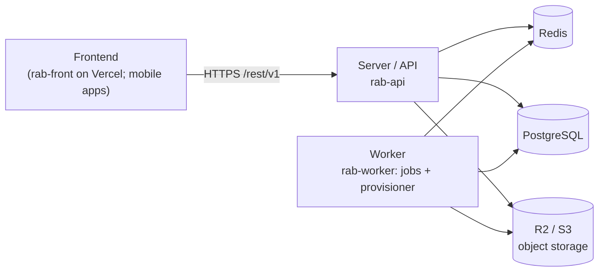
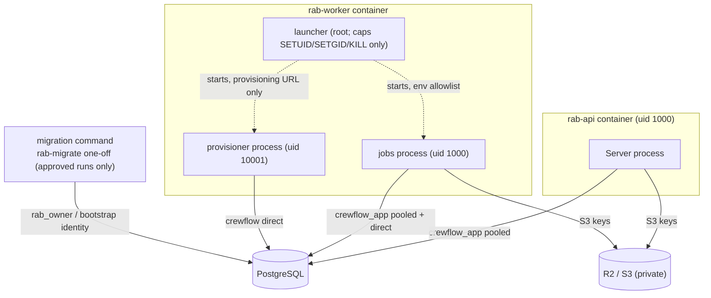

# Crewflow — Twenty-style four-service architecture: shape, boundaries and verdict

Date: 2026-10-22. Companion to `CREWFLOW_FOUR_SERVICE_WORKER_BUNDLE_REPORT.md` (implementation, tests, evidence).
Nothing was committed, pushed, deployed or migrated on a shared/remote database. Twenty facts below come from the
source review supplied in the owner's brief (Twenty revision `f836a286d16793e70ef7b668dd88959c18c0add3`); Twenty's
repository was **not** re-inspected here (no network use).

**Verdict: PARTIAL.** The four-service deployment shape and the Worker-bundle security boundaries are verified locally
(launcher 30/30, integration 26/26, guard unit 32/32). OpenShip compatibility and an arm64 build are unverified, so the
deployment shape is not verified on the target platform. Nothing required weakening a current control (not FAIL).

---

## 1. Current vs target

| | Current (today's working-tree baseline, before this change) | Target (this change) |
|---|---|---|
| Always-on services | API, Worker, **Provisioner**, Redis, PostgreSQL (5) | API, Worker, Redis, PostgreSQL (4) |
| Provisioner | own container/service | second process inside the Worker container, own UID and credential |
| Migrations | one-off `rab-migrate`, explicitly approved | unchanged |
| Frontend | Vercel (separate) | unchanged |
| Storage | R2 (S3 API), external | unchanged |

## 2. Logical diagram (Redis and PostgreSQL are peers; neither sits behind the other)

## 3. Security / credential diagram

`crewflow_app`: LOGIN, no SUPERUSER/BYPASSRLS, owns nothing, no membership (verified, case 15). `crewflow`: owns business
tables, may run `core.provision_workspace_schema`. Workspace schemas are owned by NOLOGIN `rab_secure_owner` (case 16).
The migration identity is never on a running service.

## 4. Comparison (specific controls only; no global "more secure" claim)

| Area | Twenty | Crewflow Current | Crewflow Target | Security impact |
|---|---|---|---|---|
| Visible services | server, worker, db, redis | api, worker, provisioner, redis (+ Neon db) | api, worker, redis (+ Neon db) | One fewer deployable; provisioner now shares the Worker's container boundary |
| Server DB access | core connection (per brief; schema creation in the server path) | `crewflow_app` only; guard refuses `DATABASE_URL_UNPOOLED` | same + guard also refuses `CREWFLOW_PROVISIONER_DATABASE_URL` (case 11b) | Server cannot run DDL (case 17) — unchanged/strengthened |
| Worker DB access | shared credential (per brief) | jobs: `crewflow_app` pooled + direct | jobs unchanged; provisioner child `crewflow` direct | Privileged credential now in the same container, different UID; not readable by jobs (cases 13, 14) |
| Redis use | queues/cache | BullMQ, caches, throttling, pub/sub, heartbeats | unchanged | Same; global heartbeat keys still replica-masked (documented) |
| PostgreSQL use | system of record | system of record, RLS, durable outboxes | unchanged | Unchanged |
| Workspace provisioning location | server request path (`activateWorkspace → createWorkspaceDBSchema`) | separate provisioner service | provisioner process in the Worker container | Never in the HTTP process; DDL not reachable from requests |
| Migration responsibility | startup migrations (per brief) | explicit one-off `rab-migrate` | unchanged | No startup migration (case 18) |
| Privileged credentials | shared | `crewflow` only on provisioner service; migration identity only on one-off | `crewflow` only in launcher env → provisioner child | Root launcher + container config now hold it (trade-off) |
| Storage | S3/local | R2 via S3 API, keys on API + worker | unchanged | Unchanged |
| Health checks | container/process | API `/healthz`, Redis ping, worker/provisioner global Redis keys | + per-instance both-role Worker check, watchdog | Detects a hung child in one replica (case 22) |
| Process isolation | separate server/worker containers | separate containers per role | jobs/provisioner: separate UIDs, no caps, RO root, in one container | Weaker than separate containers; mitigated, not equal |
| RLS / tenant isolation model | workspace schemas, app-level | ENABLE+FORCE RLS, restricted runtime role, workspace schemas | unchanged, re-verified (case 17) | Unchanged |

## 5. Exact services and processes

| Service | Image / command | Processes |
|---|---|---|
| rab-api | shared image, `node packages/rab-server/dist/main.js` | 1, uid 1000 |
| rab-worker | `Dockerfile.worker-bundle`, tini → `node /opt/crewflow-bundle/start-worker-bundle.cjs` | launcher (uid 0), jobs `dist/main.js` (uid 1000), provisioner `dist/workspace-provisioner.main.js` (uid 10001), transient Chromium (uid 1000) |
| rab-redis | `redis:7-alpine`, AOF | 1 |
| PostgreSQL | Neon today (external); devdb locally | — |
| rab-migrate | profile `migrate`, guarded, one-off | only when explicitly approved |

## 6. Database role boundaries

API → `crewflow_app` (pooled). Jobs → `crewflow_app` (pooled `DATABASE_URL`, direct `DATABASE_DIRECT_URL` for session
advisory locks). Provisioner → `crewflow` (direct; its own BEGIN/COMMIT and session advisory lock). Migration →
`rab_owner` (phase A) / bootstrap identity (phase B), one-off. Live guards in every process: identity probe and cluster
agreement, `assertRuntimeDbRole` (login = `crewflow_app`, no BYPASSRLS/SUPERUSER, no SET ROLE, no owner membership),
refusal of `DATABASE_URL_UNPOOLED` / `CREWFLOW_PROVISIONER_DATABASE_URL` outside their owner.

## 7. Redis responsibilities (confirmed from code) — PostgreSQL stays authoritative

- BullMQ queues: email (`EmailQueueService` → `email-send.processor`), push, approved shift statements.
- Auth caches: `AuthContextCacheService` (version-keyed snapshot of the **authoritative PostgreSQL** security snapshot,
  `auth-security-snapshot.service.ts`), `UserSessionCacheService`, `CoreEntityCacheService`, `WorkspaceMetadataCacheService`
  (documented NON-AUTHORITATIVE).
- Throttling (`RabThrottlerGuard`, fails closed 503 if Redis storage is down) and invitation token buckets (`rate-limit/`).
- Realtime: the Worker publishes the PostgreSQL outbox `core.realtime_event` to Redis Pub/Sub; the API subscribes for SSE.
- Heartbeats/stats: `rab:worker:heartbeat`, `rab:workspace-provisioner:heartbeat`, `rab:worker:stats` (admin Health tab).
Business state, outboxes (`email_outbox`, `realtime_event`, push, statements), lifecycle (`workspace_schema_registry`)
live in PostgreSQL; a Redis outage did not change committed PostgreSQL state (case 29).

## 8. Storage

R2 through the S3 API (`STORAGE_DRIVER=S3`, bucket `rab-production-storage`, `S3_SERVER_SIDE_ENCRYPTION=NONE` for R2),
used by both the API and the Worker jobs process (reports/PDFs), private bucket, keys only on those two services, never
on the provisioner child (case 13) and never in the frontend: `rab-front` is configured only with `VITE_API_URL`
(`src/shared/api.ts`); its `vercel.json` CSP allows `connect-src` to the API host only. Least-privilege R2 token scope is
an owner/cloud setting, not verifiable here.

## 9. Frontend placement

Deployed separately on Vercel (`packages/rab-front/vercel.json`; production compose header). It is not part of the
compose stack and is **not** combined into the API image. Serving the built SPA from the API would be a separate option
with its own CSP/caching/cookie review; not proposed here.

## 10. Environment matrix (names only)

| Variable group | Server | Worker jobs child | Provisioner child | Migration command |
|---|---|---|---|---|
| `DATABASE_URL` | `crewflow_app` pooled | `crewflow_app` pooled | `crewflow` direct (set by launcher) | set by command from `CREWFLOW_MIGRATION_DATABASE_URL` |
| `DATABASE_DIRECT_URL` | — | `crewflow_app` direct | — | — |
| `DATABASE_URL_UNPOOLED` | refused | refused | `crewflow` direct (set by launcher) | same as its URL |
| `CREWFLOW_PROVISIONER_DATABASE_URL` | refused | never forwarded; refused | never forwarded; refused | — |
| `REDIS_URL` | yes | yes | yes (heartbeat only) | — |
| `APP_SECRET`, keyrings | yes | yes | — | — |
| URLs, CORS, `TRUSTED_PROXY_CIDRS` | yes | yes | — | — |
| Email, S3/R2, push, sign-in config | yes | yes | — | — |
| `HWS_RUNTIME_ENABLED` | unset | service value (unset) | `true` (launcher) | — |
| `NODE_ENV`, `RAB_RUNTIME_ENV`, `SENTRY_DSN` | yes | yes | yes | `DB_TARGET`, `ALLOW_PRODUCTION_DB_COMMANDS`, bootstrap passwords — one run only |
| `NODE_OPTIONS`, `DOTENV_CONFIG_*`, unknown keys | platform-dependent | never | never | — |

## 11. Files changed, tests run, OpenShip, risks

See `CREWFLOW_FOUR_SERVICE_WORKER_BUNDLE_REPORT.md` §4 (files), §7 (tests: launcher 30/30, integration 26/26, guard unit
32/32, reference 11/11), §9 (OpenShip: `user`, `read_only`, tmpfs options, capabilities, `no-new-privileges`,
`stop_grace_period`, healthcheck, `additional_contexts` — all unverified), §7 finding (provisioner crash on DB drop now
restarts the jobs process too), §10 trade-off. Other risks: +1.1 GB image; arm64 build untested; `render.yaml` and
`docker-compose.qa.yml` stale.

## 12. DigitalOcean Managed PostgreSQL (documentation only; nothing implemented)

- Pooled access through a DO connection pool (PgBouncer, transaction mode) for `DATABASE_URL` of the API and jobs.
- A direct connection (no pool) for `DATABASE_DIRECT_URL` (session advisory locks) and for the provisioner.
- Use the same restricted `crewflow_app` user for the pool and the direct connection where DO allows pools per user.
- Keep `crewflow` (provisioning) and the migration identity separate, never on the API or jobs.
- Caveats to resolve before moving: DO pool URLs use the **pool name** as the database name, but the launcher and
  `runtime-database-guard.ts` require all routes to name the same database — a reviewed change is needed;
  `EXPECTED_PRODUCTION_IDENTITY` (`database-target.ts`) is Neon-specific; the runtime probe's startup option
  (`default_transaction_read_only`) must be accepted by the pooler (cf. risk R6).

## 13. Is the Worker-bundled provisioner proven safe?

Proven **locally**, against the owner's isolation and lifecycle gate: env separation, distinct non-root UIDs with no
capabilities/groups, read-only and root-owned code (also with a writable root), `/proc` environ/mem denial, signal denial,
no dotenv, both children start, any exit incl. 0 fails the service, SIGTERM/SIGINT forwarding with bounded drain, tini
reaping (0 zombies), no orphans after stop/restart, health covering both children with replica masking demonstrated.
Therefore the standalone provisioner was removed from the **default** compose topologies, its entrypoint kept.
It is **not** proven on OpenShip. If any §9 setting is unsupported there, the standalone provisioner must remain for
that platform (five-service compose kept for rollback). Same-container isolation is weaker than separate containers;
see the trade-off in the companion report §10. Workspace DDL was not moved into the API.
