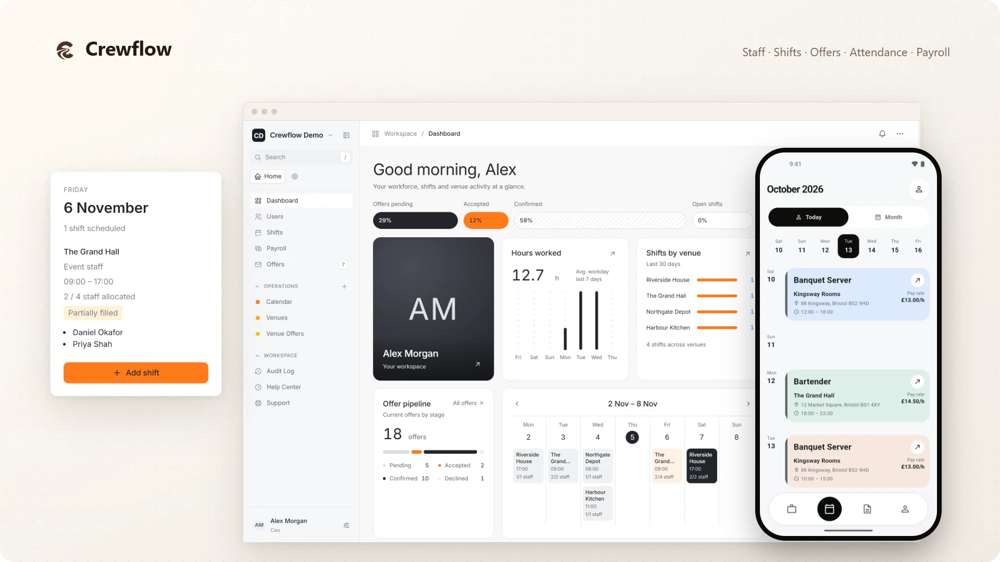
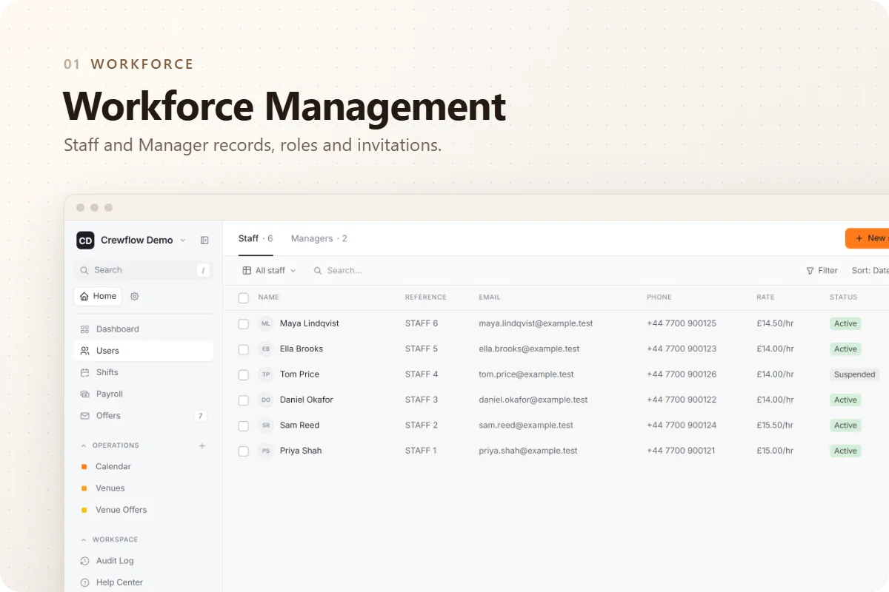
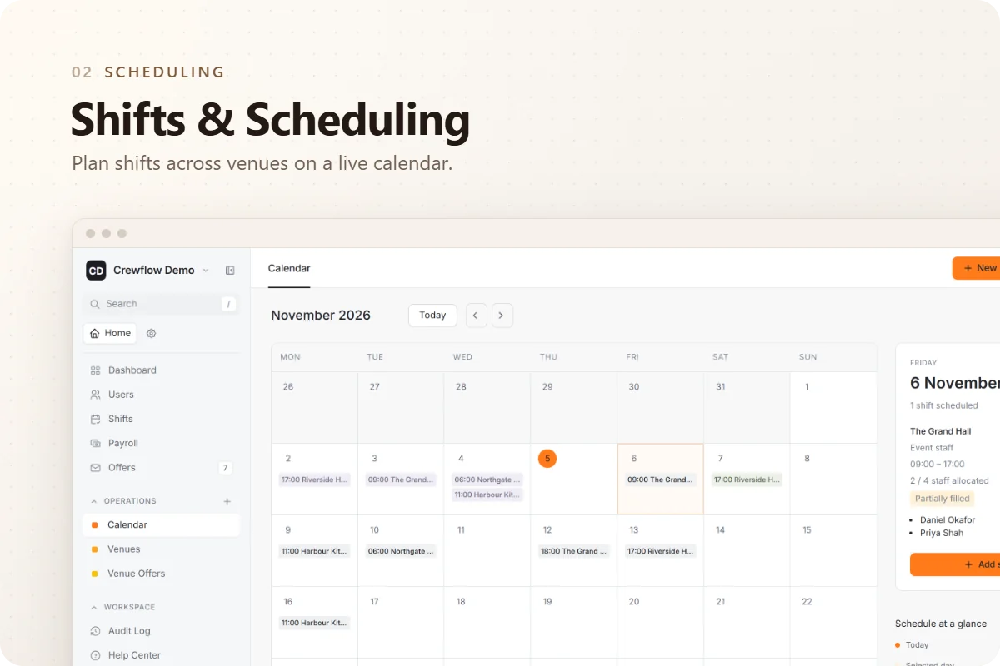
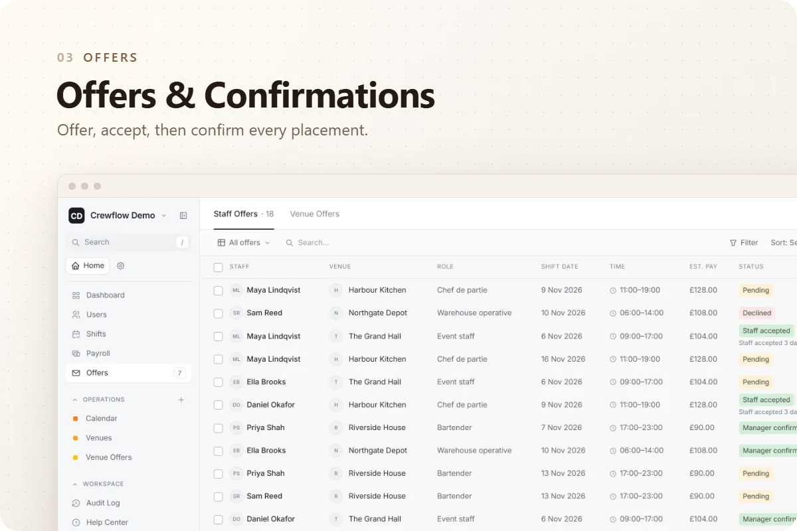
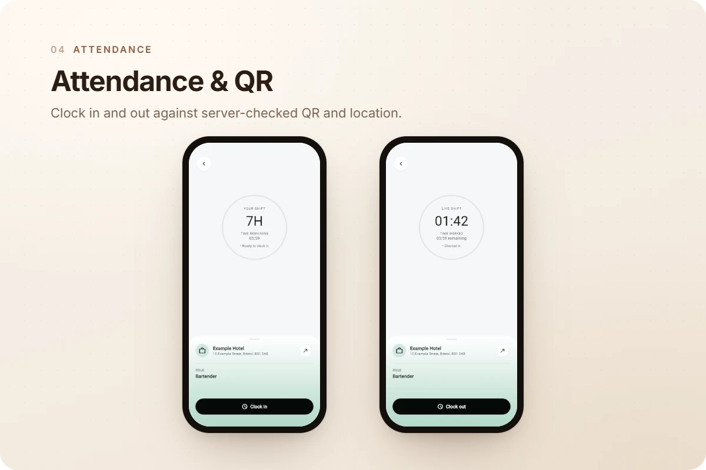
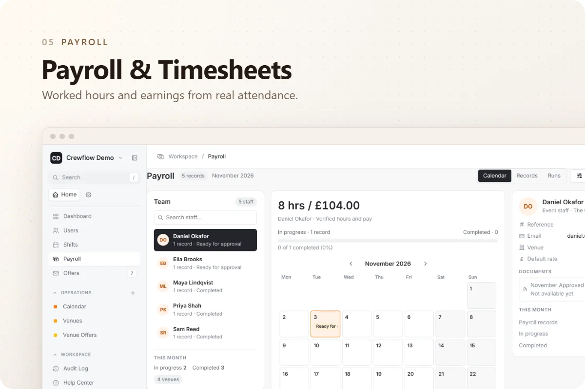
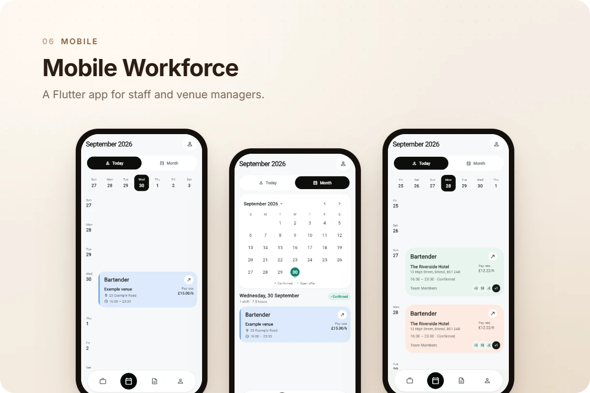
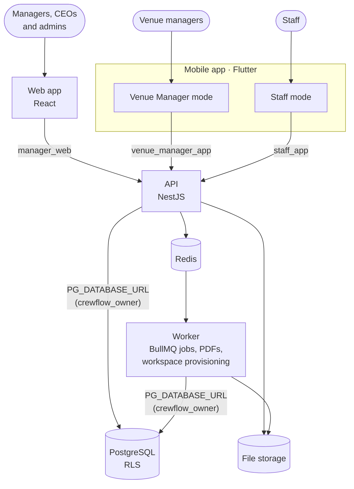

<p align="center">
  <picture>
    <source media="(prefers-color-scheme: dark)" srcset="./packages/rab-readme/crewflow-logo-dark.png">
    <source media="(prefers-color-scheme: light)" srcset="./packages/rab-readme/crewflow-logo-light.png">
    
  </picture>
</p>

<h1 align="center">Crewflow</h1>

<p align="center"><b>Workforce operations, beautifully connected.</b></p>
<p align="center"><i>By Adolphus Recruitment Solutions</i></p>

<p align="center">
  <a href="#everything-you-need">Features</a> ·
  <a href="#from-shift-creation-to-payroll">Workflow</a> ·
  <a href="#private-and-secure-workspaces">Security</a> ·
  <a href="#architecture">Architecture</a> ·
  <a href="#getting-started">Getting started</a>
</p>

<p align="center">
  <picture>
    <source media="(prefers-color-scheme: dark)" srcset="./packages/rab-readme/crewflow-cover-dark.webp">
    <source media="(prefers-color-scheme: light)" srcset="./packages/rab-readme/crewflow-cover-light.webp">
    
  </picture>
</p>

<br>

## Why Crewflow

Staffing agencies and hospitality operators still run shifts through a mix of spreadsheets, group chats and phone calls. Nobody can see at a glance who accepted, who is confirmed, who actually turned up, or what they are owed.

Crewflow brings that whole loop into one system:

- **Managers** plan shifts across their venues, send offers to staff and confirm placements.
- **Venue managers** request cover for their own venue and follow its staffing.
- **Staff** receive offers, accept work, and clock in and out from a mobile app.
- **Hours and earnings** come straight from recorded attendance, not re-typed timesheets.

Each Manager works inside a private workspace, so their staff, venues, shifts and attendance stay isolated from every other Manager.

## Everything you need

<table align="center">
  <tr>
    <td width="50%" valign="top">
      <picture>
        <source media="(prefers-color-scheme: dark)" srcset="./packages/rab-readme/feature-workforce-dark.webp">
        <source media="(prefers-color-scheme: light)" srcset="./packages/rab-readme/feature-workforce-light.webp">
        
      </picture>
      <p align="center">Staff and Manager records, email invitations, custom workspace roles and account status.</p>
    </td>
    <td width="50%" valign="top">
      <picture>
        <source media="(prefers-color-scheme: dark)" srcset="./packages/rab-readme/feature-scheduling-dark.webp">
        <source media="(prefers-color-scheme: light)" srcset="./packages/rab-readme/feature-scheduling-light.webp">
        
      </picture>
      <p align="center">Shifts across venues, fill status and a calendar with day-level staffing.</p>
    </td>
  </tr>
  <tr>
    <td width="50%" valign="top">
      <picture>
        <source media="(prefers-color-scheme: dark)" srcset="./packages/rab-readme/feature-offers-dark.webp">
        <source media="(prefers-color-scheme: light)" srcset="./packages/rab-readme/feature-offers-light.webp">
        
      </picture>
      <p align="center">Every offer tracked from sent to accepted to confirmed. <a href="#from-shift-creation-to-payroll">See the lifecycle</a></p>
    </td>
    <td width="50%" valign="top">
      <picture>
        <source media="(prefers-color-scheme: dark)" srcset="./packages/rab-readme/feature-attendance-dark.webp">
        <source media="(prefers-color-scheme: light)" srcset="./packages/rab-readme/feature-attendance-light.webp">
        
      </picture>
      <p align="center">Clock in and out with a signed venue QR code, validated on the server.</p>
    </td>
  </tr>
  <tr>
    <td width="50%" valign="top">
      <picture>
        <source media="(prefers-color-scheme: dark)" srcset="./packages/rab-readme/feature-payroll-dark.webp">
        <source media="(prefers-color-scheme: light)" srcset="./packages/rab-readme/feature-payroll-light.webp">
        
      </picture>
      <p align="center">Payroll records for approval, payroll runs and PDF shift statements, all from attendance.</p>
    </td>
    <td width="50%" valign="top">
      <picture>
        <source media="(prefers-color-scheme: dark)" srcset="./packages/rab-readme/feature-mobile-dark.webp">
        <source media="(prefers-color-scheme: light)" srcset="./packages/rab-readme/feature-mobile-light.webp">
        
      </picture>
      <p align="center">A Flutter app for staff and venue managers: offers, schedule and history.</p>
    </td>
  </tr>
</table>

<p align="center"><sub>Screens are the real Crewflow interface, shown with fictional demo data.</sub></p>

## From shift creation to payroll

Every step is an explicit state transition checked on the server; a client can request an action, never set a status directly.

```text
Shift created ─▶ Offers sent ─▶ Staff accepts ─▶ Manager confirms ─▶ Scheduled
                                                                         │
                                                                         ▼
Payroll & statements ◀─ Attendance reviewed ◀─ Clock out ◀─────────── Clock in
```

1. **Create the shift.** A Manager creates a shift and opens it for staffing. Shifts requested by a venue manager start as *pending approval* and must be approved first.
2. **Send offers.** Offers go to eligible staff. Each offer can be accepted or declined by the staff member, withdrawn, or left to expire.
3. **Confirm the placement.** Staff acceptance alone does not book a shift: a Manager confirms or rejects it. For venue-manager requests the acceptance confirms the placement directly. If a Manager does not respond within the configured window, the Worker confirms it automatically, using the same seat and double-booking checks as a manual confirmation.
4. **Work the shift.** Staff clock in and out from the mobile app by scanning the venue's signed QR code, inside a time window around the shift. Where a venue requires it, their location is checked against its geofence.
5. **Reconcile attendance.** Late clock-ins, missing clock-outs and no-shows are detected by background jobs. Records can move to review or dispute before approval.
6. **Approve and pay.** Payroll records are created from attendance and approved or rejected by a Manager. Payroll runs group approved work into payslips per pay period, with an export, and each payslip can be marked paid with a payment reference. Crewflow records the payment; it does not move money.

Along the way the Worker renders three PDFs: a pre-shift roster, a final timesheet for each shift and an Approved Shift Statement for each approved payroll record.

## Private and secure workspaces

- **Server-derived identity.** The organisation, workspace and user come from the verified session, never from the request body.
- **Workspace membership.** Each request resolves the caller's active workspace membership; without one, workspace data is unreachable.
- **Server-side authorization.** Permissions are resolved on the server for every request, at the route and again in the service layer.
- **PostgreSQL Row-Level Security.** Tenant tables enable and force RLS. The application's database login is `NOBYPASSRLS`, so the policies apply to every request and job. A CI check fails the build if a tenant table lacks a policy.
- **Separate Manager workspaces.** Managers in the same organisation cannot see each other's staff, venues, shifts or offers. Records outside your scope return *not found*.
- **Two-factor authentication.** Optional TOTP for every role, with recovery codes and step-up re-authentication for sensitive actions.
- **Auditability.** Sensitive actions are written to an audit log that the application only ever appends to, and workflow states move only through allow-listed transitions.

**One database login, stated plainly.** The API, the Worker and migrations all use one login, `crewflow_owner`, which owns the schema. It is not a superuser and cannot bypass RLS, but a SQL-injection bug, a compromised dependency or a leaked `PG_DATABASE_URL` would reach every tenant, and the database alone can no longer stop the audit log from being changed. The owner accepted this trade-off; it is recorded as **PT-01** in [THREAT-MODEL.md](./THREAT-MODEL.md), together with the controls that replace the old restricted login and the items still awaiting approval.

Crewflow also includes infrastructure for a dedicated PostgreSQL schema per workspace. It is built and tested behind a runtime flag but is not yet activated.

## Technology stack

| Layer | Technology |
|---|---|
| Web app | React 18, TypeScript 5.9, Vite 6, React Router 7, TanStack Query 5, Framer Motion |
| Mobile app | Flutter, Dart 3.10 |
| API | NestJS 11, TypeORM 0.3 |
| Background work | BullMQ 5 Worker, including workspace provisioning |
| PDFs | Native rendering with `@react-pdf/renderer` in a Worker thread pool; no browser |
| Data | PostgreSQL 16 with Row-Level Security, Redis 7 |
| Files | Local storage or S3-compatible object storage |
| Monorepo | Nx 22, Yarn 4, Node.js 24 |
| Quality | Jest, Playwright, `flutter_test`, GitHub Actions with gitleaks, CodeQL and Trivy, and an image security gate before every release |

## Architecture



One NestJS backend serves two clients: **`rab-front`**, the web console for Managers, CEOs and administrators, and **`rab-mobile`**, the Flutter app for staff and venue managers. The API admits each role only to its own application. Venue managers sign in to the **Venue Manager mode** of the mobile app; their role can't use the web console or the staff experience. From there they request cover for their venue, which a Manager approves. They also follow its staffing and calendar, review shift history and sign off final timesheets. Their access is limited to the venues they are assigned to, and the database enforces this with its own Row-Level Security policies.

- **API:** handles every request, from authentication and permissions to business rules. Its container, started with `CREWFLOW_MIGRATE_ON_START=true`, applies pending migrations under a lock before the API serves.
- **Worker:** runs emails, notifications, reminders, scheduled lifecycle jobs, workspace provisioning and PDF rendering. It shares the API's domain code and re-checks tenant scope itself, so a queued job never carries authority on its own. PDFs are rendered natively in JavaScript; the Worker image contains no Chromium or Playwright, and its release gate fails if either returns.
- **Database:** one PostgreSQL database and one login, `crewflow_owner`, given to every process as the single `PG_DATABASE_URL`.

## Getting started

### Database setup

Crewflow needs an **empty PostgreSQL 16 database**; versions 15 and earlier are refused. A connection URL alone is not enough: the database administrator first runs one SQL file, once, and the application does everything after that.

1. **One-time provider step.** As the PostgreSQL superuser or your provider's admin role, in SQL, over the direct (non-pooler) host, run [`01-crewflow-owner.sql`](./packages/rab-docker/postgres-init/owner-login/01-crewflow-owner.sql) against the empty database. It creates the `crewflow_owner` login (`NOSUPERUSER`, `NOBYPASSRLS`) and grants it `CONNECT`, `CREATE` and `TEMPORARY` on that database. The password is read from a file, so it never appears on a command line:

   ```bash
   openssl rand -hex 32 > crewflow-owner-password   # secret: keep it outside the repository
   psql "<admin URL of the empty database>" \
     -v owner_password_file=./crewflow-owner-password \
     -f packages/rab-docker/postgres-init/owner-login/01-crewflow-owner.sql
   ```

2. **One URL.** Every process (API, Worker and the migration step) uses the same `PG_DATABASE_URL`, logging in as `crewflow_owner`. There are no other database URLs or logins to configure: `DATABASE_URL`, `DATABASE_URL_UNPOOLED`, the replica URL, the provisioner URL and the old role passwords are refused at boot.

3. **Migrations run on start.** On the first start the server installs the whole schema into the empty database; on later starts it applies only what is pending, under a migration lock, and runs its post-checks every time. In the API container this happens when `CREWFLOW_MIGRATE_ON_START=true`. Production can instead run the same step as a separate release job.

**Before every upgrade, take a backup or a restore point.** This is mandatory. The application login cannot take a complete logical backup (forced-RLS tables dump empty for it), so the backup is taken by the cluster superuser or by your provider. The supported rollback is to restore that backup and then deploy the previous image.

- Deployment, release and provider notes: [`OWNER-LOGIN-DEPLOYMENT.md`](./packages/rab-docker/docs/release/OWNER-LOGIN-DEPLOYMENT.md)
- Backup, recovery and rollback: [`OWNER-LOGIN-RECOVERY.md`](./packages/rab-docker/docs/release/OWNER-LOGIN-RECOVERY.md)

### Local development

**Prerequisites:** Node.js 24, Yarn 4 via Corepack, PostgreSQL 16 and Redis 7 (Docker works for both), and the Flutter SDK for mobile.

```bash
git clone https://github.com/Rabblo06/rab-recurit.git
cd rab-recurit
corepack enable
yarn install
npx nx run-many -t build -p rab-shared,rab-emails,rab-ui
npx nx build rab-server
```

Prepare an empty local database with the one-time provider step above. Then configure the API from the template, which documents every variable. Set `PG_DATABASE_URL` to `postgres://crewflow_owner:<password>@localhost:5432/<database>`, plus `REDIS_URL` and `APP_SECRET`. Never commit real values.

```bash
cp packages/rab-server/.env.example packages/rab-server/.env
```

Install the schema. Run this once on the empty database, and again after pulling new migrations. The migration step reads only its environment, not `.env`:

```bash
PG_DATABASE_URL='postgres://crewflow_owner:<password>@localhost:5432/<database>' \
NODE_ENV=development RAB_RUNTIME_ENV=development CREWFLOW_MIGRATE_ON_START=true \
  node packages/rab-server/dist/database/typeorm/scripts/migrate/twenty/twenty-migrate.js
```

Start the API and the web console, then the Worker once the API is up:

```bash
npx nx run-many -t start -p rab-server rab-front
npx nx run rab-worker:start
```

Create the first platform administrator with the `bootstrap-admin` command (`BOOTSTRAP_ADMIN_EMAIL=<you> npx nx run rab-server:command bootstrap-admin`). It takes no password: it emails an activation link.

For mobile, from `packages/rab-mobile`:

```bash
flutter pub get
flutter run --dart-define=API_URL=http://10.0.2.2:3000/rest/v1   # Android emulator
```

| Command | What it does |
|---|---|
| `yarn build` | Build every package |
| `yarn lint` | Typecheck every package |
| `yarn test` | Run the Jest suites across the monorepo |
| `yarn check-rls` | Fail if any tenant table lacks Row-Level Security |
| `yarn mobile` | Start the Flutter app through Nx |

## Project structure

```text
packages/
├── rab-server/        API (NestJS): auth, permissions, business rules, migrations
├── rab-worker/        Worker (BullMQ jobs, native PDF rendering, workspace provisioning)
├── rab-front/         Web app (React): console for Managers and administrators
├── rab-mobile/        Mobile app (Flutter) for staff and venue managers
├── rab-iphone/        Native iPhone app (SwiftUI): source written, not yet built or tested
├── rab-shared/        Shared types, state machines, money and duration utilities
├── rab-ui/            Design tokens
├── rab-emails/        Email templates
├── rab-docker/        Images, Compose files, the owner-login SQL and the release runbooks
├── rab-docs/          User and developer documentation (Mintlify)
├── rab-e2e-testing/   End-to-end tests
├── rab-utils/         Development scripts
├── rab-website/       Adolphus Recruitment Solutions marketing website
└── rab-readme/        Images for this README
```

## Development status

| Status | Area |
|---|---|
| **Available** | Staff, Manager and venue management; email invitations with custom workspace roles; venue manager teams; shifts and calendar; offers and confirmations; QR and geofence attendance; payroll approval, payroll runs and export; native PDF rosters, timesheets and Approved Shift Statements; audit log; private Manager workspaces; organisation onboarding; Platform Admin Panel; password sign-in with optional Google and Microsoft sign-in; optional two-factor authentication; one-login database with migrate-on-start and fresh install from an empty database |
| **In progress** | Push notifications: delivery pipeline and Android client built, not yet verified on devices. Native iPhone app: source written, not yet compiled. Real-time updates: built, off by default. Per-workspace PostgreSQL schemas: built behind a flag, not yet activated. AI assistant: chat and Settings → AI built, runs a real model only in development on synthetic data, off in production. |
| **Planned** | Payment processing (Crewflow records payments; it does not make them). |

## Security, documentation and license

- [Security policy](./SECURITY.md): vulnerability reporting and secret rotation.
- [Threat model](./THREAT-MODEL.md): per-feature threats and mitigations, including the owner-login trade-off (PT-01).
- [Architecture](./rab-workforce-architecture.md): domain model, permissions and state machines.
- [Engineering agreements](./CLAUDE.md): the rules every change follows.

Crewflow is proprietary software owned by Adolphus Recruitment Solutions. The repository is publicly visible, but **this is not open-source software**. All rights are reserved; see [LICENSE](./LICENSE).
