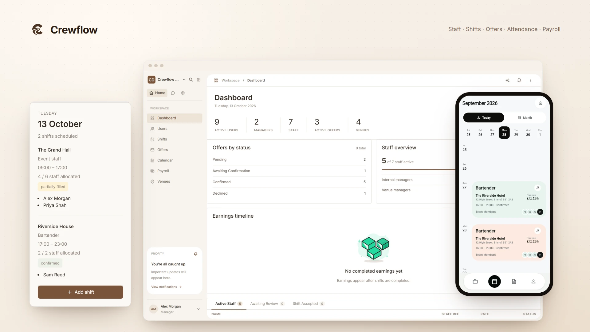
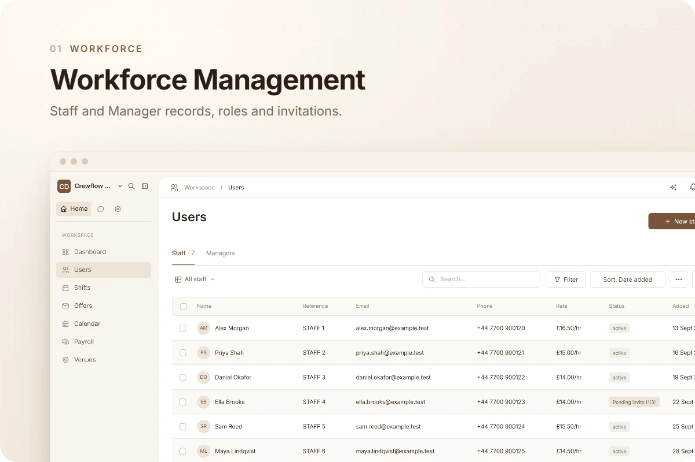
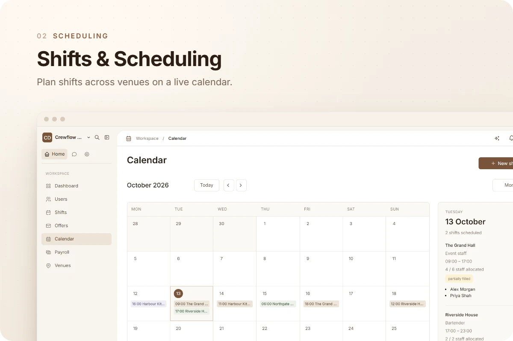
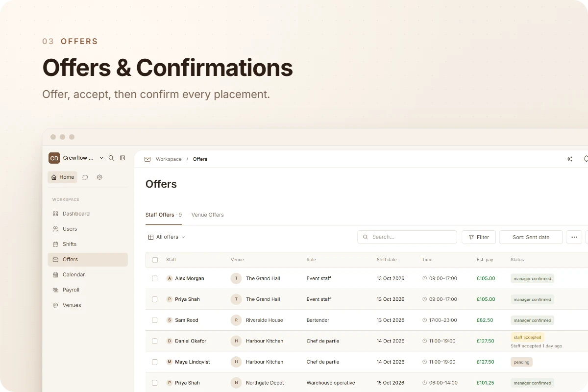
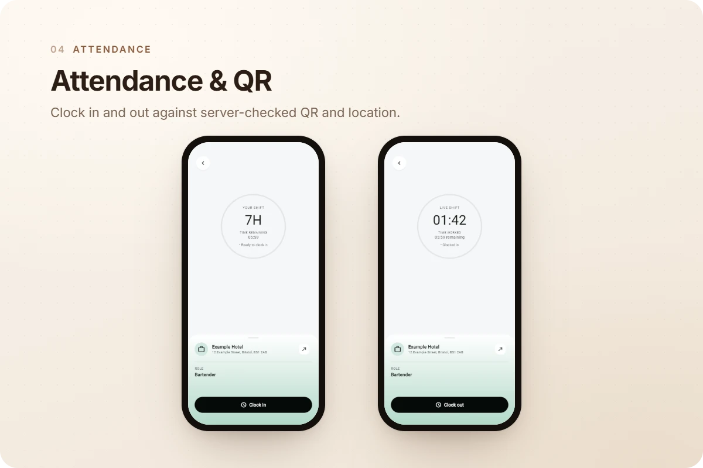
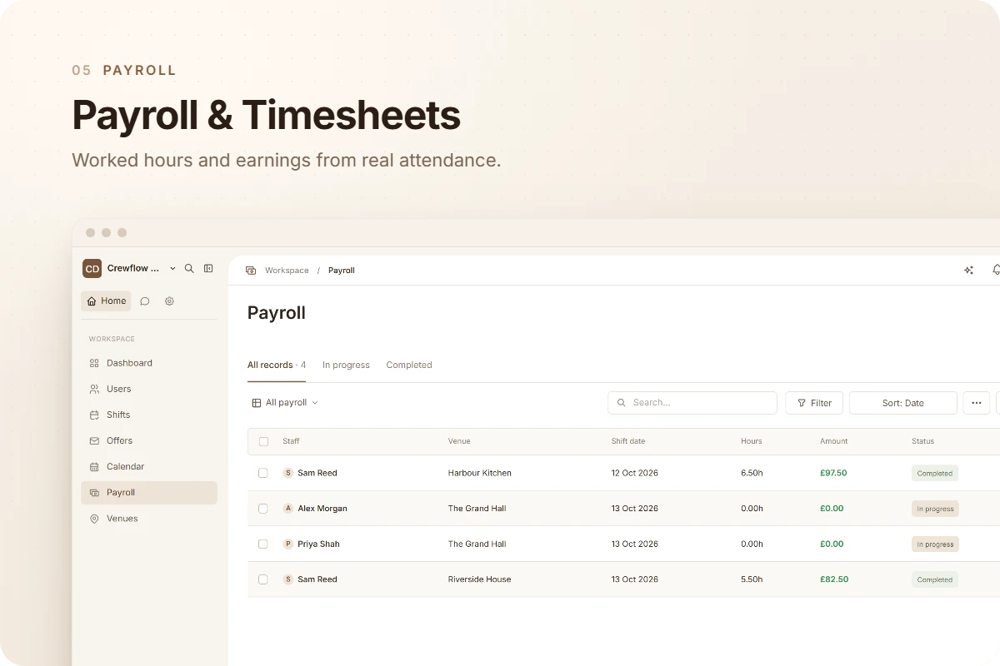
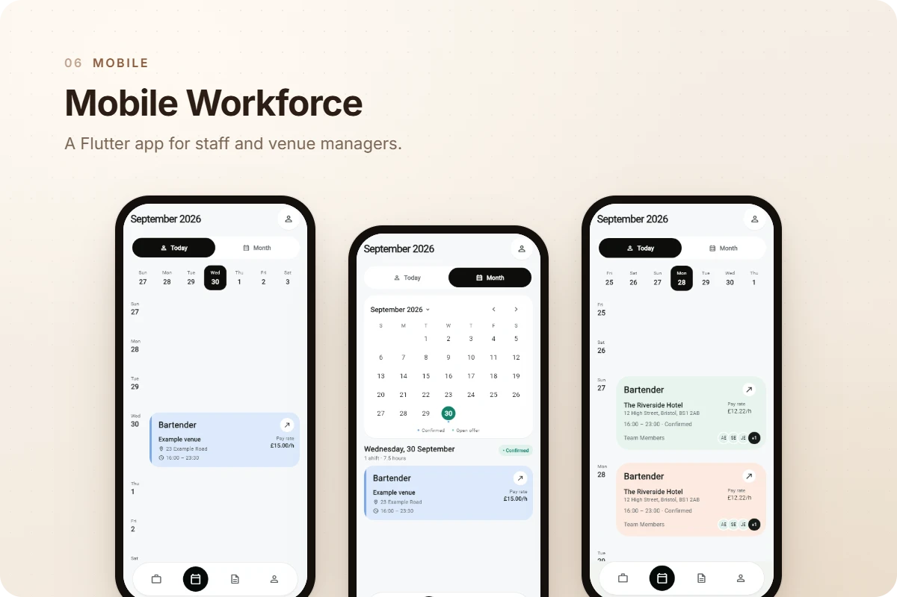
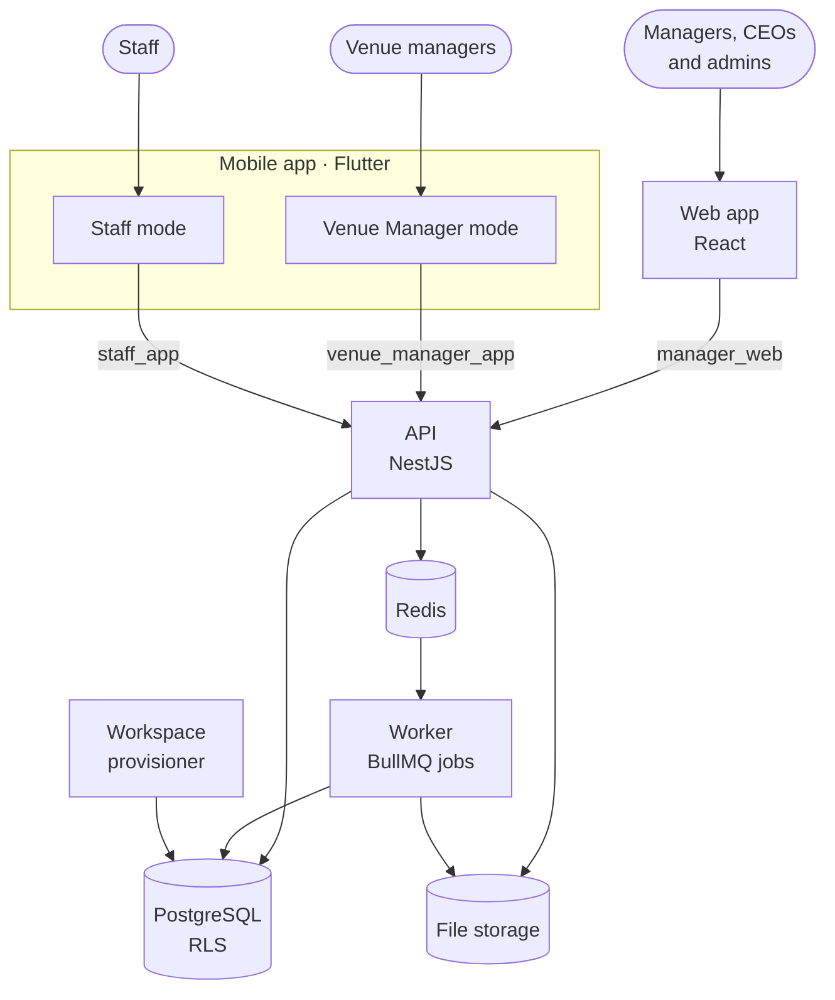

<p align="center">
  <picture>
    <source media="(prefers-color-scheme: dark)" srcset="./packages/rab-readme/crewflow-logo-dark.png">
    <source media="(prefers-color-scheme: light)" srcset="./packages/rab-readme/crewflow-logo-light.png">
    
  </picture>
</p>

<h1 align="center">Crewflow</h1>

<p align="center"><b>Workforce operations, beautifully connected.</b></p>
<p align="center"><i>By Adolphus Recruitment Solutions</i></p>

<p align="center">
  <a href="#everything-you-need">Features</a> ·
  <a href="#from-shift-creation-to-payroll">Workflow</a> ·
  <a href="#private-and-secure-workspaces">Security</a> ·
  <a href="#architecture">Architecture</a> ·
  <a href="#getting-started">Getting started</a>
</p>

<p align="center">
  <picture>
    <source media="(prefers-color-scheme: dark)" srcset="./packages/rab-readme/crewflow-cover-dark.webp">
    <source media="(prefers-color-scheme: light)" srcset="./packages/rab-readme/crewflow-cover-light.webp">
    
  </picture>
</p>

<br>

## Why Crewflow

Staffing agencies and hospitality operators still run shifts through a mix of spreadsheets, group chats and phone calls. Nobody can see at a glance who accepted, who is confirmed, who actually turned up, or what they are owed.

Crewflow brings that whole loop into one system:

- **Managers** plan shifts across their venues, send offers to staff and confirm placements.
- **Venue managers** request cover for their own venue and follow its staffing.
- **Staff** receive offers, accept work, and clock in and out from a mobile app.
- **Hours and earnings** come straight from recorded attendance, not re-typed timesheets.

Each Manager works inside a private workspace, so their staff, venues, shifts and attendance stay isolated from every other Manager.

## Everything you need

<table align="center">
  <tr>
    <td width="50%" valign="top">
      <picture>
        <source media="(prefers-color-scheme: dark)" srcset="./packages/rab-readme/feature-workforce-dark.webp">
        <source media="(prefers-color-scheme: light)" srcset="./packages/rab-readme/feature-workforce-light.webp">
        
      </picture>
      <p align="center">Staff and Manager records, invitations, roles and account status.</p>
    </td>
    <td width="50%" valign="top">
      <picture>
        <source media="(prefers-color-scheme: dark)" srcset="./packages/rab-readme/feature-scheduling-dark.webp">
        <source media="(prefers-color-scheme: light)" srcset="./packages/rab-readme/feature-scheduling-light.webp">
        
      </picture>
      <p align="center">Shifts across venues, fill status and a calendar with day-level staffing.</p>
    </td>
  </tr>
  <tr>
    <td width="50%" valign="top">
      <picture>
        <source media="(prefers-color-scheme: dark)" srcset="./packages/rab-readme/feature-offers-dark.webp">
        <source media="(prefers-color-scheme: light)" srcset="./packages/rab-readme/feature-offers-light.webp">
        
      </picture>
      <p align="center">Every offer tracked from sent to accepted to confirmed. <a href="#from-shift-creation-to-payroll">See the lifecycle</a></p>
    </td>
    <td width="50%" valign="top">
      <picture>
        <source media="(prefers-color-scheme: dark)" srcset="./packages/rab-readme/feature-attendance-dark.webp">
        <source media="(prefers-color-scheme: light)" srcset="./packages/rab-readme/feature-attendance-light.webp">
        
      </picture>
      <p align="center">Clock in and out with a signed venue QR code, validated on the server.</p>
    </td>
  </tr>
  <tr>
    <td width="50%" valign="top">
      <picture>
        <source media="(prefers-color-scheme: dark)" srcset="./packages/rab-readme/feature-payroll-dark.webp">
        <source media="(prefers-color-scheme: light)" srcset="./packages/rab-readme/feature-payroll-light.webp">
        
      </picture>
      <p align="center">Worked hours and earnings from attendance, plus generated shift timesheets.</p>
    </td>
    <td width="50%" valign="top">
      <picture>
        <source media="(prefers-color-scheme: dark)" srcset="./packages/rab-readme/feature-mobile-dark.webp">
        <source media="(prefers-color-scheme: light)" srcset="./packages/rab-readme/feature-mobile-light.webp">
        
      </picture>
      <p align="center">A Flutter app for staff and venue managers: offers, schedule and history.</p>
    </td>
  </tr>
</table>

<p align="center"><sub>Screens are the real Crewflow interface, shown with fictional demo data.</sub></p>

## From shift creation to payroll

Every step is an explicit state transition checked on the server; a client can request an action, never set a status directly.

```text
Shift created ─▶ Offers sent ─▶ Staff accepts ─▶ Manager confirms ─▶ Scheduled
                                                                         │
                                                                         ▼
Payroll & timesheets ◀─ Attendance reviewed ◀─ Clock out ◀─────────── Clock in
```

1. **Create the shift.** A Manager creates a shift and opens it for staffing. Shifts requested by a venue manager start as *pending approval* and must be approved first.
2. **Send offers.** Offers go to eligible staff. Each offer can be accepted or declined by the staff member, withdrawn, or left to expire.
3. **Confirm the placement.** Staff acceptance alone does not book a shift: a Manager confirms or rejects it. For venue-manager requests the acceptance confirms the placement directly. If a Manager does not respond within the configured window, the Worker confirms it automatically, using the same seat and double-booking checks as a manual confirmation.
4. **Work the shift.** Staff clock in and out from the mobile app by scanning the venue's signed QR code, inside a time window around the shift. Where a venue requires it, their location is checked against its geofence.
5. **Reconcile attendance.** Late clock-ins, missing clock-outs and no-shows are detected by background jobs. Records can move to review or dispute before approval.
6. **See what was earned.** Payroll shows worked hours and amounts from attendance. The Worker generates a pre-shift roster and a final timesheet PDF for each shift.

## Private and secure workspaces

- **Server-derived identity.** The organisation, workspace and user come from the verified session, never from the request body.
- **Workspace membership.** Each request resolves the caller's active workspace membership; without one, workspace data is unreachable.
- **Server-side authorization.** Permissions are resolved on the server for every request, at the route and again in the service layer.
- **PostgreSQL Row-Level Security.** Tenant tables enforce RLS, and the application's runtime database role cannot bypass it. A CI check fails the build if a tenant table lacks a policy.
- **Separate Manager workspaces.** Managers in the same organisation cannot see each other's staff, venues, shifts or offers. Records outside your scope return *not found*.
- **Auditability.** Sensitive actions are written to an insert-only audit log, and workflow states move only through allow-listed transitions.

Crewflow also includes infrastructure for a dedicated PostgreSQL schema per workspace, provisioned by a separate process. It is built and tested behind a runtime flag but is not yet activated.

## Technology stack

| Layer | Technology |
|---|---|
| Web app | React 18, TypeScript 5.9, Vite 6, React Router 7, TanStack Query 5, Framer Motion |
| Mobile app | Flutter, Dart 3.10 |
| API | NestJS 11, TypeORM 0.3 |
| Background work | BullMQ 5 Worker, plus a separate workspace provisioner |
| Data | PostgreSQL 16 with Row-Level Security, Redis 7 |
| Files | Local storage or S3-compatible object storage |
| Monorepo | Nx 22, Yarn 4, Node.js 24 |
| Quality | Jest, Playwright, `flutter_test`, GitHub Actions with gitleaks, CodeQL and Trivy |

## Architecture



The API admits each role only to its own application. Venue managers sign in to the **Venue Manager mode** of the mobile app; their role can't use the web console or the staff experience. From there they request cover for their venue, which a Manager approves. They also follow its staffing and calendar, review shift history and sign off final timesheets. Their access is limited to the venues they are assigned to, and the database enforces this with its own Row-Level Security policies.

- **API:** handles every request, from authentication and permissions to business rules.
- **Worker:** runs emails, PDF reports, reminders and scheduled lifecycle jobs. It shares the API's domain code and re-checks tenant scope itself, so a queued job never carries authority on its own.
- **Workspace provisioner:** a separate, privileged process that prepares workspace schemas. Ordinary API and Worker processes never hold its database credential.

## Getting started

**Prerequisites:** Node.js 24, Yarn 4 via Corepack, Docker (for PostgreSQL and Redis), and the Flutter SDK for mobile.

```bash
git clone https://github.com/Rabblo06/rab-recurit.git
cd rab-recurit
corepack enable
yarn install
```

Start PostgreSQL and Redis:

```bash
docker compose -f packages/rab-docker/docker-compose.yml up -d postgres redis
```

The database container creates its roles on first start.

Configure the API from the template, which documents every variable. Never commit real values.

```bash
cp packages/rab-server/.env.example packages/rab-server/.env
```

The workspace provisioner reads its own `packages/rab-worker/.env.provisioner`. Give it `NODE_ENV`, `RAB_RUNTIME_ENV`, `DB_TARGET`, `DATABASE_URL`, `DATABASE_URL_UNPOOLED`, `REDIS_URL` and `HWS_RUNTIME_ENABLED`.

Apply pending migrations (this never resets data), then start everything:

```bash
npx nx run rab-server:migration:run
yarn start   # API + web app, then Worker and provisioner once the API is up
```

For mobile, from `packages/rab-mobile`:

```bash
flutter pub get
flutter run --dart-define=API_URL=http://10.0.2.2:3000/rest/v1   # Android emulator
```

| Command | What it does |
|---|---|
| `yarn build` | Build every package |
| `yarn lint` | Typecheck every package |
| `yarn test` | Run the Jest suites across the monorepo |
| `yarn check-rls` | Fail if any tenant table lacks Row-Level Security |
| `yarn mobile` | Start the Flutter app through Nx |

## Project structure

```text
packages/
├── rab-server/        API (NestJS): auth, permissions, business rules, migrations
├── rab-worker/        Worker (BullMQ jobs) and the separate workspace provisioner
├── rab-front/         Web app (React): console for Managers and administrators
├── rab-mobile/        Mobile app (Flutter) for staff and venue managers
├── rab-shared/        Shared types, state machines, money and duration utilities
├── rab-ui/            Design tokens
├── rab-emails/        Email templates
├── rab-docker/        Local PostgreSQL, Redis and S3-compatible storage, plus the server image
├── rab-e2e-testing/   End-to-end tests
├── rab-utils/         Development scripts
├── rab-website/       Adolphus Recruitment Solutions marketing website
└── rab-readme/        Images for this README
```

## Development status

| Status | Area |
|---|---|
| **Available** | Staff, Manager and venue management; shifts and calendar; offers and confirmations; QR and geofence attendance; attendance-based payroll view; shift roster and timesheet PDFs; audit log; private Manager workspaces; organisation onboarding; password sign-in with optional Google and Microsoft sign-in |
| **In progress** | Push notifications: delivery pipeline and Android client built, not yet verified on devices; iOS app not set up. Real-time updates: built, off by default. Per-workspace PostgreSQL schemas: built behind a flag, not yet activated. |
| **Planned** | AI assistant (the chat interface exists, with no AI backend connected). Payroll approval and payment processing. |

## Security, documentation and license

- [Security policy](./SECURITY.md): vulnerability reporting and secret rotation.
- [Threat model](./THREAT-MODEL.md): per-feature threats and mitigations.
- [Architecture](./rab-workforce-architecture.md): domain model, permissions and state machines.
- [Engineering agreements](./CLAUDE.md): the rules every change follows.

Crewflow is proprietary software owned by Adolphus Recruitment Solutions. The repository is publicly visible, but **this is not open-source software**. All rights are reserved; see [LICENSE](./LICENSE).
