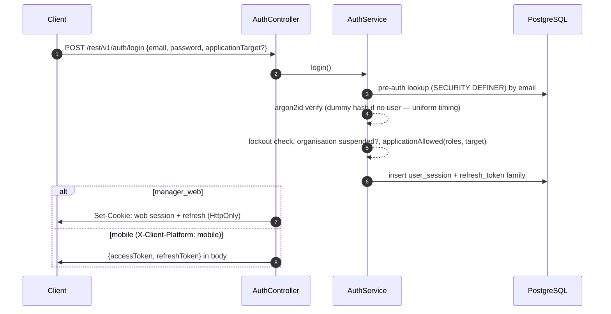

## Login

## Application targets

`manager_web`, `venue_manager_app` and `staff_app` (`engine/core-modules/auth/application-access.ts`).

| Role | Allowed targets |
| --- | --- |
| `staff` | `staff_app` |
| `venue_manager` | `venue_manager_app` |
| `manager`, `ceo` and administrator roles | all |
| Platform administrator | all |

A mobile login with no explicit target gets `venue_manager_app` for venue managers, otherwise `staff_app`. The `x-application-target` header must match the session's target, and `@ManagerApplication()` handlers require `manager_web`.

## Sessions and lifetimes

| | Value | Source |
| --- | --- | --- |
| Access token | 15 minutes | `session-policy.ts` |
| Refresh token | 30 days per token, clamped to the session's absolute expiry | `refresh-token.service.ts` |
| `manager_web` session | 24 h absolute, 30 min idle | `session-policy.ts` |
| Mobile sessions | 90 days absolute, 7 days idle | `session-policy.ts` |
| Manager-tier roles and platform admins | 24 h / 30 min on every target | `session-policy.ts` |

Each `core.user_session` row records the organisation, user, workspace, application target, device, user agent, IP, last-seen, expiries and revocation.

## Refresh rotation and reuse detection

Every refresh replaces the token. Presenting a rotated or revoked token raises `RefreshTokenReuseError` and revokes the whole family. Refresh is also refused when the session row is revoked or idle-expired. Revocation helpers: `revokeFamily` (logout, per-device revoke), `revokeAllForUser` (password change, suspension), `revokeAllForOrganisation` (organisation suspension). Each also bumps the security version so cached authority is discarded.

## The guard chain

`JwtAuthGuard` authenticates the request and then runs `OrganisationSuspendedGuard`, `MustResetPasswordGuard` and `MaintenanceModeGuard`. Route guards follow: `PermissionGuard(flag)` resolves **effective permissions** (role grants ∪ per-user grants − per-user revocations) from the per-request security snapshot — never from the token. `RequireWorkspaceGuard` requires a resolved workspace and returns 404 when there is none.

## CSRF

For cookie-authenticated requests, `JwtAuthGuard` checks the `Origin` header against the trusted-origin allowlist on every unsafe method (POST, PUT, PATCH, DELETE). `/auth/refresh` has its own Origin check when the token comes from the cookie. The web session credential is never accepted as a bearer token, and the optional `x-crewflow-expected-session-id` header fences a tab to the session it started with.

## Passwords

- Argon2id with `memoryCost: 19456`, `timeCost: 2`, `parallelism: 1`.
- 10–128 characters with upper-case, lower-case and a digit; checked against a common-password list and the email.
- Lockout: 10 failures in 15 minutes returns 429 with a 900-second retry.
- Forgot-password responses are padded to a constant time and identical whether or not the account exists. Reset tokens last 1 hour; admin-initiated and initial-setup tokens last 48 hours. Completing a reset revokes every session.

## OIDC (Google and Microsoft)

State, PKCE and nonce are used; OAuth state lives 10 minutes. Google requires `email_verified`. OIDC links only to existing users — it never creates accounts. Providers are enabled by environment flags and per organisation.
