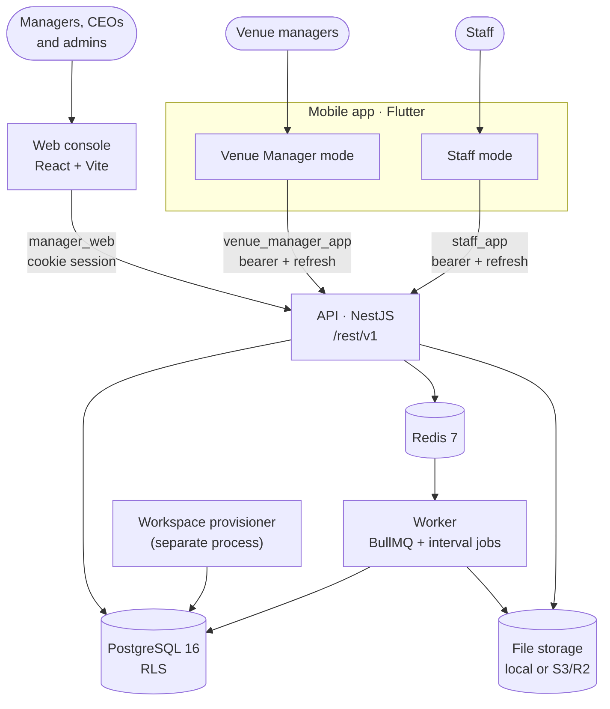

Crewflow (codename **rab**) is an Nx + Yarn 4 monorepo. One backend owns every business rule; the web console and the Flutter app are clients of the same REST API.

## Runtime processes

| Process | Package | Responsibility |
| --- | --- | --- |
| **API** | `rab-server` | REST endpoints under `/rest/v1`, authentication, permissions, business rules, migrations. |
| **Worker** | `rab-worker` | BullMQ consumers (email, push) and interval jobs (expiry, reminders, timesheets, clean-up). No HTTP listener. |
| **Workspace provisioner** | `rab-worker` | A separate, privilege-isolated process that provisions per-workspace database schemas. Only runs when `HWS_RUNTIME_ENABLED=true`. |
| **Web console** | `rab-front` | React SPA for managers, CEOs and platform administrators. |
| **Mobile app** | `rab-mobile` | Flutter app for staff and venue managers (Android). |

The API and Worker ship as **one Docker image with two start commands**. The Worker imports domain services from `@rab/server`, so a rule can never differ between an HTTP request and a background job.

## Non-negotiable rules

<AccordionGroup>
  <Accordion title="Five enforcement layers" icon="layer-group" defaultOpen>
    Guard → service → workspace-scoped query → PostgreSQL RLS policy → a tighter staff/venue RLS predicate. The service-level check matters because jobs and CLI commands call services directly and never pass a guard.
  </Accordion>
  <Accordion title="organisationId never comes from the client" icon="ban">
    It is read from the verified session and bound into the database transaction with `SET LOCAL`. A body containing `organisationId` fails validation (`forbidNonWhitelisted`).
  </Accordion>
  <Accordion title="Named actions, not raw statuses" icon="arrows-turn-right">
    Mutations name the action (`/offers/:id/confirm`). Transitions are validated with `assertTransition` against the tables in `@rab/shared/state`; anything not listed throws `InvalidTransitionError` (409).
  </Accordion>
  <Accordion title="404, not 403, outside your scope" icon="eye-slash">
    A 403 confirms a row exists. Records outside the caller's tenant, workspace, venue or own scope return 404.
  </Accordion>
  <Accordion title="engine/ never imports modules/" icon="arrow-right-arrow-left">
    `engine/` is platform machinery (auth, permissions, tenant context, audit, storage, email, queues). `modules/` is the staffing domain. Dependencies flow one way.
  </Accordion>
  <Accordion title="Money and minutes live in one place" icon="sterling-sign">
    Money is always integer pence (`@rab/shared` `money.ts`). Worked minutes are calculated only by `@rab/shared` `duration.ts`.
  </Accordion>
  <Accordion title="Migrations only" icon="database">
    `synchronize: false`. Every schema change is a versioned TypeORM migration, never edited after merge. Every tenant table gets RLS in the same migration that creates it.
  </Accordion>
</AccordionGroup>

## Where to go next

<Columns cols={2}>
  <Card title="Local development" icon="laptop-code" href="/developers/local-development" />
  <Card title="Backend services" icon="server" href="/developers/backend-services" />
  <Card title="Authentication flow" icon="key" href="/developers/authentication-flow" />
  <Card title="API endpoints" icon="plug" href="/developers/api-reference/endpoints" />
</Columns>
