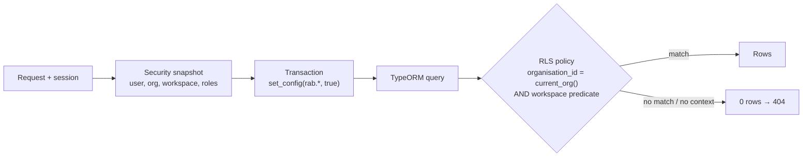

## Ownership model

- `core.manager_workspace` — one row per workspace, with `owner_user_id`, a unique `subdomain`, `schema_status` and `onboarding_completed_at`.
- `core.workspace_membership` — which workspace each user works in. A unique index allows **one active membership per user** (`active`, `suspended`, `removed`).
- An **internal manager's** own workspace becomes their operational home when they create it.
- A **CEO's** workspace becomes their operational home only when they create it themselves, have no profile binding and no active membership. Otherwise it is purely additive and grants no permissions.
- **Venue managers** and **staff** join the creating manager's workspace.

There is no workspace switching. The workspace is always resolved server-side from the session.

## Binding a request

`TenantContextService` opens a transaction and sets transaction-local settings (equivalent to `SET LOCAL`), so a pooled connection can never leak one tenant's context to the next request:

```sql
SELECT set_config('rab.organisation_id', $1, true),
       set_config('rab.workspace_id',    $2, true),
       set_config('rab.user_id',         $3, true),
       set_config('rab.role',            $4, true),
       set_config('rab.actor_type',      $5, true);
SELECT set_config('search_path', $1, true);  -- 'core', or the workspace schema when HWS is enabled
```

Policies read those settings through helper functions:

```sql
CREATE FUNCTION core.current_org() RETURNS uuid
LANGUAGE sql STABLE AS $$
  SELECT NULLIF(current_setting('rab.organisation_id', true), '')::uuid
$$;
```

With no context bound, `current_org()` is `NULL`, every predicate is false, and queries return **zero rows**.



## Per-workspace schemas (HWS)

When `HWS_RUNTIME_ENABLED=true`, `search_path` points at `workspace_<uuid>`, resolved through `core.workspace_schema_registry`. There is no fallback to `core` for a workspace that is not `READY`. The provisioner process creates schemas; the runtime role cannot run DDL. HWS is built but not yet enabled in production.

## Background jobs

Jobs discover candidate rows, then reload each row under that row's own tenant context before acting. A queue payload is only a hint; it never grants authority.
