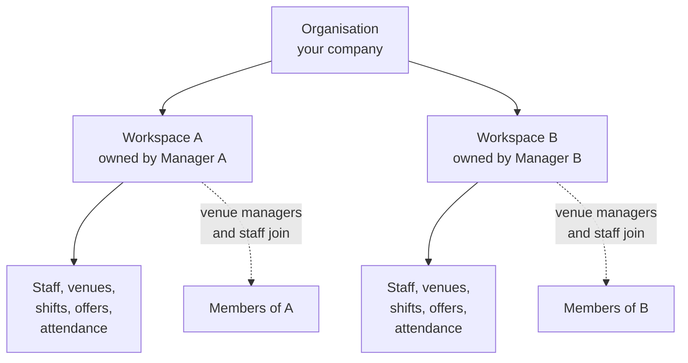

Crewflow keeps data apart at two levels: the **organisation** and the **workspace**.

## Organisation

An organisation is your company. Organisations are completely separate: no account, record, file or notification ever crosses from one organisation to another. A Crewflow platform administrator creates the organisation and invites its CEO.

## Workspace

A workspace is a manager's private operating area inside the organisation. When a manager signs in for the first time, they create their workspace by choosing a name and a web address. Everything they then create — staff, venues, job roles, shifts, offers, attendance and timesheets — belongs to that workspace.

Two managers in the same organisation can each run their own workspace. Each one sees only the people and records in their own workspace. This lets an agency give each branch or account manager their own independent operation.

| | Organisation | Workspace |
| --- | --- | --- |
| **What it represents** | The company | One manager's operation |
| **Who creates it** | A platform administrator | A manager, during first sign-in |
| **What it contains** | Accounts, workspaces, settings | Staff, venues, shifts, offers, attendance |
| **How many** | One per company | One per workspace owner |

## Who belongs to a workspace

- **The manager who owns it.** An internal manager's own workspace is their working home.
- **Staff** created by that manager.
- **Venue managers** invited by that manager. They join the manager's workspace and are limited to their assigned venues.

Each account works in exactly one workspace. Crewflow works out your workspace from your account when you sign in. You never choose it, and there is no workspace switcher.

<Note>
  A CEO can also create a workspace. If the CEO is not already a member of another workspace, the new workspace becomes their working home. Otherwise it is added alongside their existing access and grants no extra permissions.
</Note>

## Related articles

<Columns cols={2}>
  <Card title="Workspace overview" icon="building" href="/workspaces/overview" />
  <Card title="Data isolation" icon="lock" href="/security/data-isolation" />
</Columns>
