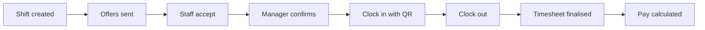

import { VideoTutorial } from '/snippets/media.mdx';
import DemoDataNote from '/snippets/demo-data-note.mdx';

Crewflow is the workforce operations platform from {{company}}. Managers plan shifts and send offers on the web. Staff accept work, clock in and see their history in the mobile app. Venue managers request cover and sign off timesheets for their own venues.

## Find your way

<Columns cols={3}>
  <Card title="Get started" icon="rocket" href="/getting-started/what-is-crewflow">
    What Crewflow is, how the pieces fit together, and which role you have.
  </Card>
  <Card title="Managers" icon="briefcase" href="/getting-started/quickstart-manager">
    Set up your workspace, add staff and venues, and start scheduling.
  </Card>
  <Card title="Staff mobile app" icon="mobile-screen" href="/mobile/overview">
    Accept offers, clock in and out, and review the work you have done.
  </Card>
  <Card title="Shifts and offers" icon="calendar-check" href="/shifts/overview">
    From a new shift to a confirmed team, step by step.
  </Card>
  <Card title="Attendance and payroll" icon="clock" href="/attendance/overview">
    QR and location check-in, timesheets, and calculated pay.
  </Card>
  <Card title="Developer documentation" icon="code" href="/developers/introduction">
    Architecture, local setup, the API and background jobs.
  </Card>
</Columns>

## See Crewflow in one minute

<VideoTutorial
  src="/videos/getting-started/overview-tour.mp4"
  poster="/videos/posters/overview-tour.webp"
  title="A tour of the Crewflow web console"
  duration="About 1 minute"
/>

## Who uses Crewflow

| Role | Where they work | What they do |
| --- | --- | --- |
| **Manager** | Web console | Adds staff and venues, creates shifts, sends offers, confirms staff, reviews attendance and pay. |
| **CEO** | Web console | Everything a manager does, plus inviting managers for the organisation. |
| **Venue manager** | Mobile app (Venue manager mode) | Requests staff for their venues, follows the staffing of each event, reviews and finalises timesheets. |
| **Staff** | Mobile app (Staff mode) | Accepts or declines offers, clocks in and out on site, and sees upcoming and completed shifts. |

Read [Understanding user roles](/getting-started/user-roles) for exactly what each role can and cannot do.

## How the work flows

Each step is covered in detail in [Shifts and offers](/shifts/overview) and [Attendance and timesheets](/attendance/overview).

<DemoDataNote />

<Note>
  Crewflow calculates pay from recorded attendance. It does **not** send payments to staff. See [Payroll overview](/payroll/overview).
</Note>
