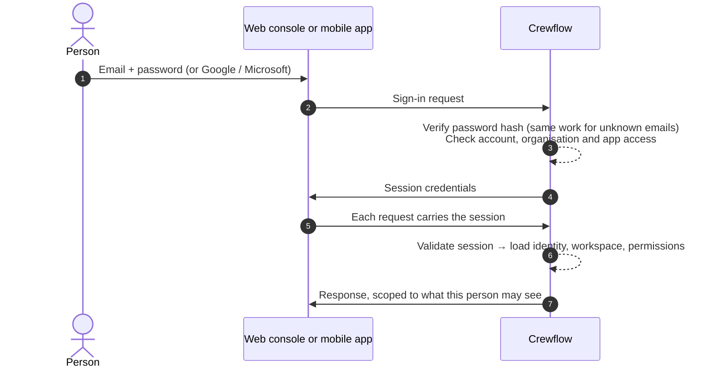

## Signing in

| Protection | Detail |
| --- | --- |
| **Password hashing** | Argon2id, a modern memory-hard algorithm. Passwords are never stored or logged. |
| **Password rules** | 10–128 characters with upper-case, lower-case and a number; common passwords and your email are refused. |
| **Uniform responses** | Wrong email and wrong password get the same message and take the same time, so attackers cannot discover accounts. |
| **Lockout** | 10 failed attempts within 15 minutes pauses sign-in for 15 minutes. Sign-in, reset and similar endpoints are also rate-limited. |
| **App access** | Each account may only use the apps its role allows. Staff and venue managers cannot use the web console. |
| **Google and Microsoft** | Invitation-only: they sign in existing accounts with a matching, verified email, and never create accounts. |

## Sessions

| | Web console | Mobile app |
| --- | --- | --- |
| **How the session is held** | In secure, HttpOnly cookies the browser cannot read with scripts | In the phone's secure storage |
| **Short-lived access** | Access is renewed every 15 minutes | Access is renewed every 15 minutes |
| **Inactivity limit** | 30 minutes | 7 days |
| **Maximum length** | 24 hours | 90 days |

Managers, CEOs and administrators always get the stricter web limits, even in the mobile app.

## Refresh and revocation

Each time access is renewed, the old renewal token is replaced. If an old one is ever presented again — a sign it was copied — Crewflow ends the whole session immediately.

Sessions end when:

- you sign out (on the server, not just in your browser)
- you revoke a device in **Settings → Profile → Active sessions**
- your password is reset or changed (all sessions end)
- your account is suspended or deactivated
- your organisation is suspended

## Cross-site request protection

For cookie-based sessions, Crewflow only accepts changes (create, update, delete) from Crewflow's own trusted web addresses, checked on every request. Other websites cannot make changes using your signed-in browser.

## Step-up confirmation

The most sensitive actions — deleting a user, and platform administration such as granting administrator access or suspending an organisation — require your current password again, even though you are already signed in.

<Note>
  Multi-factor authentication is not yet available.
</Note>
