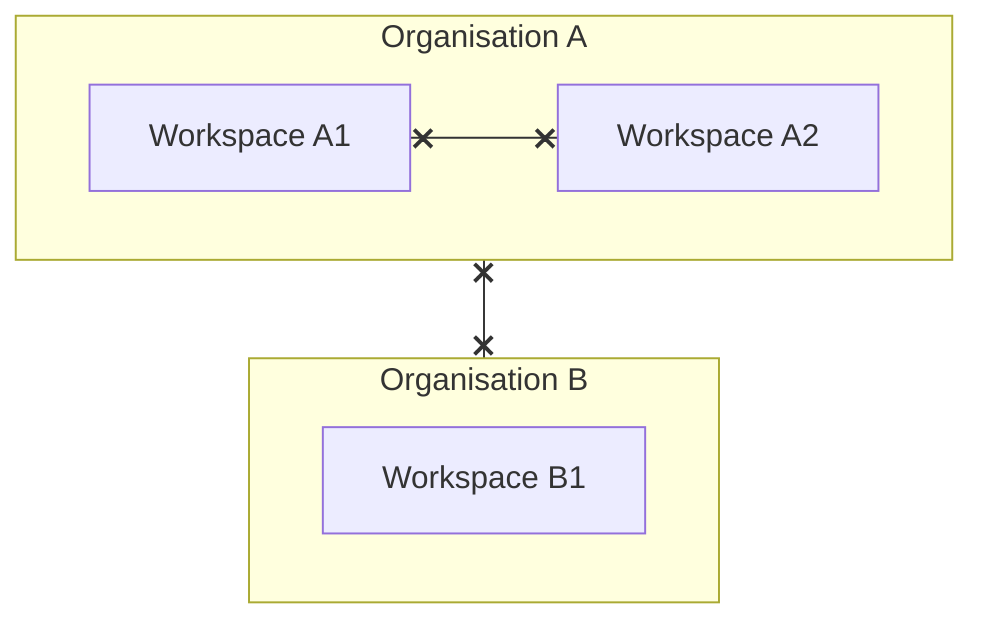

## Two boundaries

1. **Organisation isolation.** Every record carries its organisation. Nothing — accounts, records, files, notifications — crosses between organisations.
2. **Workspace isolation.** Inside an organisation, each manager's workspace holds its own staff, venues, shifts, offers and attendance. Managers in the same organisation cannot see each other's workspace data.

## Enforced by the database

Crewflow does not rely on the apps to filter data. Each request sets the verified organisation and workspace on its database connection, and the database's **row-level security** rules only return and accept rows that match. If no workspace has been verified, the database returns **no rows at all**.

The database account Crewflow uses at runtime cannot bypass these rules, and Crewflow checks this when it starts.

## Tighter rules within a workspace

- **Venue managers** only see their assigned venues and the staff and attendance linked to them.
- **Staff** only see their own offers, shifts, attendance and profile.

## Your workspace is never chosen by the app

Crewflow resolves your workspace from your account when you sign in. The apps cannot ask to see a different workspace, and there is no workspace switcher to misuse.

## Background work

Background jobs that find work across many workspaces reload every record under that record's own organisation and workspace before acting on it. A queued job cannot grant access by itself.
