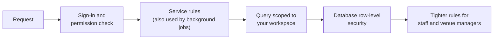

## Role-based access

Each account has a role — CEO, manager, venue manager or staff — and each role grants a set of permissions such as *view staff*, *send offers* or *finalise timesheets*. The full matrix is in [Understanding user roles](/getting-started/user-roles).

## Server-derived identity

Crewflow never trusts the app to say who someone is or what they may do:

- Your identity, organisation and workspace come from your verified session.
- Your permissions are worked out on the server for each request — they are not stored in the browser or phone where they could be changed.
- A request that tries to name an organisation, or set a status directly, is rejected as invalid rather than ignored.

## Checked in every layer

Hiding a button in the app is a convenience, never the protection. Background jobs go through the same service rules as people do.

## Denials

| Situation | Response |
| --- | --- |
| The record is outside your organisation, workspace, venues or own records | **Not found** — its existence is not confirmed. |
| You can see the record but your role cannot perform the action | **Refused** (forbidden). |
| The action is not valid in the record's current state — for example confirming an offer the staff member has not accepted | **Conflict** — nothing changes. |

## Platform administrators

Platform administrator access is separate from organisation roles. It grants access to the Admin Panel, not to any organisation's staffing data by itself.
