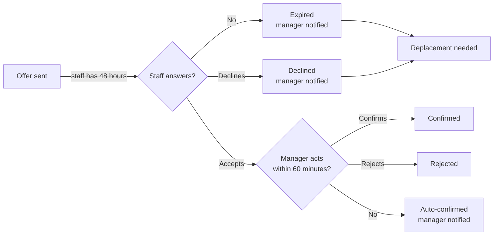

Crewflow uses two timers so a shift never waits forever on someone's answer.

## Staff response deadline

| Rule | Detail |
| --- | --- |
| **Default deadline** | 48 hours after the offer is sent. |
| **After the deadline** | The offer becomes **expired**. The staff member can no longer accept it. |
| **Checked** | Every minute. An accept that arrives after the deadline is refused even if the check has not run yet. |
| **You are told** | "An offer I sent expires unanswered", and Crewflow flags that a replacement is needed. |

## Manager confirmation window

| Rule | Detail |
| --- | --- |
| **Applies to** | Shifts you created. Shifts from approved venue requests are confirmed as soon as staff accept. |
| **Default window** | 60 minutes after the staff member accepts. |
| **If you do nothing** | Crewflow confirms the acceptance automatically and sends you "Shift auto-confirmed". |
| **Never applies** | To cancelled shifts. |

<Note>
  The 48-hour and 60-minute values are the defaults. Your Crewflow deployment may be configured differently.
</Note>

## After a shift ends

One hour after a shift ends Crewflow marks it complete for follow-up, and two hours after it ends the attendance window closes. These markers are for record-keeping. They never change anyone's pay.
