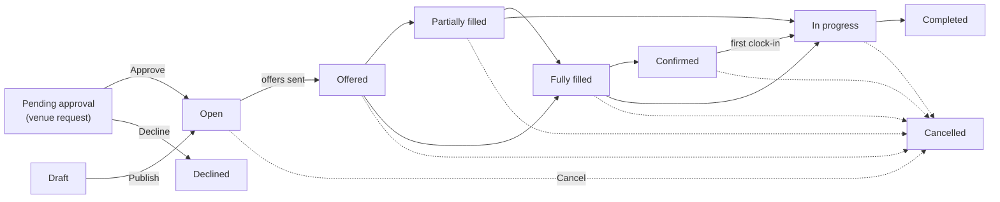
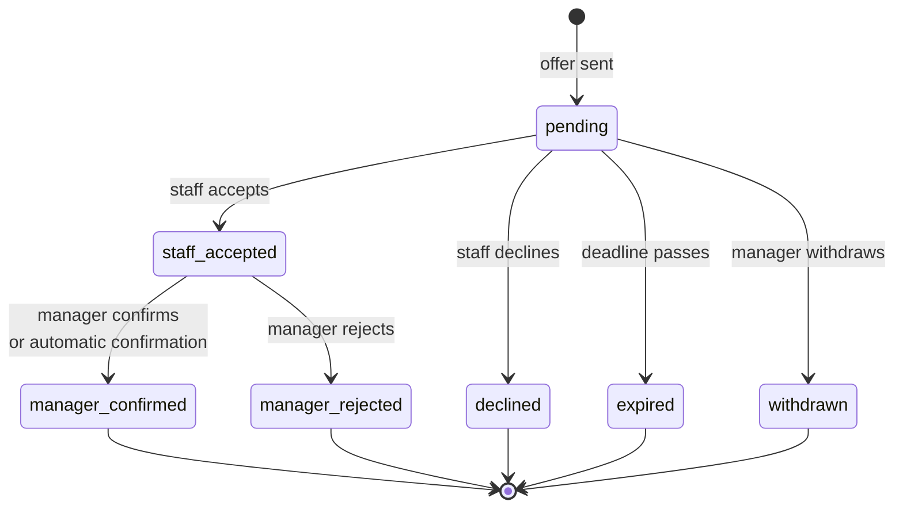

Shifts and offers are the heart of Crewflow. A **shift** describes the work; **offers** invite people to do it; a **confirmed placement** is a person who will turn up.

## Four words to know

| Term | What it is | Example |
| --- | --- | --- |
| **Shift** | One block of work at a venue, for a role, at a time. | Bartender at Riverside House, Friday 17:00–23:00, 30-minute break. |
| **Offer** | An invitation to one person for one shift. | Priya is offered the Friday bartender shift at £15.00/hr. |
| **Assignment** | Crewflow's record of a person's place on the shift, created when the offer is sent. It holds the agreed pay rate. | Priya's place on the shift, rate locked at £15.00/hr. |
| **Confirmed placement** | An assignment the person accepted and a manager confirmed. Only confirmed people can clock in. | Priya accepted and Jordan confirmed her. |

## The lifecycle of a shift

A shift moves forward as people accept and are confirmed, and goes back to **Offered** or **Partially filled** if someone drops out and more offers are sent. Any shift that has not finished can be cancelled.

## The lifecycle of an offer

An offer can only be confirmed after the staff member has accepted it. Once an offer is finished — confirmed, rejected, declined, expired or withdrawn — it cannot change again. To ask the same person again, send a new offer.

## In this section

<Columns cols={2}>
  <Card title="Creating shifts" icon="calendar-plus" href="/shifts/creating-shifts">Create a shift and send offers in one step.</Card>
  <Card title="Sending offers" icon="paper-plane" href="/shifts/sending-offers">Send more offers and find replacements.</Card>
  <Card title="Staff responses" icon="hand-pointer" href="/shifts/staff-responses">What staff see and how they answer.</Card>
  <Card title="Confirming offers" icon="user-check" href="/shifts/confirming-offers">Confirm or reject the people who accepted.</Card>
  <Card title="Venue requests" icon="inbox" href="/shifts/venue-requests">Approve staffing requests from venue managers.</Card>
  <Card title="Live staffing" icon="table-columns" href="/shifts/live-staffing-pipeline">Follow a shift from offer to clock-out.</Card>
  <Card title="Cancelling shifts" icon="ban" href="/shifts/cancelling-shifts">Cancel and what happens to offers.</Card>
  <Card title="Offer expiry" icon="hourglass-half" href="/shifts/offer-expiry">Deadlines and automatic confirmation.</Card>
</Columns>
