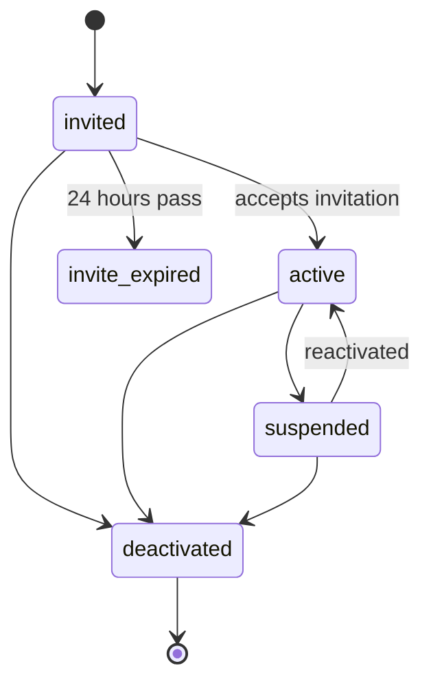

Every account has a state. The **Status** column shows it in plain words.

## Before the person activates

| Status shown | Meaning | What you can do |
| --- | --- | --- |
| **Pending — invite not sent** | The account exists but no invitation has gone out. | Resend invitation. |
| **Invitation queued** / **Invitation sending…** | The email is on its way. | Wait a moment. |
| **Pending invite (1/3)**, **(2/3)** | Invitation sent and not yet accepted. | Resend if needed. |
| **Final invite (3/3)** | The last allowed send. | Contact the person another way to make sure they accept. |
| **Delivery failed** | The email could not be delivered. | Check the email address, then resend. |
| **Invite expired** | 24 hours passed without acceptance. | Re-invite (if sends remain). |
| **Expired — cleanup in 7d** | The final invitation expired. The pending account will be removed. | Create the person again later if needed. |
| **Invitation cancelled** | You cancelled the invitation. | — |

## After activation

| Status | Meaning |
| --- | --- |
| **Active** (managers) or the employment status (staff) | The person can sign in. |
| **Suspended** | Temporarily blocked. They are signed out and cannot sign in. |
| **Deactivated** | Permanently closed. Records are kept. |

## How states change

Crewflow rejects any change that is not on this diagram. For example, an expired invitation cannot become active; the person must be re-invited.
