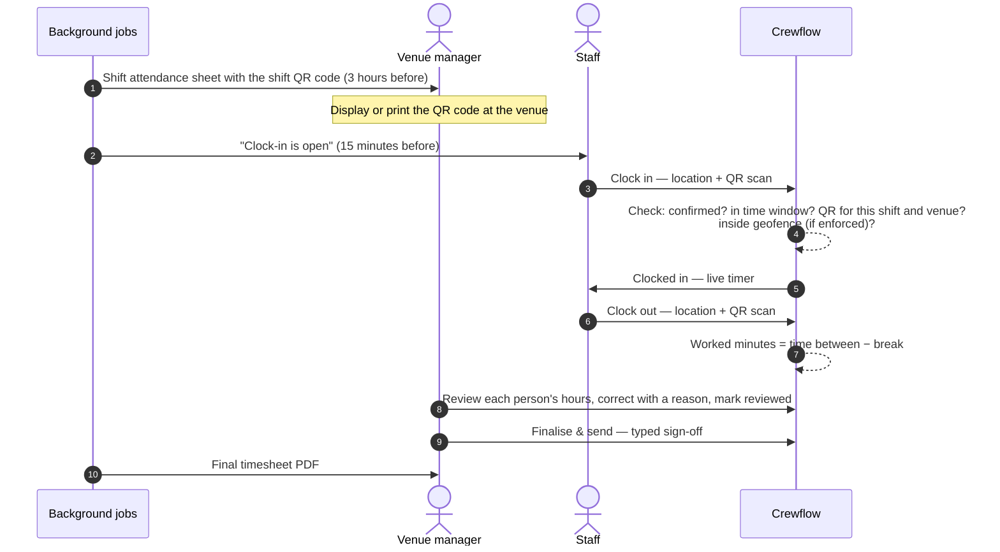

Attendance in Crewflow is recorded on site, by the staff member's phone, and checked by Crewflow — not typed in afterwards. After the shift, the venue manager reviews each person's hours in the Crewflow app and signs off the timesheet.

## The rules

| Rule | Detail |
| --- | --- |
| **Who can clock in** | Only staff with a **confirmed** place on the shift. |
| **When** | From **15 minutes before** the start until **2 hours after** the end. |
| **How** | Scan the shift's QR code. One code per shift, used for clocking in and out. |
| **Where** | Anywhere — unless the venue enforces its geofence, in which case inside the radius. |
| **How many at once** | One active clock-in per person. |

## What counts as worked time

Worked minutes are the minutes between clock-in and clock-out, minus the break. The break is the one recorded for that person's attendance, otherwise their individual assignment break, otherwise the shift's break. See [Pay calculation](/payroll/pay-calculation).

The live timer in the app always counts from the server's clock-in time, so changing the phone's clock cannot add hours.

## Monitored automatically

- **Late:** not clocked in 10 minutes after the start — managers are notified.
- **No-show:** not clocked in 30 minutes after the start — the place is marked no-show.
- **Missing clock-out:** still clocked in 30 minutes after the end — flagged for review.

See [Late arrivals and missing clock-outs](/attendance/late-and-missing-clock-outs).

## Where each step happens

| Step | Where |
| --- | --- |
| Clock in and out | Staff, in the Crewflow app. |
| Follow attendance live | Web console: the shift's [live staffing board](/shifts/live-staffing-pipeline). |
| Correct times, review each person, finalise the timesheet | Venue managers, in the Crewflow app. See [Timesheet review](/attendance/timesheet-review). |
| View or download timesheet PDFs | Web console: **Timesheet report** on the staffing board. Venue managers: **Time-sheet** in the app. |
| Hours and calculated pay | Web console: [Payroll](/payroll/reviewing-payroll). |

## In this section

<Columns cols={2}>
  <Card title="Clock in and out" icon="qrcode" href="/attendance/clock-in-and-out" />
  <Card title="Late and missing clock-outs" icon="triangle-exclamation" href="/attendance/late-and-missing-clock-outs" />
  <Card title="Timesheet review" icon="file-pen" href="/attendance/timesheet-review" />
  <Card title="Timesheet documents" icon="file-pdf" href="/attendance/timesheet-documents" />
</Columns>
