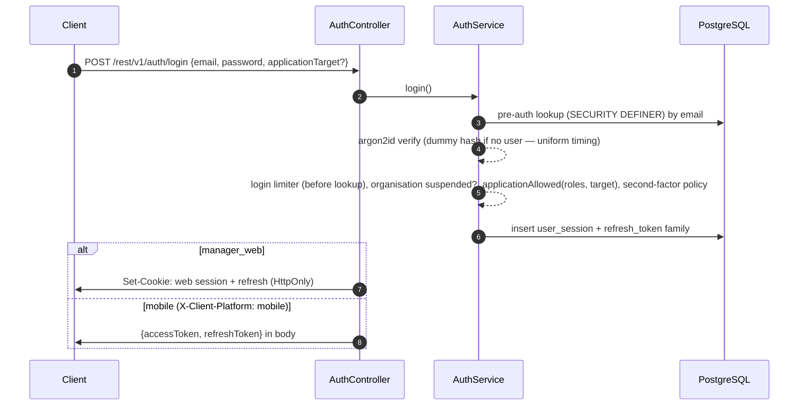

## Login

## Application targets

`manager_web`, `venue_manager_app` and `staff_app` (`engine/core-modules/auth/application-access.ts`).

| Role | Allowed targets |
| --- | --- |
| `staff` | `staff_app` |
| `venue_manager` | `venue_manager_app` |
| `manager`, `ceo` and administrator roles | all |
| Platform administrator | all |

A mobile login with no explicit target gets `venue_manager_app` for venue managers, otherwise `staff_app`. The `x-application-target` header must match the session's target, and `@ManagerApplication()` handlers require `manager_web`.

## Sessions and lifetimes

| | Value | Source |
| --- | --- | --- |
| Access token | 15 minutes | `session-policy.ts` |
| Refresh token | 30 days per token, clamped to the session's absolute expiry | `refresh-token.service.ts` |
| `manager_web` sessions, and manager-tier roles on every target | 180 days absolute, 30 days idle (owner decision 2026-10-14) | `session-policy.ts` |
| Mobile worker sessions (`staff_app`, `venue_manager_app`) | 90 days absolute, 7 days idle | `session-policy.ts` |
| Platform administrators | 24 h absolute, 30 min idle, on every target | `session-policy.ts` |
| Dead refresh-token rows | Deleted 181 days after expiry or revocation | `token/retention-policy.ts`, `core.worker_cleanup_auth_tokens` |

The idle limit is recomputed from the caller's current roles on every request. The absolute deadline is fixed when the session is created.

Each `core.user_session` row records the organisation, user, workspace, application target, device, user agent, IP, last-seen, expiries and revocation.

## Refresh rotation and reuse detection

Every refresh replaces the token. Presenting a rotated or revoked token raises `RefreshTokenReuseError` and revokes the whole family. Refresh is also refused when the session row is revoked or idle-expired. Revocation helpers:

- `revokeFamily`: logout, per-device revoke, and a completed login handoff.
- `revokeAllForUser`: password change or reset, and suspension.
- `revokeAllForOrganisation`: organisation suspension.

Each one also bumps the security version, so cached authority is thrown away.

Three more events revoke sessions:

- Turning password sign-in off for an organisation revokes password sessions only (`password-session-revocation.service.ts`).
- Turning MFA on ends every other session of the account.
- An admin MFA reset ends all of the target's sessions.

## The guard chain

`JwtAuthGuard` authenticates the request and then runs `OrganisationSuspendedGuard`, `MustResetPasswordGuard` and `MaintenanceModeGuard`. Route guards follow: `PermissionGuard(flag)` resolves **effective permissions** (role grants ∪ per-user grants − per-user revocations) from the per-request security snapshot — never from the token. `RequireWorkspaceGuard` requires a resolved workspace and returns 404 when there is none.

## CSRF

For cookie-authenticated requests, `JwtAuthGuard` checks the `Origin` header against the trusted-origin allowlist on every unsafe method (POST, PUT, PATCH, DELETE). `/auth/refresh` has its own Origin check when the token comes from the cookie. The web session credential is never accepted as a bearer token, and the optional `x-crewflow-expected-session-id` header fences a tab to the session it started with.

## Passwords

- Argon2id with `memoryCost: 19456`, `timeCost: 2`, `parallelism: 1`.
- 10–128 characters with upper-case, lower-case and a digit; checked against a common-password list and the email.
- Sign-in limiter (`login-attempt-limiter.service.ts`, wave 1 D-A1). It replaced the old per-email lockout of 10 failures in 15 minutes, and it runs before any account lookup.
  - Per (email, IP): a burst of `AUTH_LOGIN_EMAIL_IP_BURST`=5 over `AUTH_LOGIN_EMAIL_IP_WINDOW_SECONDS`=900, and `AUTH_LOGIN_EMAIL_IP_DAILY_LIMIT`=30 per 24 h.
  - Account-wide: `AUTH_LOGIN_ACCOUNT_BURST`=50 per 900 s, only for addresses that have not signed in within `AUTH_LOGIN_KNOWN_IP_TTL_DAYS`=30.
  - A refused attempt gets 429 `LOGIN_RATE_LIMITED` with Retry-After. If Redis fails, the answer is 503 `RATE_LIMIT_UNAVAILABLE`.
- Route throttle: 5 per minute per IP on login, refresh, forgot password, reset password and activation.
- Forgot-password responses are padded to a constant time and identical whether or not the account exists. Reset tokens last 1 hour; admin-initiated and initial-setup tokens last 48 hours. Completing a reset revokes every session.

## Second factor (TOTP)

`LoginSecondFactorPolicyService` runs in `AuthService.completeLogin` for every provider:

- An enrolled user is always challenged on the web.
- A user whose role is covered by an enforcement flag must enrol. The flags are `AUTH_MFA_ENFORCE_PLATFORM_ADMIN`, `_ORGANISATION_OWNER`, `_INITIAL_MANAGER` and `_OTHER_WEB_USERS`, and all default to false.
- Mobile targets are exempt while `AUTH_MFA_MOBILE_POLICY=exempt`, the default.

A challenged sign-in answers `409 SECOND_FACTOR_REQUIRED {requirement, challengeToken, challengeExpiresAt}` and creates no session. The client finishes at `POST /auth/mfa/challenge/verify` (or `/enrolment` followed by `/enrolment/confirm`).

Challenges live in Redis. Each is single use, lasts 300 s and allows 5 attempts, and each user gets 10 attempts per 900 s in total. Step-up (`/auth/step-up`, password plus code) grants 300 s per session.

## Cookies

`auth/constants/auth-cookie-policy.ts` decides every cookie.

- **Default (legacy names):** `crewflow_session` (Path=/rest/v1) and `rab_rt` (Path=/rest/v1/auth). Both are HttpOnly and Secure in production, with SameSite None in production and Lax in development.
- **`AUTH_COOKIE_HOST_PREFIX_ENABLED=true` (default false):** the same names gain the `__Host-` prefix (Secure, Path=/, no Domain).

A request carrying duplicate session cookies is refused.

## Workspace hosts and the login handoff

With `WORKSPACE_HOST_ROUTING_ENABLED=true`, the request host is resolved to a workspace. The host comes from `Host`, or from `X-Forwarded-Host` only when the peer is in `TRUSTED_PROXY_CIDRS`. It must agree with the session's workspace, otherwise the request gets 404 `WORKSPACE_HOST_MISMATCH`. The host never grants authority.

With `AUTH_LOGIN_HANDOFF_ENABLED=true`, a web sign-in on a non-canonical host returns a single-use handoff bound to the workspace host (30 s) instead of a session. Exchanging it on the workspace host issues a host-only session and revokes the source session.

## OIDC (Google and Microsoft)

State, PKCE and nonce are used; OAuth state lives 10 minutes. Google requires `email_verified`. OIDC links only to existing users — it never creates accounts. Providers are enabled by environment flags and per organisation.
