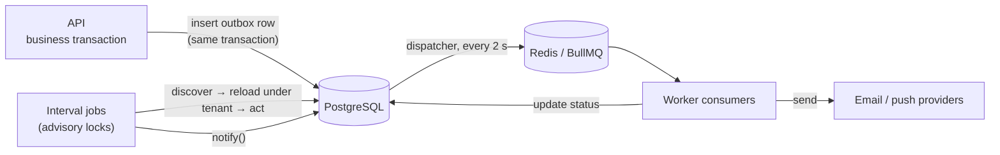

The Worker (`packages/rab-worker/src/main.ts`) is a NestJS application context with no HTTP listener. It reuses `@rab/server` services.

## Queues

| Queue | Job | Concurrency | Retries |
| --- | --- | --- | --- |
| `rab-email` | `send-email` | 5 | 5 attempts, exponential backoff from 5 s |
| `rab-push` | `send-push` | 10 | — |

Email job IDs are `email-outbox.{id}.attempt.N`, so a re-dispatched outbox row cannot be queued twice for the same attempt.

## Interval jobs

| Job | Interval | Purpose |
| --- | --- | --- |
| Heartbeat | 15 s | Liveness for the Admin Panel health check. |
| Email dispatch / push dispatch | 2 s | Move committed outbox rows onto BullMQ. |
| Realtime outbox publish | 2 s | Publish committed realtime events to Redis Pub/Sub. |
| Offer expiry | 60 s | `pending → expired` past `expires_at`. |
| Manager confirmation deadline | 60 s (`WORKER_MANAGER_CONFIRMATION_TIMEOUT_INTERVAL_SECONDS`) | Withdraw `staff_accepted` offers past their approval deadline (standard: assignment start − 30 min; replacement/standby: assignment end; computed by the database clock). Never confirms. Offer → `manager_rejected` with no rejecting manager; notifies staff, the responsible manager and that venue's venue managers, except for withdrawals processed long after the assignment ended, which are audited but not notified. |
| Shift cancellation follow-up | 60 s | Withdraw, reject and cancel everything attached to a cancelled shift. |
| Replacement staff | 2 min | Create a `replacement_request` with up to five ranked candidates. Never sends offers. |
| Late clock-in | 2 min | Notify after `LATE_CLOCK_IN_GRACE_MINUTES`. |
| Shift monitor | 5 min | 24 h / 2 h / 30 min reminders, clock-in window open, no-show, post-shift milestones. |
| Attendance monitor | 5 min | `clocked_in → missing_clock_out` once `QR_POST_SHIFT_GRACE_MINUTES` (120) after the staff member's own end has passed. |
| Shift report scheduler | 5 min | Roster PDF `REPORT_AVAILABLE_BEFORE_MINUTES` before the start. |
| Final timesheet | 5 min | Render and email the final timesheet after finalisation. |
| Account invite clean-up | 15 min | Expire and remove stale invitations. |
| Token clean-up / storage clean-up | 24 h | Remove old tokens and orphaned files. |

## Idempotency

Every side-effecting job claims a **worker event** before acting, inside the same transaction as the work:

```sql
INSERT INTO core.worker_event (event_key, …) VALUES ($1, …)
ON CONFLICT (event_key) DO NOTHING;   -- 0 rows → another worker already did it
```

`event_key` is unique, so retries and concurrent workers cannot send a reminder twice or expire an offer twice. Timed work such as the confirmation deadline uses leased `core.worker_due_work` pointers, and report generation is serialised with advisory locks. Notifications for a suspended organisation are silenced at the single `NotificationService.notify()` choke point.

## Workspace provisioner

The Worker provisions workspace schemas itself, in-process (`packages/rab-worker/src/queues/rab-maintenance/workspace-provisioning.loops.ts`), on its own dedicated database session that acts as `crewflow` under the one owner login. There is no separate provisioner process any more (the old `workspace-provisioner.main.ts` and the `rab-worker:provision` target were removed in X5.1). It polls every `WORKSPACE_PROVISIONER_INTERVAL_SECONDS`: 5 to 120, default 60 (the deployment files pin 5). Waiting for the provisioning lock is bounded, so a second Worker replica skips a cycle instead of queueing behind the first. A daily, alert-only schema drift check runs in the same loops.

<Note>
  `rab-worker` imports `@rab/server` through a Yarn workspace symlink. Its Nx targets set `NODE_OPTIONS=--preserve-symlinks` so TypeORM's `DataSource` resolves to one module instance. Any new Worker entrypoint needs the same flag.
</Note>
