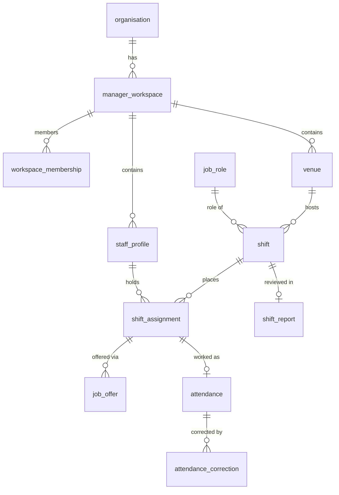

## Schemas

| Schema | Contents |
| --- | --- |
| `core` | Identity, authentication, platform, workspace registry, messaging, audit and storage metadata. Also the 15 workspace business tables while per-workspace schemas are switched off. |
| `workspace_<uuid>` | Per-workspace copies of the 15 business tables, used only when `HWS_RUNTIME_ENABLED=true`. Provisioned by the workspace provisioner. |

## Tables by domain

| Domain | Tables |
| --- | --- |
| Identity | `user`, `role`, `permission`, `role_permission`, `user_role`, `user_permission_override`, `organisation`, `organisation_member`, `user_preference`, `notification_preference`, `user_note` |
| Authentication | `refresh_token`, `user_session`, `password_reset_token`, `account_invite`, `login_history`, `user_auth_identity`, `oauth_transaction_state` |
| Platform | `platform_admin`, `platform_config`, `admin_inspect_session` |
| Workspace | `manager_workspace`, `workspace_membership`, `workspace_schema_registry`, `hws_backfill_checkpoint` |
| Workspace business (15) | `staff_profile`, `user_note`, `venue`, `venue_manager_staff`, `job_role`, `venue_role_rate`, `manager_venue`, `shift`, `shift_request_staff`, `shift_assignment`, `job_offer`, `replacement_request`, `attendance`, `attendance_correction`, `shift_report` |
| Messaging | `notification`, `email_outbox`, `push_device`, `push_delivery`, `realtime_event`, `worker_event`, `worker_due_work` |
| Other | `stored_file`, `audit_log` |

There are **no payroll tables**. Pay is derived from `attendance` and the rate snapshot on `shift_assignment`.



## Roles and Row-Level Security

- The runtime connects as a role that **does not own the tables** and has **no `BYPASSRLS`**. The API checks this at boot.
- Tables use `ENABLE` and `FORCE ROW LEVEL SECURITY` with `USING` and `WITH CHECK` predicates, created in the **same migration** as the table.
- A small, documented set of tables needed by pre-authentication lookups (for example `user`, `refresh_token`, `account_invite`, `login_handoff`) skip only `FORCE`. Their runtime access still goes through RLS.
  - As of 2026-10-23 there are 15: the 13 in `NOT_FORCED_ALLOWLIST`, plus `organisation` and `platform_admin`.
  - All 15 are owned by the NOLOGIN role `rab_secure_owner`. The runtime role `crewflow_app` owns nothing, so RLS binds it on every one of them.
  - The authoritative list is `tools/check-rls-coverage.ts`.
- Narrow `SECURITY DEFINER` functions handle lookups that must happen before a tenant is known.
- `audit_log` has `UPDATE`, `DELETE` and `TRUNCATE` revoked.

## Migrations

```bash
npx nx run rab-server:migration:run        # apply pending migrations (never resets data)
npx nx run rab-server:migration:generate   # generate from entity changes, then review by hand
```

Migrations live in `packages/rab-server/src/database/typeorm/core/migrations/` (about 160 files). Rules:

- `synchronize: false`, always.
- Never edit a migration after it is merged — add a new one.
- Every new tenant table gets `organisation_id` and its RLS policy in the same migration.
- Run migrations only with the migration identity, as that process's own `PG_DATABASE_URL` (the one-off `rab-migrate` step reads it from `packages/rab-docker/.env.migrate`); the runtime role cannot run DDL, and the API and the Worker never migrate.
- `yarn check-rls` fails CI if a tenant table lacks RLS.

In Docker (O3, owner decisions C1-C5, like Twenty), the API migrates on start: `api-prestart.sh` runs the migration child under the migration lock (approval mode `none`, no token), registers the job schedulers, then starts `main.js`. A failed migration never serves (exit 66; the next start retries it). Only a failed upgrade command, with every migration applied, serves, and `/healthz` then says `upgradeFailed: true` and nothing more; the step, versions and attempt are on the platform-admin health report. `CREWFLOW_UPGRADE_FAILURE` was removed and is refused. The Worker never migrates (`DISABLE_DB_MIGRATIONS=true`). There is no `rab-migrate` release step; take the backup before every upgrade (`packages/rab-docker/docs/release/OWNER-LOGIN-DEPLOYMENT.md` section 3).

<Warning>
**Back up the database before deploying 0.6.0.** Going back to an image older than 0.6.0 (for example R256) is only possible by restoring that backup. 0.6.0 adds the upgrade logbook (`core.upgrade_migration`, its row-level security policies and grants). An older image's start-up security check compares the database with what that older code expects, sees the logbook as unexpected security objects, and refuses to start. Putting the previous image digest back is therefore not a rollback path across 0.6.0.
</Warning>

### Upgrade logbook

From 0.6.0 every start records each upgrade step in `core.upgrade_migration`, like Twenty's upgrade log: `<version>_TypeOrmMigrations` for the migrations of a version, then one row per upgrade command, each `completed` or `failed` with its attempt number. A database older than the supported floor (R254 / R256) is refused with exit 65 and nothing is applied. `node packages/rab-server/dist/command upgrade --force` (a one-off `docker compose run --rm --no-deps rab-api ...`) skips only that version refusal, and every row it writes is marked `forced`. The application login adds steps only inside the locked upgrade run, and a new workspace's first row when the workspace is created; it can never change or delete a row.

### Schema-version compatibility

Every process compares the database with its own code at start-up (`src/database/boot-checks/schema-compatibility.ts`):

| Database state | API / Worker | CLI | Provisioner | `rab-migrate` |
|---|---|---|---|---|
| Migrations pending | refuse | refuse | refuse | applies (approved) or exits 3 |
| Ledger has newer migrations only (image rollback) | warn, run | warn, run | refuse | check: warn; apply: refuse |
| Ledger has unknown migrations among the code's own (another branch, wrong database; not in `RETIRED_MIGRATIONS`) | refuse | refuse | refuse | refuse |
| `core.provision_workspace` body unknown | refuse in production, else warn | — | refuse | post-check refuses |
| …known, behind the code | refuse | — | refuse | post-check refuses |
| …known, ahead (rollback) | warn | — | refuse | post-check refuses |
| A READY workspace below the code's minimum module | that workspace's requests get 503 | — | — | post-check refuses any workspace not at the latest module |
| A READY workspace above the code's module | warn once, route | — | refuse | post-check refuses |

A retired migration (removed from `core/migrations/` after databases applied it) must be added to `RETIRED_MIGRATIONS`; a migration that re-creates `core.provision_workspace` must add its `app_version` literal to `PROVISION_FUNCTION_MODULE_VERSIONS`.
