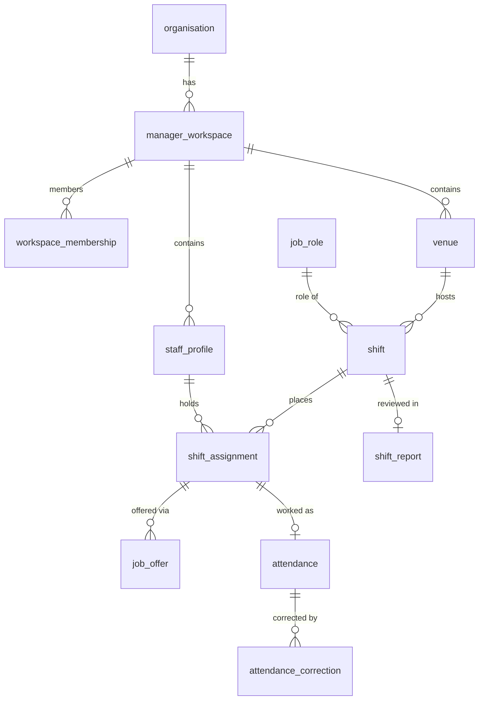

## Schemas

| Schema | Contents |
| --- | --- |
| `core` | Identity, authentication, platform, workspace registry, messaging, audit and storage metadata. Also the 15 workspace business tables while per-workspace schemas are switched off. |
| `workspace_<uuid>` | Per-workspace copies of the 15 business tables, used only when `HWS_RUNTIME_ENABLED=true`. Provisioned by the workspace provisioner. |

## Tables by domain

| Domain | Tables |
| --- | --- |
| Identity | `user`, `role`, `permission`, `role_permission`, `user_role`, `user_permission_override`, `organisation`, `organisation_member`, `user_preference`, `notification_preference`, `user_note` |
| Authentication | `refresh_token`, `user_session`, `password_reset_token`, `account_invite`, `login_history`, `user_auth_identity`, `oauth_transaction_state` |
| Platform | `platform_admin`, `platform_config`, `admin_inspect_session` |
| Workspace | `manager_workspace`, `workspace_membership`, `workspace_schema_registry`, `hws_backfill_checkpoint` |
| Workspace business (15) | `staff_profile`, `user_note`, `venue`, `venue_manager_staff`, `job_role`, `venue_role_rate`, `manager_venue`, `shift`, `shift_request_staff`, `shift_assignment`, `job_offer`, `replacement_request`, `attendance`, `attendance_correction`, `shift_report` |
| Messaging | `notification`, `email_outbox`, `push_device`, `push_delivery`, `realtime_event`, `worker_event`, `worker_due_work` |
| Other | `stored_file`, `audit_log` |

There are **no payroll tables**. Pay is derived from `attendance` and the rate snapshot on `shift_assignment`.



## Roles and Row-Level Security

- The runtime connects as a role that **does not own the tables** and has **no `BYPASSRLS`**. The API checks this at boot.
- Tables use `ENABLE` and `FORCE ROW LEVEL SECURITY` with `USING` and `WITH CHECK` predicates, created in the **same migration** as the table.
- A small, documented set of tables needed by pre-authentication lookups (for example `user`, `refresh_token`, `account_invite`, `login_handoff`) skip only `FORCE`. Their runtime access still goes through RLS.
  - As of 2026-10-23 there are 15: the 13 in `NOT_FORCED_ALLOWLIST`, plus `organisation` and `platform_admin`.
  - All 15 are owned by the NOLOGIN role `rab_secure_owner`. The runtime role `crewflow_app` owns nothing, so RLS binds it on every one of them.
  - The authoritative list is `tools/check-rls-coverage.ts`.
- Narrow `SECURITY DEFINER` functions handle lookups that must happen before a tenant is known.
- `audit_log` has `UPDATE`, `DELETE` and `TRUNCATE` revoked.

## Migrations

```bash
npx nx run rab-server:migration:run        # apply pending migrations (never resets data)
npx nx run rab-server:migration:generate   # generate from entity changes, then review by hand
```

Migrations live in `packages/rab-server/src/database/typeorm/core/migrations/` (about 160 files). Rules:

- `synchronize: false`, always.
- Never edit a migration after it is merged — add a new one.
- Every new tenant table gets `organisation_id` and its RLS policy in the same migration.
- Run migrations only with the migration identity, as that process's own `PG_DATABASE_URL` (the one-off `rab-migrate` step reads it from `packages/rab-docker/.env.migrate`); the runtime role cannot run DDL, and the API and the Worker never migrate.
- `yarn check-rls` fails CI if a tenant table lacks RLS.

In Docker, the one-off `rab-migrate` service (`deploy-prepare.js`) runs first; the API and the Worker start only after it exits 0. It applies pending migrations only when the release is approved (`CREWFLOW_MIGRATION_APPROVED=apply-pending-migrations`), and otherwise refuses to promote a release whose migrations are pending. The API image's command (`api-prestart.sh`) never migrates. See the database runbook (`docs/runbooks/database.md`).

### Schema-version compatibility

Every process compares the database with its own code at start-up (`src/database/boot-checks/schema-compatibility.ts`):

| Database state | API / Worker | CLI | Provisioner | `rab-migrate` |
|---|---|---|---|---|
| Migrations pending | refuse | refuse | refuse | applies (approved) or exits 3 |
| Ledger has newer migrations only (image rollback) | warn, run | warn, run | refuse | check: warn; apply: refuse |
| Ledger has unknown migrations among the code's own (another branch, wrong database; not in `RETIRED_MIGRATIONS`) | refuse | refuse | refuse | refuse |
| `core.provision_workspace` body unknown | refuse in production, else warn | — | refuse | post-check refuses |
| …known, behind the code | refuse | — | refuse | post-check refuses |
| …known, ahead (rollback) | warn | — | refuse | post-check refuses |
| A READY workspace below the code's minimum module | that workspace's requests get 503 | — | — | post-check refuses any workspace not at the latest module |
| A READY workspace above the code's module | warn once, route | — | refuse | post-check refuses |

A retired migration (removed from `core/migrations/` after databases applied it) must be added to `RETIRED_MIGRATIONS`; a migration that re-creates `core.provision_workspace` must add its `app_version` literal to `PROVISION_FUNCTION_MODULE_VERSIONS`.
