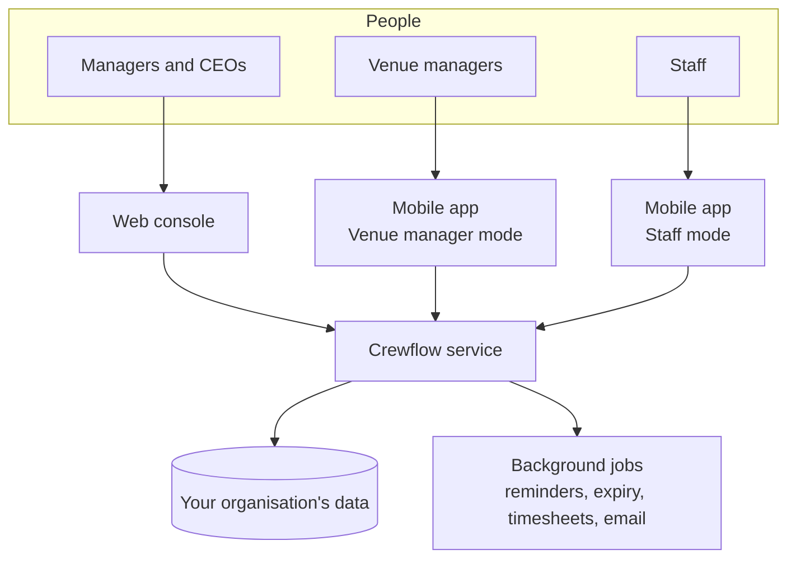

Crewflow is one system with three front doors. Managers use the web console, staff and venue managers use the mobile app, and all three talk to the same Crewflow service, which checks every request against the user's role and workspace.

## The building blocks

<AccordionGroup>
  <Accordion title="Organisation" icon="building-columns" defaultOpen>
    Your company. Every account, workspace and record belongs to exactly one organisation, and organisations never see each other's data.
  </Accordion>
  <Accordion title="Workspace" icon="building">
    A manager's private operating area inside the organisation. Staff, venues, shifts and offers are created in a workspace. See [Organisations and workspaces](/getting-started/organisations-and-workspaces).
  </Accordion>
  <Accordion title="Venue" icon="location-dot">
    A place where work happens — a hotel, restaurant, event space or warehouse. A venue holds the address, the optional location check, default break settings and role pay rates.
  </Accordion>
  <Accordion title="Job role" icon="id-card">
    The kind of work, such as Bartender or Event staff, with a default hourly rate.
  </Accordion>
  <Accordion title="Shift" icon="calendar-day">
    A block of work at a venue for a role, on a date, with a start time, end time and break.
  </Accordion>
  <Accordion title="Offer" icon="paper-plane">
    An invitation to one staff member to work one shift. Offers expire if they are not answered in time.
  </Accordion>
  <Accordion title="Assignment and confirmed placement" icon="user-check">
    When an offer is sent, Crewflow records an assignment for that person and locks in the pay rate. Once the staff member accepts and a manager confirms, the assignment is confirmed — the person is placed on the shift.
  </Accordion>
  <Accordion title="Attendance" icon="clock">
    The clock-in and clock-out record for one person on one shift, including worked minutes and calculated earnings. After the shift, the venue manager reviews each person's attendance before finalising the timesheet.
  </Accordion>
  <Accordion title="Venue manager team" icon="people-group">
    The staff a venue manager can see and choose when requesting cover. A manager assigns this team from the venue manager's record in the web console.
  </Accordion>
</AccordionGroup>

## What happens automatically

Crewflow runs background jobs so nothing depends on someone remembering to check:

- **Offers expire** when nobody answers before the deadline (48 hours by default).
- **Accepted offers are confirmed automatically** if no manager confirms or rejects them within the confirmation window (60 minutes by default). The responsible manager is told.
- **Reminders** go to staff 24 hours, 2 hours and 30 minutes before a shift, and when clock-in opens.
- **Late arrivals and missing clock-outs** are flagged and the right people are notified.
- **Timesheet PDFs** are produced before the shift (the shift attendance sheet with its QR code) and after the timesheet is finalised.

Details are in [Notifications and automation](/notifications/automation).

## Related articles

<Columns cols={2}>
  <Card title="Recruitment workflow overview" icon="route" href="/getting-started/workflow-overview" />
  <Card title="Key features" icon="star" href="/getting-started/key-features" />
</Columns>
