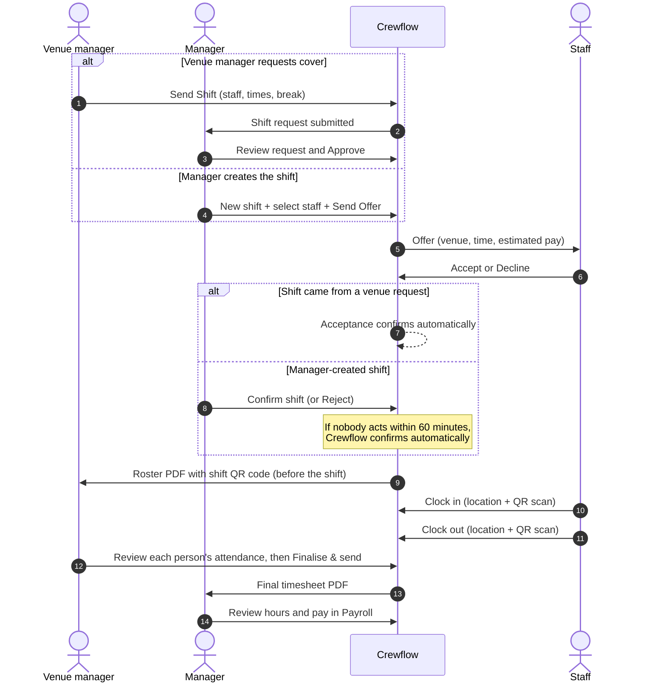

This page follows one shift from start to finish. Each step links to the detailed guide.

## Step by step

<Steps>
  <Step title="Plan the shift" icon="calendar-plus">
    A manager creates the shift in **Shifts → New shift**, choosing the venue, role, date, times and break, then the staff to invite. A venue manager can instead submit a request from the mobile app's **Send Shift** screen, choosing from the team their manager has assigned to them.
    [Creating shifts](/shifts/creating-shifts) · [Venue requests](/shifts/venue-requests)
  </Step>
  <Step title="Send offers" icon="paper-plane">
    Crewflow sends one offer to each selected person and locks in the pay rate for each. Offers stay open for 48 hours unless answered.
    [Sending offers](/shifts/sending-offers)
  </Step>
  <Step title="Staff respond" icon="hand-pointer">
    Staff open the offer in the mobile app and tap **Accept** or **Decline**. After accepting, they see "Waiting for manager confirmation".
    [Staff responses](/shifts/staff-responses)
  </Step>
  <Step title="Confirm the team" icon="user-check">
    The manager confirms or rejects each acceptance on the **Offers** page, in the **Awaiting Confirmation** view, one at a time with **Confirm shift** or together with **Confirm All Accepted**. Acceptances on shifts requested by a venue manager are confirmed automatically, because the manager already approved the request.
    [Confirming offers](/shifts/confirming-offers)
  </Step>
  <Step title="Work the shift" icon="qrcode">
    From 15 minutes before the start, staff clock in by allowing location access and scanning the shift QR code. They clock out the same way.
    [Clock in and out](/attendance/clock-in-and-out)
  </Step>
  <Step title="Finalise the timesheet" icon="file-signature">
    In the mobile app, the venue manager checks each person's times, corrects anything wrong with a reason, and marks each person's attendance as reviewed. **Finalise & send** becomes available once everyone has clocked out and every person has been reviewed. Managers follow progress on the shift's board in **Venue Offers**.
    [Timesheet review](/attendance/timesheet-review)
  </Step>
  <Step title="Review pay" icon="sterling-sign">
    Managers see worked hours and calculated pay for every attendance record in **Payroll**.
    [Reviewing payroll](/payroll/reviewing-payroll)
  </Step>
</Steps>

## Shift, assignment, offer and placement

These words are related but not the same:

| Term | Meaning |
| --- | --- |
| **Shift** | The work to be done: venue, role, date, times, break, number of people. |
| **Offer** | One invitation to one person for one shift. It can be pending, accepted, confirmed, declined, rejected, withdrawn or expired. |
| **Assignment** | Crewflow's record of a person's place on a shift. It is created when the offer is sent and holds the pay rate that was agreed. |
| **Confirmed placement** | An assignment that the staff member accepted and a manager (or the automatic rule) confirmed. Only confirmed people can clock in. |
