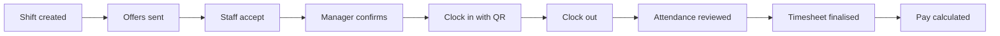

import { VideoTutorial } from '/snippets/media.mdx';
import DemoDataNote from '/snippets/demo-data-note.mdx';

Crewflow is the workforce operations platform from {{company}}. Managers plan shifts and send offers on the web. Staff accept work, clock in and see their history in the mobile app. Venue managers request cover and sign off timesheets for their own venues.

## Find your way

<Columns cols={3}>
  <Card title="Get started" icon="rocket" href="/getting-started/what-is-crewflow">
    What Crewflow is, how the pieces fit together, and which role you have.
  </Card>
  <Card title="Managers" icon="briefcase" href="/getting-started/quickstart-manager">
    Set up your workspace, add staff and venues, and start scheduling.
  </Card>
  <Card title="Staff mobile app" icon="mobile-screen" href="/mobile/overview">
    Accept offers, clock in and out, and review the work you have done.
  </Card>
  <Card title="Shifts and offers" icon="calendar-check" href="/shifts/overview">
    From a new shift to a confirmed team, step by step.
  </Card>
  <Card title="Attendance and payroll" icon="clock" href="/attendance/overview">
    QR and location check-in, timesheets, and calculated pay.
  </Card>
  <Card title="Developer documentation" icon="code" href="/developers/introduction">
    Architecture, local setup, the API and background jobs.
  </Card>
</Columns>

## See how Crewflow works

Follow a staffing request from planning and confirmation to attendance, reviewed hours and the final timesheet.

<VideoTutorial src="/videos/getting-started/crewflow-introduction.mp4" poster="/videos/posters/crewflow-introduction.webp" captions="/videos/captions/crewflow-introduction.en.vtt" title="From staffing request to final timesheet" duration="4 min 48 s" narrated>
  Fictional demonstration data. The phone's QR scan is simulated in this demo.
</VideoTutorial>

<Accordion title="Chapters" icon="list">
| Time | Chapter |
| --- | --- |
| 0:00 | Why Crewflow |
| 0:19 | Who uses it |
| 0:40 | Build the team |
| 1:06 | Request and approve |
| 1:41 | Offers and confirmation |
| 2:12 | Shift day |
| 2:42 | Review the hours |
| 3:22 | Final timesheet |
| 3:50 | Manage the operation |
| 4:13 | Behind the scenes |
| 4:30 | Get started |
</Accordion>

<Accordion title="Video transcript" icon="closed-captioning">
  **Why Crewflow.** A venue needs a team for Friday. A manager needs to know who's booked. And staff need to know where to be, and what happens next. Crewflow connects that whole journey, from the first request to the final timesheet.

  **Who uses it.** Managers run their agency from the web console. Each manager has a private workspace, with their own staff, venues and shifts. Venue managers use the Crewflow app to request staff. Staff use the same app to see their offers, clock in, and check their hours.

  **Build the team.** It starts with the team. In the web console, the manager keeps a record for every staff member and every venue. Each venue manager is linked to a venue, and the manager decides which staff each one can work with. Here, Riley Chen is the venue manager at Riverside House. In the app, Riley sees that assigned team, and no one else.

  **Request and approve.** On Tuesday, Riley needs four waiting staff for a wedding reception on Friday. Riley chooses the venue, the role, the time and the break, then picks four people from the team. If someone isn't normally available that day, Crewflow warns Riley before anything is sent. The request goes to the manager for approval. Nothing reaches the staff yet. In Venue Offers, the manager checks the request, adds or removes people if needed, and approves it.

  **Offers and confirmation.** Approval sends each person their own offer, with the venue, the time, and their estimated pay. Priya opens hers and accepts. Because this shift came from an approved request, she's booked straight away. It's different when the manager creates a shift directly. Then, accepting holds the place until the manager confirms it. Either way, the manager can follow every person on the staffing board in Venue Offers.

  **Shift day.** On Friday, Priya's confirmed shift is waiting in her app. Clock-in opens shortly before it starts. At the venue, she scans the shift's QR code, and Crewflow's server checks it. Some venues also require her to be on site. Her shift is now live, timed by Crewflow's own clock, not her phone's. When the shift ends, she scans the same code again to clock out.

  **Review the hours.** Afterwards, Riley opens the shift report. Three people clocked in and out. Isla clocked in, but never clocked out, so Crewflow flags the missing clock-out instead of guessing her hours. Riley enters the right time, gives a reason, and saves the correction. Saving a correction doesn't approve it. Riley still marks each person's hours as reviewed, one by one. Rating each person's work is a separate, optional step. Finalise & send only unlocks once everyone is clocked out and reviewed.

  **Final timesheet.** Riley confirms the break details, signs off by typing a full name, and sends. That locks the hours. Crewflow then creates the final timesheet as a PDF, queues it for delivery, and shows when it's been sent. In the app, the finished shift moves to History. In the web console, the manager can open both the original and the signed timesheet.

  **Manage the operation.** Back in the web console, the hours appear in Payroll, with the pay they add up to. Crewflow doesn't move any money. Ratings from venue managers build up on each staff member's record. And the dashboard and calendar show the week ahead, the hours worked, and how ready the next shift is.

  **Behind the scenes.** Behind the scenes, the web console and the app share one Crewflow service. On every request, it checks who you are, and which workspace you belong to. Background jobs look after reminders, expiries and documents.

  **Get started.** Request. Approve. Work. Review. Sign off. That's Crewflow. To get started, open the guide for your role.
</Accordion>

## Who uses Crewflow

| Role | Where they work | What they do |
| --- | --- | --- |
| **Manager** | Web console | Adds staff, venue managers and venues, assigns each venue manager's team, creates shifts, sends and confirms offers, and follows attendance and pay. |
| **CEO** | Web console | Everything a manager does, plus adding managers for the organisation. |
| **Venue manager** | Mobile app (Venue manager mode) | Requests staff for their venues, follows the staffing of each event, reviews each person's attendance and finalises timesheets. |
| **Staff** | Mobile app (Staff mode) | Accepts or declines offers, clocks in and out on site, and sees upcoming and completed shifts. |

Read [Understanding user roles](/getting-started/user-roles) for exactly what each role can and cannot do.

## How the work flows

Each step is covered in detail in [Shifts and offers](/shifts/overview) and [Attendance and timesheets](/attendance/overview). New to the web console? Start with the [Web console overview](/getting-started/web-app-overview) and [The Dashboard](/getting-started/dashboard).

<DemoDataNote />

<Note>
  Crewflow calculates pay from recorded attendance. It does **not** send payments to staff. See [Payroll overview](/payroll/overview).
</Note>
