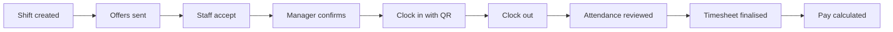

import { VideoTutorial } from '/snippets/media.mdx';
import DemoDataNote from '/snippets/demo-data-note.mdx';

Crewflow is the workforce operations platform from {{company}}. Managers plan shifts and send offers on the web. Staff accept work, clock in and see their history in the mobile app. Venue managers request cover and sign off timesheets for their own venues.

## Find your way

<Columns cols={3}>
  <Card title="Get started" icon="rocket" href="/getting-started/what-is-crewflow">
    What Crewflow is, how the pieces fit together, and which role you have.
  </Card>
  <Card title="Managers" icon="briefcase" href="/getting-started/quickstart-manager">
    Set up your workspace, add staff and venues, and start scheduling.
  </Card>
  <Card title="Staff mobile app" icon="mobile-screen" href="/mobile/overview">
    Accept offers, clock in and out, and review the work you have done.
  </Card>
  <Card title="Shifts and offers" icon="calendar-check" href="/shifts/overview">
    From a new shift to a confirmed team, step by step.
  </Card>
  <Card title="Attendance and payroll" icon="clock" href="/attendance/overview">
    QR and location check-in, timesheets, and calculated pay.
  </Card>
  <Card title="Developer documentation" icon="code" href="/developers/introduction">
    Architecture, local setup, the API and background jobs.
  </Card>
</Columns>

## See Crewflow in one minute

<VideoTutorial src="/videos/getting-started/overview-tour.mp4" poster="/videos/posters/overview-tour.webp" captions="/videos/captions/overview-tour.en.vtt" title="A tour of the Crewflow web console" duration="About 1 minute" narrated />

<Accordion title="Video transcript" icon="closed-captioning">
  This is a short tour of the Crewflow web console, using fictional demonstration data.

  The Dashboard summarises your staff, offers, shifts and attendance. Every card links to the page behind it.

  The sidebar is grouped. The main pages are at the top, Operations holds Calendar, Venues and Venue Offers, and Workspace holds the Audit Log, Help Center and Support.

  Users lists your staff, and the venue managers who work at your venues.

  Shifts shows every shift, how many places are filled, and its status.

  Offers tracks each offer you have sent, and how staff have responded.

  Venue Offers lists staffing requests and shifts, each with its own staffing board.

  The calendar shows the month ahead. Select a day to see its shifts.

  Press the forward slash key at any time to search people, venues, shifts and offers.

  And Help Center has short guides to everyday tasks.
</Accordion>

## Who uses Crewflow

| Role | Where they work | What they do |
| --- | --- | --- |
| **Manager** | Web console | Adds staff, venue managers and venues, assigns each venue manager's team, creates shifts, sends and confirms offers, and follows attendance and pay. |
| **CEO** | Web console | Everything a manager does, plus adding managers for the organisation. |
| **Venue manager** | Mobile app (Venue manager mode) | Requests staff for their venues, follows the staffing of each event, reviews each person's attendance and finalises timesheets. |
| **Staff** | Mobile app (Staff mode) | Accepts or declines offers, clocks in and out on site, and sees upcoming and completed shifts. |

Read [Understanding user roles](/getting-started/user-roles) for exactly what each role can and cannot do.

## How the work flows

Each step is covered in detail in [Shifts and offers](/shifts/overview) and [Attendance and timesheets](/attendance/overview). New to the web console? Start with the [Web console overview](/getting-started/web-app-overview) and [The Dashboard](/getting-started/dashboard).

<DemoDataNote />

<Note>
  Crewflow calculates pay from recorded attendance. It does **not** send payments to staff. See [Payroll overview](/payroll/overview).
</Note>
