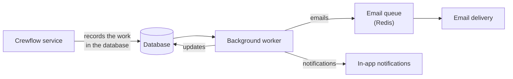

Crewflow runs a background worker alongside the main service. It handles work that must happen on time, whether or not anyone is signed in.

## What runs and when

| Job | How often | What it does |
| --- | --- | --- |
| **Offer expiry** | Every minute | Expires pending offers past their deadline and tells the sender. |
| **Manager confirmation timeout** | Every minute | Confirms acceptances left unanswered for 60 minutes and tells the manager. |
| **Replacement staff** | Every 2 minutes | After a decline or expiry, finds up to five suitable people and tells the manager. It never sends offers itself. |
| **Shift cancellation follow-up** | Every minute | Withdraws, rejects and cancels everything attached to a cancelled shift, and notifies people. |
| **Shift monitor** | Every 5 minutes | Sends 24-hour, 2-hour and 30-minute reminders, "clock-in is open", detects no-shows, and records post-shift milestones. |
| **Late clock-in** | Every 2 minutes | Notifies managers about staff not clocked in 10 minutes after the start. |
| **Attendance monitor** | Every 5 minutes | Flags missing clock-outs. |
| **Shift attendance sheet** | Every 5 minutes | Produces the shift attendance sheet PDF with the QR code about 3 hours before each shift, and emails it to the venue's managers. |
| **Timesheets** | Every 5 minutes | Produces the unsigned original timesheet once everyone has clocked out or been marked a no-show, and produces and emails the final timesheet after the venue manager signs off. |
| **Email delivery** | Every few seconds | Sends queued emails, retrying failures up to five times. |
| **Invitation and token clean-up** | Every 15 minutes / daily | Removes expired invitations and old sign-in tokens. |
| **File clean-up** | Daily | Removes files that are no longer used. |

## Every job runs once

Each automatic action is recorded the first time it happens, so it never happens twice — even if two worker processes run at the same moment, or a job is retried. A reminder is never sent twice and an offer is never expired twice.

## Notification preferences

You choose in-app and email delivery per notification type in **Settings → Account → Notifications**. Types you have not changed are in-app only by default. See [Notifications](/notifications/overview).
