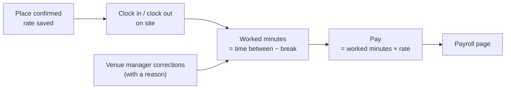

The **Payroll** page turns attendance into the numbers you need for paying staff: hours worked and the pay those hours earn at the agreed rate.

## Calculated, not paid

<Columns cols={2}>
  <Card title="What Crewflow does" icon="calculator">
    Records clock-in and clock-out on site, deducts breaks, applies the hourly rate saved on the person's place when it was confirmed, and shows the amount for each shift.
  </Card>
  <Card title="What Crewflow does not do" icon="circle-xmark">
    Approve pay runs, mark pay as paid, produce payslips, calculate tax or National Insurance, or send money. Pay your staff through your usual payroll provider.
  </Card>
</Columns>

<Warning>
  Treat the Payroll page as the source for gross pay calculations. Payroll approval and payment processing are planned but not available. See [Product status](/getting-started/product-status).
</Warning>

## Where the numbers come from

## In this section

<Columns cols={2}>
  <Card title="Pay calculation" icon="calculator" href="/payroll/pay-calculation" />
  <Card title="Reviewing payroll" icon="magnifying-glass-dollar" href="/payroll/reviewing-payroll" />
  <Card title="Audit log" icon="list-ul" href="/payroll/audit-log" />
</Columns>
