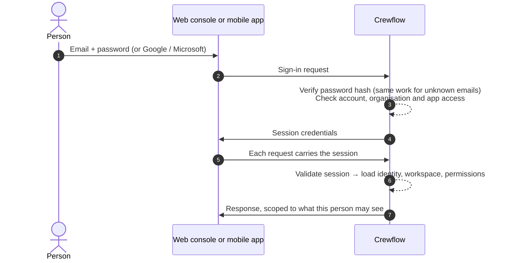

## Signing in

| Protection | Detail |
| --- | --- |
| **Password hashing** | Argon2id, a modern memory-hard algorithm. Passwords are never stored or logged. |
| **Password rules** | 10–128 characters with upper-case, lower-case and a number; common passwords and your email are refused. |
| **Uniform responses** | Wrong email and wrong password get the same message and take the same time, so attackers cannot discover accounts. |
| **Slowing down guessing** | Repeated failed sign-ins for the same account from the same address are slowed down: 5 quick attempts, then about one every 3 minutes, and at most 30 a day. An account being guessed from many unfamiliar addresses is slowed down too, but you can still sign in from an address you have used before. Nothing locks your account indefinitely. Sign-in, password reset and similar endpoints are also rate-limited. |
| **App access** | Each account may only use the apps its role allows. Staff and venue managers cannot use the web console. |
| **Google and Microsoft** | Invitation-only: they sign in existing accounts with a matching, verified email, and never create accounts. |

## Sessions

| | Web console | Mobile app |
| --- | --- | --- |
| **How the session is held** | In secure, HttpOnly cookies the browser cannot read with scripts | In the phone's secure storage |
| **Short-lived access** | Access is renewed every 15 minutes | Access is renewed every 15 minutes |
| **Inactivity limit** | 30 days | 7 days |
| **Maximum length** | 180 days | 90 days |

Managers and CEOs always get the web console limits, even in the mobile app. Platform administrators always get stricter limits in every app: 30 minutes of inactivity and 24 hours at most.

## Refresh and revocation

Each time access is renewed, the old renewal token is replaced. If an old one is ever presented again — a sign it was copied — Crewflow ends the whole session immediately.

Sessions end when:

- you sign out (on the server, not just in your browser)
- you revoke a device in **Settings → Profile → Active sessions**
- your password is reset or changed (all sessions end)
- your account is suspended or deactivated
- your organisation is suspended
- you turn on two-factor authentication (every *other* session ends)
- an administrator resets your two-factor authentication
- Crewflow moves you to your workspace's own web address after you sign in, where that is turned on (the sign-in on the first address ends)

## Cross-site request protection

For cookie-based sessions, Crewflow only accepts changes (create, update, delete) from Crewflow's own trusted web addresses, checked on every request. Other websites cannot make changes using your signed-in browser.

## Step-up confirmation

The most sensitive actions — deleting a user, and platform administration such as granting administrator access or suspending an organisation — require your current password again, even though you are already signed in.

## Two-factor authentication

Anyone who uses the web console can turn on two-factor authentication in **Settings → Account → Two-factor authentication**. It uses a code from an authenticator app (TOTP), plus 10 one-time recovery codes. Once it is on, every web sign-in asks for a code after your password. To turn it off, or to make new recovery codes, you need both your password and a current code.

<Note>
  Two-factor authentication is not yet required for any role, and the mobile apps do not ask for a code yet.
</Note>
