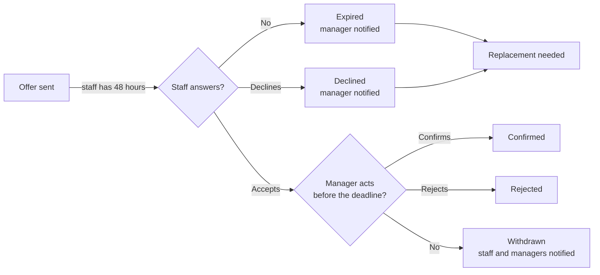

Crewflow uses two deadlines so a shift never waits forever on someone's answer. Crewflow never confirms an offer by itself: only the manager who sent it confirms an acceptance.

## Staff response deadline

| Rule | Detail |
| --- | --- |
| **Default deadline** | 48 hours after the offer is sent. |
| **After the deadline** | The offer becomes **expired**. The staff member can no longer accept it. |
| **Checked** | Every minute. An accept that arrives after the deadline is refused even if the check has not run yet. |
| **You are told** | "An offer I sent expires unanswered", and Crewflow flags that a replacement is needed. |

## Manager-confirmation deadline

| Rule | Detail |
| --- | --- |
| **Applies to** | Every accepted offer, including shifts from approved venue requests. |
| **Standard offer** | Confirm before 30 minutes ahead of the staff member's start time. |
| **Replacement or standby offer** | Confirm before its booked window ends. |
| **If you do nothing** | At the deadline the acceptance is withdrawn. Staff see **Withdrawn**; managers see **Not confirmed in time**. You, and the venue managers of that venue, get "Confirmation deadline passed". |
| **Afterwards** | The offer can never be confirmed. History is kept. There is no attendance, no-show, lateness or pay consequence, and no automatic replacement — fill the place through your usual replacement or staffing steps. |
| **Too close to start** | A standard offer can't be sent, or accepted, less than 30 minutes before the start. |

<Note>
  The 30-minute confirmation deadline is fixed and measured by the Crewflow server's clock. The 48-hour response deadline is the default; your Crewflow deployment may be configured differently.
</Note>

## After a shift ends

One hour after a shift ends Crewflow marks it complete for follow-up, and two hours after it ends the attendance window closes. These markers are for record-keeping. They never change anyone's pay.
