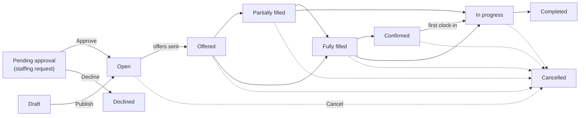
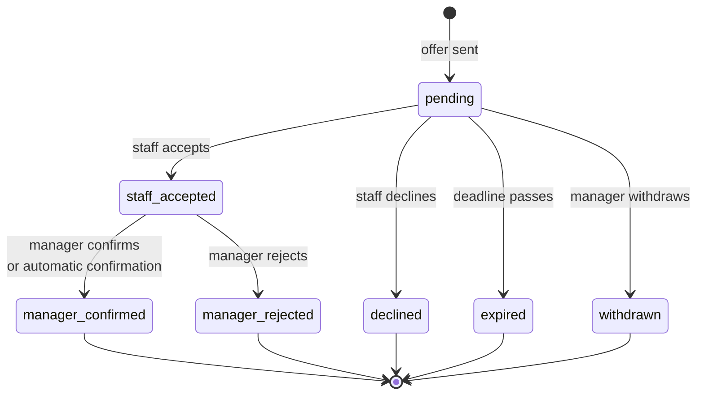

Shifts and offers are the heart of Crewflow. A **shift** describes the work, **offers** invite people to do it, and a **confirmed placement** is a person who will turn up.

## Words to know

| Term | What it is | Example |
| --- | --- | --- |
| **Shift** | One block of work at a venue, for a role, at a time. | Bartender at Riverside House, Friday 17:00–23:00, 30-minute break. |
| **Staffing request** | A venue manager's request for staff, sent from the mobile app. It names the people they would like, but **nothing is sent to staff** until a manager approves it. Requests are listed under **Venue Offers**. | The Riverside House venue manager asks for three bartenders and suggests Priya, Sam and Leah. |
| **Offer** | An invitation to **one person** for one shift. Every offer goes to a single recipient and is listed under **Offers → Staff Offers**. | Priya is offered the Friday bartender shift at £15.00/hr. |
| **Assignment** | Crewflow's record of a person's place on the shift, created when the offer is sent. | Priya's place on the Friday shift. |
| **Confirmed placement** | An assignment the person accepted **and** a manager confirmed. Only confirmed people can clock in. | Priya accepted and Jordan confirmed her. |

<Note>
  A staffing request is not an offer. When you approve a request, Crewflow sends **one offer to each selected person**. From then on, each person's offer moves through its own statuses.
</Note>

## Two steps to a confirmed placement

Every placement needs two separate decisions:

1. **Staff acceptance** — the staff member taps **Accept** in the mobile app. The offer becomes **staff accepted** (shown as **Awaiting Confirmation** in the Offers view menu).
2. **Manager confirmation** — a manager confirms the acceptance. The offer becomes **manager confirmed** and the person is on the shift.

For a shift you created yourself, you confirm acceptances on the [Offers](/shifts/confirming-offers) page, or Crewflow confirms them automatically after 60 minutes. For an approved staffing request, acceptances are confirmed automatically straight away, because you already chose the people when you approved it.

## The lifecycle of a shift

A shift moves forward as people accept and are confirmed. It goes back to **Offered** or **Partially filled** if someone drops out and more offers are sent. Any shift that has not finished can be cancelled.

## The lifecycle of an offer

An offer can only be confirmed after the staff member has accepted it. Once an offer is finished — confirmed, rejected, declined, expired or withdrawn — it cannot change again. To ask the same person again, send a new offer.

Offer actions also close **5 hours after the shift's scheduled end**. After that, no new offers can be sent for the shift, and offers can no longer be accepted or confirmed. See [Offer expiry](/shifts/offer-expiry).

## Where to find things

| You want to… | Go to |
| --- | --- |
| Create a shift and offer it to people | **Shifts** → **New shift** |
| See every offer and confirm acceptances | **Offers** → **Staff Offers** |
| Review staffing requests from venue managers | **Venue Offers** in the sidebar (under **Operations**), or **Offers** → **Venue Offers** |
| Follow an approved request from offer to clock-out | Select the request in **Venue Offers** to open its live staffing board |
| See shifts by day | **Calendar** |

## In this section

<Columns cols={2}>
  <Card title="Creating shifts" icon="calendar-plus" href="/shifts/creating-shifts">Create a shift and send offers in one step.</Card>
  <Card title="Sending offers" icon="paper-plane" href="/shifts/sending-offers">Send more offers and find replacements.</Card>
  <Card title="Staff responses" icon="hand-pointer" href="/shifts/staff-responses">What staff see and how they answer.</Card>
  <Card title="Confirming offers" icon="user-check" href="/shifts/confirming-offers">Confirm or reject the people who accepted.</Card>
  <Card title="Venue requests" icon="inbox" href="/shifts/venue-requests">Approve staffing requests from venue managers.</Card>
  <Card title="Live staffing" icon="table-columns" href="/shifts/live-staffing-pipeline">Follow a request from offer to clock-out.</Card>
  <Card title="Cancelling shifts" icon="ban" href="/shifts/cancelling-shifts">Cancel and what happens to offers.</Card>
  <Card title="Offer expiry" icon="hourglass-half" href="/shifts/offer-expiry">Deadlines and automatic confirmation.</Card>
</Columns>
