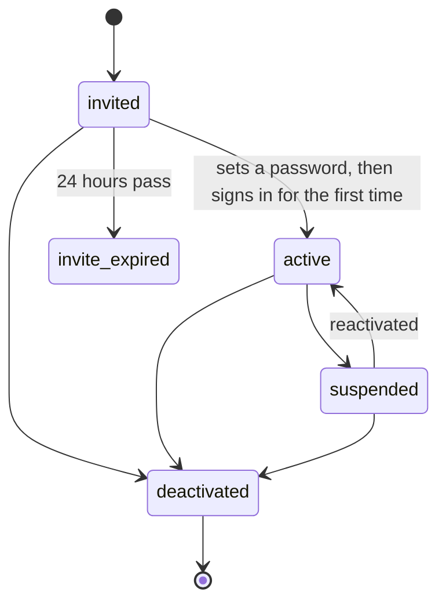

Every account has a state. The **Status** column in **Users** and the badge at the top of a profile show the same state in plain words.

## Who can use this

Managers and CEOs. The actions below are in **More actions** at the bottom of the person's profile.

## Before the person activates

| Status shown | Meaning | What you can do |
| --- | --- | --- |
| **Pending — invite not sent** | The account exists but no invitation has gone out. | **Send invitation**. |
| **Invitation queued** / **Invitation sending…** | The email is on its way. The status updates by itself. | Wait a moment. |
| **Pending invite (1/3)**, **(2/3)** | Invitation sent and not yet accepted. | **Resend invitation** or **Cancel invitation**. |
| **Final invite (3/3)** | The last allowed send. | Contact the person another way to make sure they accept, or **Cancel invitation**. |
| **Delivery failed** | The email could not be delivered. | Check the email address, then **Resend invitation**, or **Cancel invitation**. |
| **Invite expired** | 24 hours passed without acceptance. | **Re-invite**, if sends remain. |
| **Expired — cleanup in 7d** | The final invitation expired. The pending account will be removed. | Create the person again later if needed. |
| **Invitation cancelled** | You cancelled the invitation. | **Re-invite**, if sends remain. |
| **Awaiting first sign-in** | The person used the link and set a password. The account becomes active the first time they sign in. | Wait, or **Send a new setup link** if they lost access. |

Each invitation action shows how many of the three allowed sends have been used, for example "2 of 3".

## After activation

| Status | Meaning |
| --- | --- |
| **Active** (managers) | The person can sign in. |
| The employment status (staff): **active**, **pending compliance**, **inactive** or **suspended** | The account is active; the label shows whether they can currently be offered work. See [Staff profiles](/staff/staff-profiles). |
| **Suspended** | Temporarily blocked. They are signed out and cannot sign in. |
| **Deactivated** | Permanently closed. Records are kept. |

## How states change

Between setting a password and signing in, the person shows as **Awaiting first sign-in**.

Crewflow rejects any change that is not on this diagram. For example, an expired invitation cannot become active; the person must be re-invited.

## Related

- [Staff profiles](/staff/staff-profiles): where the invitation actions are
- [Deactivating and deleting staff](/staff/deactivating-and-deleting)
