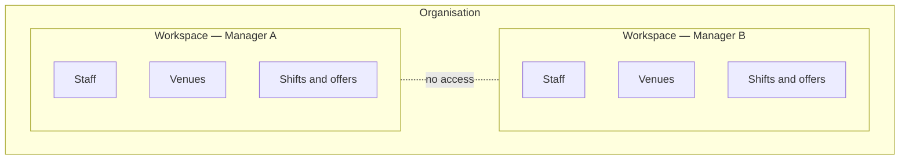

A **workspace** is where a manager runs their operation: their staff, venues, job roles, shifts, offers, attendance and timesheets all live there. Each internal manager — and each CEO — creates one workspace the first time they sign in.

## Organisation versus workspace

| | Organisation | Workspace |
| --- | --- | --- |
| Represents | Your company | One manager's operation |
| Created by | A Crewflow platform administrator | The manager or CEO, at first sign-in |
| Contains | Accounts and workspaces | Staff, venues, roles, shifts, offers, attendance, timesheets |
| Separation | Organisations never share anything | Workspaces in the same organisation do not see each other's records |

## The manager-isolation model

Managers in the same organisation can work completely independently. Manager A cannot see Manager B's staff, venues or shifts, even though both work for the same company. Venue managers and staff belong to the workspace of the manager who added them, and each venue manager sees only the staff that manager assigns to them.

Crewflow enforces this separation in its database as well as in the apps. When a record belongs to someone else's workspace, Crewflow answers as if it does not exist, rather than saying "access denied" — so nobody can even confirm that another workspace's records exist. [How data isolation works](/security/data-isolation)

## In this section

<Columns cols={2}>
  <Card title="Creating a workspace" icon="wand-magic-sparkles" href="/workspaces/creating-a-workspace" />
  <Card title="Workspace settings" icon="gear" href="/workspaces/workspace-settings" />
  <Card title="Visibility and permissions" icon="eye" href="/workspaces/visibility-and-permissions" />
  <Card title="Access changes" icon="user-xmark" href="/workspaces/access-changes" />
</Columns>
